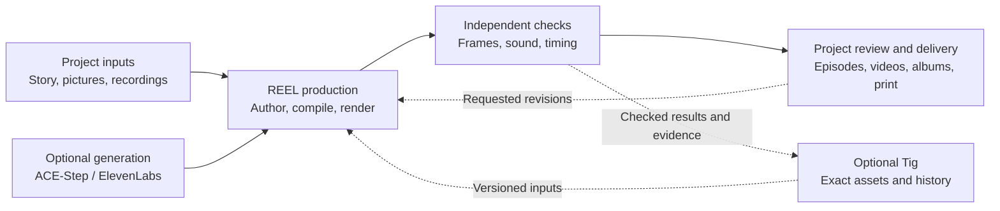

# REEL

**A framework for authoring, producing and verifying media.** REEL brings story,
animation, voice, sound, music and editing into versioned production workflows.
Describe creative intent in declarative controls, compile exact production jobs,
render through explicit tools and check the resulting pictures and sound.

The framework supports illustrated series, music videos and longer programmes,
trailers and explainers, songs and albums, scores and bilingual print collections.
It combines creative authoring tools with frame/sample timing, multilingual
composition, managed execution, revision tracking and independent media checks.
Producing projects own their content, creative decisions and release authority.

The practical benefit is controlled iteration across a complete production.
For example, replacing a cel can preserve the dialogue and unaffected pictures,
identify the work that needs rebuilding and keep the earlier edition recoverable.
The same approach connects a song to its video, an episode to its language
editions and a finished programme to its source and review evidence.

**Explore:** [Capabilities](docs/capabilities.md) ·
[Getting started](docs/getting-started.md) · [Use cases](docs/use-cases.md) ·
[Architecture](docs/architecture.md) · [Documentation](docs/README.md)

## Capabilities

| Production area | What REEL provides |
| --- | --- |
| Story and series | Briefs, formats, scene/cue contracts, continuity, pacing, openings, credits and ordered episode/programme assembly |
| Animation and picture | Cel editing, exposure sheets, sprite layers and choreography, camera tracks, effects, mixed-media timelines and frame-clock browser rendering |
| Voice and sound | Speech-provider integration, performance direction, measured alignment, voice-consistency checks, dialogue/score mixing, dynamic EQ and audio stems |
| Music | Local generation adapters, auditions and repair, editable note/lyric models, arrangement and score workflows, album mastering and companion videos |
| Languages and publishing | Shared pictures with language-local performances, captions, chapters, print collections, source and delivery histories |
| Production engineering | Exact input/runtime pins, dependency-aware change planning, bounded managed jobs, retained recovery, independent frame/sample checks and Tig integration |

The [capability guide](docs/capabilities.md) connects each area to its contracts
and tools, including optional runtime requirements. The separate
[workflow orchestration development](docs/development-status.md) extends the
task, review and handoff lifecycle; its active branch is not part of this main
checkout's support claim.

## How it works



## Dependencies and integrations

REEL combines its own media contracts, authoring tools, compilers and independent
checks with established rendering, generation and asset technologies:

| Technology | Contribution | Integration scope |
| --- | --- | --- |
| Rust and Cargo | Native contracts, compilers, authoring tools and production orchestration | REEL's core workspace; optional features select additional tools |
| FFmpeg / FFprobe | Picture/audio processing, encoding, mixing, probing and decoded-media checks | External media executables, explicitly identified for production |
| Chromium-compatible browsers | Frame-clock rendering of supported HTML/SVG/CSS/JS compositions | External browser runtime; separate browser surfaces host editors and graph inspection |
| [Tig](docs/tig-public-integration.md) | Exact asset identities, Git snapshots, verified byte access and retention/history services | Optional asset integration, with [pinned upstream source](vendor/README.md) vendored for reproducible builds |
| [ACE-Step](docs/song-generation-v0.2.25.md) | Local AI music generation | Optional generation adapter; runtime and model weights are installed and pinned separately |
| [ElevenLabs](docs/tig-speech-generation.md) | Generated speech and narration | Optional, explicit speech-provider adapter; performances remain candidates for project review |
| [PyTorch, Whisper and Demucs](docs/local-song-auditions.md) | Model execution, speech recognition and vocal/source analysis | Selected local music adapters use a separately installed Python/model environment |

Projects can supply existing recordings, pictures and performances as well as
generated material. REEL's contribution is preserving intent, timing, versions
and evidence as those inputs become editable scenes and finished productions.
MusicXML, MIDI and OpenTimelineIO provide additional score/editor interchange
routes. Dependencies are selected per workflow; the introductory planning example
needs no media engine or provider account. See [installation](docs/setup/install.md)
for runtime requirements and [capabilities](docs/capabilities.md) for detailed scope.

## Choose a workflow

| I want to… | Start with |
| --- | --- |
| Try REEL with a small checked-in example | [Validate and plan without rendering](docs/getting-started.md) |
| Make an episode, music video or longer programme | [Production use cases](docs/use-cases.md#assemble-an-illustrated-episode) and [scene authoring](docs/scene-authoring-v1.md) |
| Author animation, camera movement or visual effects | [Picture and animation guide](docs/capabilities.md#picture-and-animation) |
| Direct voices, align dialogue or mix sound | [Voice and sound guide](docs/capabilities.md#voice-and-sound) |
| Generate, edit, arrange or publish music | [Music production guide](docs/capabilities.md#music-production) |
| Make multilingual, captioned or print editions | [Editions and delivery guide](docs/capabilities.md#editions-and-delivery) |
| Reproduce, revise or recover a production | [Production engineering guide](docs/capabilities.md#production-engineering) and [Tig integration](docs/tig-public-integration.md) |
| Find an exact command, schema or specialist operation | [Complete reference index](docs/reference-index.md) |
| Inspect a semantic dependency graph in a browser | [WASM workbench](https://giodl73-repo.github.io/REEL/assembly/) |

<details>
<summary>Technical setup, architecture and support details</summary>

## Try it

From a source checkout, using a current stable Rust toolchain:

```sh
cargo build --locked --bin reel
cargo run --locked --bin reel -- validate manifests/fixtures/two-speaker-untimed/planning.yaml --output json
cargo run --locked --bin reel -- plan manifests/fixtures/two-speaker-untimed/planning.yaml --output json
```

These commands validate and plan a fixture without rendering or opening a cache.
The fixture is intentionally untimed; [conform it](docs/getting-started.md#conform-measured-timing)
before attempting delivery. See [installation](docs/setup/install.md) for binary
selection, optional features and platform-specific media dependencies.

## How the pieces fit

A project can use explicit local files or the optional
[public Tig integration](docs/tig-public-integration.md). Tig owns generic asset
identity and storage services. REEL interprets media controls and checks frames,
samples, timing and composition. Project profiles specify locations, budgets,
definitions and delivery policy; the engines do not require a particular show,
drive layout or cloud provider.

## Available source and support boundaries

| Area | Available | Important boundary |
| --- | --- | --- |
| Planning and video | Manifest validation, timing conform, FFmpeg previews/delivery, captions, motion and independent checks | Legacy animatic commands use WSL on Windows; native delivery APIs use explicit native programs. |
| Native scenes and episodes | Sample/frame clocks, protected input bindings, retained component proofs and bounded managed jobs | Managed native runtime protection, strict Tig path guards and contained browser workers currently require Windows. |
| Music and print | Native music contracts, note/underlay proposals, album packets and bounded print collections | Engraving, measured transcription and provider workflows have their own documented limits; some older adapters use Python. |
| Authoring UI | Explicit cel, note and underlay exports; local Rust editor host; browser semantic workbench | A saved draft is a proposal. Reapply through native validation before rendering. The WASM workbench inspects graphs rather than playing or rendering media. |
| Storage integration | Exact input resolution, explicit publication/history hosts and scoped cache-accounting tools | Deletion requires enrolled policies, complete applicable coverage and verified custody; a successful render is insufficient. |
| Other renderer adapters | Remotion package handoff; declared Blender and AI-video adapter boundaries | These are planned execution integrations, not bundled production renderers. |

This is an evolving tooling repository. Use a guide's schema and feature flags,
and pin the actual producer/checker runtime for a project. Source on `main`, a
tagged binary and an installed project tool can represent different revisions.
[Development status](docs/development-status.md) separates the main checkout
from active branch work; the [roadmap](docs/tooling-roadmap.md) preserves its
dated source/adoption checkpoint.
[CI](https://github.com/giodl73-repo/REEL/actions/workflows/ci.yml)
qualifies source with synthetic fixtures; creative acceptance remains a project
decision.

</details>

## Editorial review

The REEL rubric is **Rhythm, Emotion, Execution, Legibility**. Format, audience,
sound, pacing and reading clarity guide the production review alongside technical
checks. [Formats](formats/), [styles](styles/), [scoring](scoring/) and
[review roles](.roles/ROLE.md) preserve that design-lab practice.

Technical validation, listening/visual review, selection, rights approval and
release are separate decisions. [Principles and pitfalls](.pitfall/PITFALL.md)
document the boundaries. Roles are checklists, not invented people or approvals.

## Repository map

| Location | Purpose |
| --- | --- |
| `src/` | Media engines, main CLI and optional Tig adapters |
| `crates/reel-assembly/` | Native semantic assembly/dependency contracts |
| `crates/reel-music/` | Native music contracts and editor tools |
| `crates/reel-print/` | Bounded print production |
| `crates/reel-assets/` | Existing asset accounting, editors and custody adapters |
| `browser/assembly/` | Browser/WASM semantic workbench |
| `manifests/` | Contracts, templates and synthetic fixtures |
| `docs/` | [Task guides and reference index](docs/README.md) |
| `vendor/tig/` | [Pinned, unmodified upstream Tig source](vendor/README.md) |
| `formats/`, `styles/`, `works/`, `scoring/`, `.roles/` | Creative design and review material |

Project media, machine profiles, generated reports and renders belong in the
producing project's asset system. Keep the reusable source repository small.

## Contributing and licensing

See [contributor checks](docs/contributing.md) before changing a contract or
adapter. Use generated fixture media and keep private operational evidence out of
public issues, commits and CI logs.

README and `docs/` prose/image-only changes use lightweight required CI checks.
Code, configuration, executable examples and CI changes run full qualification.

Software, scripts, tests, configuration and ordinary software documentation are
MIT-licensed. Original non-software content is CC BY-NC 4.0; commercial use of
that content requires separate written permission. Third-party material retains
its own terms. See [LICENSE](LICENSE).
