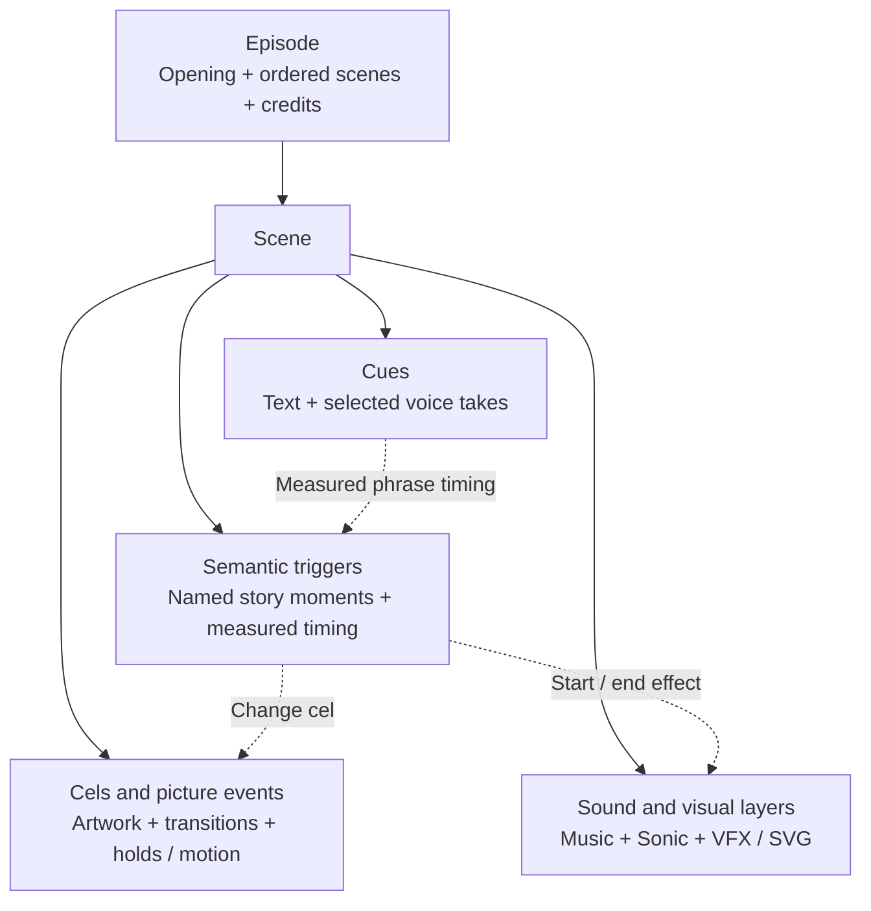
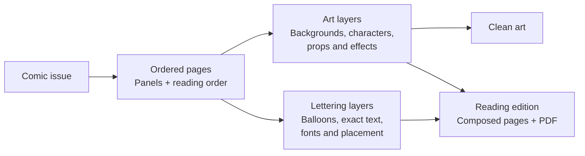

# REEL

**A framework for authoring, producing and verifying media.** REEL brings story,
animation, voice, sound, music and editing into versioned production workflows.
Describe creative intent in declarative controls, compile exact production jobs,
render through explicit tools and check the resulting pictures and sound.

The framework supports illustrated series, music videos and longer programmes,
trailers and explainers, songs and albums, scores and bilingual print collections.
It combines creative authoring tools with frame/sample timing, multilingual
composition, managed execution, revision tracking and independent media checks.
Producing projects own their content, creative decisions and release authority.

The practical benefit is controlled iteration across a complete production.
For example, replacing a cel can preserve the dialogue and unaffected pictures,
identify the work that needs rebuilding and keep the earlier edition recoverable.
The same approach connects a song to its video, an episode to its language
editions and a finished programme to its source and review evidence.

**Explore:** [Illustrated guides](docs/README.md#illustrated-guides) · [Capabilities](docs/capabilities.md) ·
[Getting started](docs/getting-started.md) · [Use cases](docs/use-cases.md) ·
[Architecture](docs/architecture.md) · [Documentation](docs/README.md)

## Capabilities

| Production area | What REEL provides |
| --- | --- |
| [Story and series](docs/guides/episodes-and-languages.md) | Briefs, formats, scene/cue contracts, continuity, pacing, openings, credits and ordered episode/programme assembly |
| [Animation and picture](docs/guides/animation-and-effects.md) | Cels, semantic triggers for picture changes, exposure sheets, sprite choreography, camera tracks, VFX and frame-clock SVG/browser compositions |
| [Voice and sound](docs/guides/voice-and-sound.md) | Dialogue/narration cues, selected performances and phrase alignment; Sonic effects, dialogue/score mixing, dynamic EQ and audio stems |
| [Music](docs/guides/music-and-albums.md) | Local generation adapters, auditions and repair, editable note/lyric models, arrangement and score workflows, album mastering and companion videos |
| [Comic layers](docs/guides/comic-layers.md) | Editable artwork and lettering, panel/reading order and issue editions; publication adapters are in active workflow development |
| [Languages and publishing](docs/guides/editions-and-delivery.md) | Shared pictures with language-local performances, captions, chapters, print collections, source and delivery histories |
| [Production engineering](docs/guides/assets-and-revisions.md) | Exact input/runtime pins, dependency-aware change planning, bounded managed jobs, retained recovery, independent frame/sample checks and git-asset integration |

The [capability guide](docs/capabilities.md) connects each area to its contracts
and tools, including optional runtime requirements. The separate
[workflow orchestration development](docs/development-status.md) extends the
task, review and handoff lifecycle; its active branch is not part of this main
checkout's support claim.

## An episode: scenes, cues, cels and effects

An episode assembles an opening, ordered scenes and credits. Within each scene,
**cues** carry narration or dialogue; **cels** supply pictures and animation;
**semantic events** declare authored story moments and their picture/sound changes.
These are separate, connected inputs: one cue can span several cels, and a sound or visual
effect can continue across cel cuts.



For example, an author can anchor a story moment to the spoken phrase
**"the door opens"** and attach several actions to it:

| At that semantic trigger | Authored action |
| --- | --- |
| Picture | Cut from the exterior cel to the interior cel |
| Sonic | Start the selected door-creak sound on the effects bus |
| VFX / SVG | Reveal an independently authored light/glow overlay |

> [!NOTE]
> **One cue, two language performances, two cel transitions**
>
> **English (~9.0 s):** "I stopped at the gate. When **the door opened**, I saw my grandmother. **She smiled**, and I stepped inside."
>
> **Español (~9.8 s):** "Me detuve junto al portón. Cuando **se abrió la puerta**, vi a mi abuela. **Ella sonrió** y entré."
>
> | Shared picture | English entrance and hold | Spanish entrance and hold |
> | --- | --- | --- |
> | Cel A: at the gate | Cue start: 0.0–2.7 s (**2.7 s**) | Inicio: 0.0–3.2 s (**3.2 s**) |
> | Cel B: open doorway | **"the door opened"** at ~2.7 s; hold to 6.3 s (**3.6 s**) | **"se abrió la puerta"** at ~3.2 s; hold to 7.0 s (**3.8 s**) |
> | Cel C: grandmother's smile | **"She smiled"** at ~6.3 s; hold to 9.0 s (**2.7 s**) | **"Ella sonrió"** at ~7.0 s; hold to 9.8 s (**2.8 s**) |
>
> The same door-opening event can also start the Sonic creak and SVG light
> effect. Both editions reuse the same three cels and event intent; each follows
> its own performance clock. These times are **illustrative estimates, not
> recorded measurements**. A real build derives entrances from word alignment
> on the exact selected take, rather than copying timestamps between languages.

REEL resolves the phrase against the selected recording's measured word timing,
then compiles the picture and effect intervals onto frame/sample clocks. Spanish
and English can share the same event intent while entering at different times
in their own performances. SVG/CSS/JS sources have their own rendering route;
scene overlays require an explicitly prepared, compatible transparent (alpha)
layer and any required derivation evidence, preserving the clean cel underneath.
Music videos can use the recording clock directly for events without speech.

Continue with the [episode and language walkthrough](docs/guides/episodes-and-languages.md)
or [animation and effects](docs/guides/animation-and-effects.md). Exact contracts:
[scene authoring](docs/scene-authoring-v1.md),
[semantic word triggers](docs/authored-native-triggers-v1.md),
[Sonic assets](docs/sonic-asset-library-v0.3.18.md) and
[SVG/browser rendering](docs/deterministic-browser-compositions-v0.3.22.md).

## A comic: pages, panels and editable layers

Comic publication adapters are in active [workflow development](docs/development-status.md).
Their source model applies the same explicit-source approach to an
**issue** of ordered **pages**, each with panel geometry, reading order and
independently editable artwork and lettering:



A balloon or translation can be edited while preserving the underlying art.
Clean art and reading editions remain distinct outputs, and source layers stay
available for later edits and recovery. Qualification scope is tracked in the
owning workflow lane. The [comic layers walkthrough](docs/guides/comic-layers.md) explains a lettering
correction and its source/output relationships.

Across both examples, **[git-asset](https://github.com/giodl73-repo/git-asset)**
provides the asset-management layer for relationships, versions and retained
bytes. REEL supplies the media meaning: which cue, cel, layer or effect is used,
what changes when it is edited, and how to compile and check the new edition.

## Dependencies and integrations

REEL combines its own media contracts, authoring tools, compilers and independent
checks with established rendering, generation and asset technologies:

| Technology | Contribution | Integration scope |
| --- | --- | --- |
| Rust and Cargo | Native contracts, compilers, authoring tools and production orchestration | REEL's core workspace; optional features select additional tools |
| FFmpeg / FFprobe | Picture/audio processing, encoding, mixing, probing and decoded-media checks | External media executables, explicitly identified for production |
| Chromium-compatible browsers | Frame-clock rendering of supported HTML/SVG/CSS/JS compositions | External browser runtime; separate browser surfaces host editors and graph inspection |
| [git-asset](https://github.com/giodl73-repo/git-asset) | Asset relationships and versions, Git/git-annex storage and explicit placement/protection policy | Optional asset layer; REEL's [native integration](docs/tig-public-integration.md) uses separately [pinned upstream source](vendor/README.md) |
| [ACE-Step](docs/song-generation-v0.2.25.md) | Local AI music generation | Optional generation adapter; runtime and model weights are installed and pinned separately |
| [ElevenLabs](docs/tig-speech-generation.md) | Generated speech and narration | Optional, explicit speech-provider adapter; performances remain candidates for project review |
| [PyTorch, Whisper and Demucs](docs/local-song-auditions.md) | Model execution, speech recognition and vocal/source analysis | Selected local music adapters use a separately installed Python/model environment |

Projects can supply existing recordings, pictures and performances as well as
generated material. REEL's contribution is preserving intent, timing, versions
and evidence as those inputs become editable scenes and finished productions.
MusicXML, MIDI and OpenTimelineIO provide additional score/editor interchange
routes. Dependencies are selected per workflow; the introductory planning example
needs no media engine or provider account. See [installation](docs/setup/install.md)
for runtime requirements and [capabilities](docs/capabilities.md) for detailed scope.

## Choose a workflow

| I want to… | Start with |
| --- | --- |
| Try REEL with a small checked-in example | [Validate and plan without rendering](docs/getting-started.md) |
| Make an episode, music video or longer programme | [Episodes and languages](docs/guides/episodes-and-languages.md), [music and albums](docs/guides/music-and-albums.md) |
| Author animation, camera movement or visual effects | [Animation and effects](docs/guides/animation-and-effects.md) |
| Direct voices, align dialogue or mix sound | [Voice and sound](docs/guides/voice-and-sound.md) |
| Generate, edit, arrange or publish music | [Songs, scores, albums and journeys](docs/guides/music-and-albums.md) |
| Understand comic pages and editable layers | [Comic source model and development scope](docs/guides/comic-layers.md) |
| Make multilingual, captioned or print editions | [Editions and delivery](docs/guides/editions-and-delivery.md) |
| Reproduce, revise or recover a production | [git-asset, revisions and reproducibility](docs/guides/assets-and-revisions.md) |
| Find an exact command, schema or specialist operation | [Complete reference index](docs/reference-index.md) |
| Inspect a semantic dependency graph in a browser | [WASM workbench](https://giodl73-repo.github.io/REEL/assembly/) |

<details>
<summary>Technical setup, architecture and support details</summary>

## Try it

From a source checkout, using a current stable Rust toolchain:

```sh
cargo build --locked --bin reel
cargo run --locked --bin reel -- validate manifests/fixtures/two-speaker-untimed/planning.yaml --output json
cargo run --locked --bin reel -- plan manifests/fixtures/two-speaker-untimed/planning.yaml --output json
```

These commands validate and plan a fixture without rendering or opening a cache.
The fixture is intentionally untimed; [conform it](docs/getting-started.md#conform-measured-timing)
before attempting delivery. See [installation](docs/setup/install.md) for binary
selection, optional features and platform-specific media dependencies.

## How the pieces fit

A project can use explicit local files or the optional
[native asset integration](docs/tig-public-integration.md).
**git-asset** is the asset-management product; existing `tig-*` commands, Cargo
features and `vendor/tig/` paths remain technical identifiers for REEL's pinned
native integration. REEL interprets media controls and checks frames,
samples, timing and composition. Project profiles specify locations, budgets,
definitions and delivery policy; the engines do not require a particular show,
drive layout or cloud provider.

## Available source and support boundaries

| Area | Available | Important boundary |
| --- | --- | --- |
| Planning and video | Manifest validation, timing conform, FFmpeg previews/delivery, captions, motion and independent checks | Legacy animatic commands use WSL on Windows; native delivery APIs use explicit native programs. |
| Native scenes and episodes | Sample/frame clocks, protected input bindings, retained component proofs and bounded managed jobs | Managed native runtime protection, strict asset path guards and contained browser workers currently require Windows. |
| Music and print | Native music contracts, note/underlay proposals, album packets and bounded print collections | Engraving, measured transcription and provider workflows have their own documented limits; some older adapters use Python. |
| Authoring UI | Explicit cel, note and underlay exports; local Rust editor host; browser semantic workbench | A saved draft is a proposal. Reapply through native validation before rendering. The WASM workbench inspects graphs rather than playing or rendering media. |
| Storage integration | Exact input resolution, explicit publication/history hosts and scoped cache-accounting tools | Deletion requires enrolled policies, complete applicable coverage and verified custody; a successful render is insufficient. |
| Other renderer adapters | Remotion package handoff; declared Blender and AI-video adapter boundaries | These are planned execution integrations, not bundled production renderers. |

This is an evolving tooling repository. Use a guide's schema and feature flags,
and pin the actual producer/checker runtime for a project. Source on `main`, a
tagged binary and an installed project tool can represent different revisions.
[Development status](docs/development-status.md) separates the main checkout
from active branch work; the [roadmap](docs/tooling-roadmap.md) preserves its
dated source/adoption checkpoint.
[CI](https://github.com/giodl73-repo/REEL/actions/workflows/ci.yml)
qualifies source with synthetic fixtures; creative acceptance remains a project
decision.

</details>

## Editorial review

The REEL rubric is **Rhythm, Emotion, Execution, Legibility**. Format, audience,
sound, pacing and reading clarity guide the production review alongside technical
checks. [Formats](formats/), [styles](styles/), [scoring](scoring/) and
[review roles](.roles/ROLE.md) preserve that design-lab practice.

Technical validation, listening/visual review, selection, rights approval and
release are separate decisions. [Principles and pitfalls](.pitfall/PITFALL.md)
document the boundaries. Roles are checklists, not invented people or approvals.

The [illustrated documentation role review](docs/reviews/2026-11-20-illustrated-documentation-role-review.md)
records the applied lenses, findings, corrections and remaining review limits.

## Repository map

| Location | Purpose |
| --- | --- |
| `src/` | Media engines, main CLI and optional asset adapters |
| `crates/reel-assembly/` | Native semantic assembly/dependency contracts |
| `crates/reel-music/` | Native music contracts and editor tools |
| `crates/reel-print/` | Bounded print production |
| `crates/reel-assets/` | Existing asset accounting, editors and custody adapters |
| [`crates/reel-workflow/`](crates/reel-workflow/README.md) | Task contracts, manual exchange and [film metadata sidecars](docs/workflow-film-inspection.md); no production admission |
| [`crates/reel-publication/`](crates/reel-publication/README.md) | Shared artifact identities and named output contracts |
| [`crates/reel-workflow-native/`](crates/reel-workflow-native/README.md) | Exact native inputs, protected manual handoffs and retained-result recovery |
| `browser/assembly/` | Browser/WASM semantic workbench |
| `manifests/` | Contracts, templates and synthetic fixtures |
| `docs/` | [Task guides and reference index](docs/README.md) |
| `vendor/tig/` | [Pinned upstream asset SDK source](vendor/README.md), retaining its existing technical path |
| `formats/`, `styles/`, `works/`, `scoring/`, `.roles/` | Creative design and review material |

Project media, machine profiles, generated reports and renders belong in the
producing project's asset system. Keep the reusable source repository small.

## Contributing and licensing

See [contributor checks](docs/contributing.md) before changing a contract or
adapter. Use generated fixture media and keep private operational evidence out of
public issues, commits and CI logs.

README and `docs/` prose/image-only changes use lightweight required CI checks.
Code, configuration, executable examples and CI changes run full qualification.

Software, scripts, tests, configuration and ordinary software documentation are
MIT-licensed. Original non-software content is CC BY-NC 4.0; commercial use of
that content requires separate written permission. Third-party material retains
its own terms. See [LICENSE](LICENSE).
