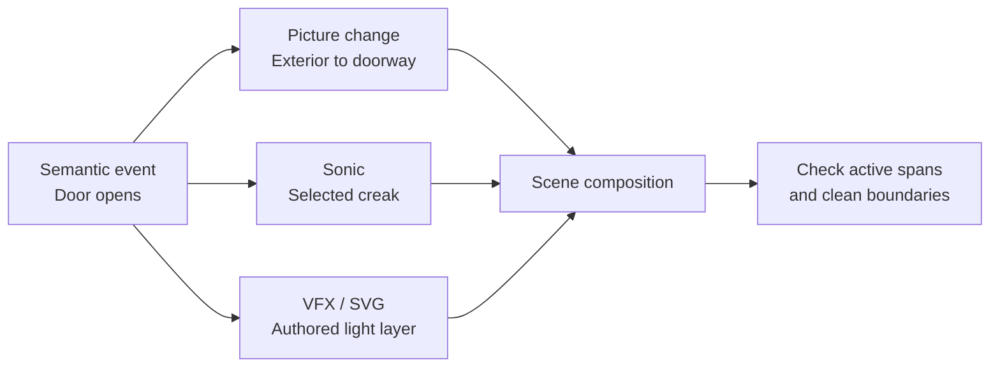

# Cels, animation and semantic effects

[All illustrated guides](../README.md#illustrated-guides) · [Capabilities](../capabilities.md#picture-and-animation)

A cel is a reusable picture source. A picture event says where that cel appears
and how long it is visible. Exposure sequences, sprite layers and camera tracks
add authored movement. Sound and visual effects remain separate layers.

## Choose the right source of movement

| Intention | Authored material | What changes |
| --- | --- | --- |
| Let the viewer read a still | Cel and intentional hold | Visible duration |
| Show a character taking a step | Progressive poses/exposure sequence or sprite choreography | The character's drawn action |
| Approach a face | Camera track and framing constraints | The view of the artwork |
| Add light, dust or a label | Separate effect/presentation source | A bounded overlay |

Moving a camera over a held picture and changing a character's pose are distinct
operations. The exposure/animation source must contain the action the viewer is
meant to see. Camera and effect controls preserve their own timing and source pins.

> [!NOTE]
> **Illustrative exposure sheet:** a four-second shot at 24 fps has 96 output
> frames. Sixteen authored poses held for six frames each fill that shot exactly.
> A camera move may also run over those 96 frames; it changes the view rather
> than supplying additional character poses.

## Keep an effect independent of a cut

In an illustrative scene, an authored door-opening event starts a light effect.
The next event changes the cel while retaining the same effect key. A contiguous
shared key can describe one continuous overlay across both picture events.
The selected effect source must cover the complete compiled interval.

SVG/CSS/JS compositions use an explicit frame clock. Supported rendered layers
can enter the scene through the documented overlay/derivation route; clean art,
effect source and rendered result retain separate identities. An effect reference
alone does not prove that its pixels appeared in a movie.

The [cel editor](../cel-sorter-v1.md) provides supported ordering, hold and
substitution edits. Its saved draft is reapplied through native validation before
a new production; browser preview timing is not the final media clock.

## Follow the implementation

| Work | Detailed contract |
| --- | --- |
| Inspect, insert or rearrange cels | [Inspection](../cel-source-inspection-v1.md), [insertion](../cel-insertion-v1.md), [project mapping](../cel-sorter-project-v1.md) |
| Describe poses and holds | [Exposure sheets](../animation-exposure-sheets-v0.2.43.md), [limited animation](../limited-animation-v0.2.23.md) |
| Stage layered performers | [Sprite layers](../layered-sprite-libraries-v0.2.31.md), [choreography](../sprite-choreography-staging-v0.2.33.md) |
| Direct the camera | [Camera tracks](../still-plate-camera-tracks-v0.2.45.md), [Motioncraft](../motioncraft-authoring.md) |
| Render SVG/browser sources | [Browser compositions](../deterministic-browser-compositions-v0.3.22.md) |
| Compose and check visual effects | [Effect passes](../effect-pass-contract-v0.3.19.md), [scene delivery](../scene-delivery-v0.1.md#existing-effects-captions-titles-and-camera-tools) |

Continue with [voice and sound](voice-and-sound.md) for the shared semantic clock,
or [assets and revisions](assets-and-revisions.md) for a bounded picture fix.
