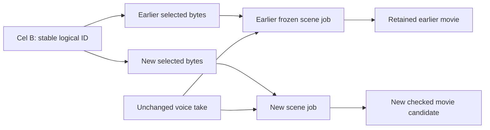

# git-asset, revisions and reproducible production

[All illustrated guides](../README.md#illustrated-guides) · [Capabilities](../capabilities.md#production-engineering)

[git-asset](https://github.com/giodl73-repo/git-asset) manages asset relationships,
versions and placement/protection policy over Git and git-annex. REEL supplies
media meaning: which sources a scene consumes, what a change affects and how to
compile/check a new result. A project chooses its admitted runtimes and stores.

## Fix one picture without losing the earlier edition

In the documented two-cel fixture, replacing cel B changes its consumed source
pin. Cel A and the shared recording retain their exact identities. The old job
must refuse the new input under its earlier expected pin; a new source view
compiles the new candidate. The previous view remains separately identifiable.

| Layer | Owns | Example after the fix |
| --- | --- | --- |
| Project | Story, logical selections, rights and creative decisions | Select the corrected cel B |
| Git / git-asset | Authored history, asset relationships and storage policy | Keep current and retained versions addressable |
| git-annex | Large-file bytes and transfers for its enrolled route | Store declared immutable content |
| REEL | Media dependencies, frame/sample jobs and independent checks | Rebuild/check the affected scene and consuming composition |

REEL's existing native adapters use separately pinned asset SDKs. Their `tig-*`
command names, Cargo features and `vendor/tig/` paths remain technical identifiers.
The git-asset product route and a project's existing native bindings have their
own installation/adoption requirements; a branding or source update does not
switch a live producer.

## Frozen jobs and current selections

A running job consumes its captured source and runtime identities. New main
selections do not silently rewrite those inputs. Managed recovery may complete
a retained handoff without rerendering, within the chosen contract's scope.

Old working copies can only be considered for removal after other jobs,
branches, retained versions and verified surviving copies are accounted for.
Deselection, a successful render or an old inventory alone grants no deletion
authority. The illustrative graph above is about dependency/history identity,
not proof of complete live storage custody.

## Follow the implementation

| Work | Detailed contract |
| --- | --- |
| Understand the current asset-management product | [git-asset](https://github.com/giodl73-repo/git-asset) |
| Try exact native input resolution and a two-version render | [Public integration fixture](../tig-public-integration.md#try-the-two-version-example) |
| Compile the current effective scene inputs | [Native scene binding](../tig-native-scene.md) |
| Plan changed work | [Changed-only planning](../changed-only-build-v0.2.41.md) |
| Run and recover bounded jobs | [Managed jobs](../tig-job-runner.md), [frozen requests](../tig-frozen-job.md), [checkpoint recovery](../jobs-checkpoint-resume.md) |
| Inspect dependencies and storage candidates | [Accounting](../asset-manager-workflow-v1.md), [version comparison](../asset-version-diff-v1.md), [tier review](../asset-tier-review-v1.md) |

For component ownership, see [architecture](../architecture.md#reel-and-git-asset).
For active orchestration work, see [development status](../development-status.md).
