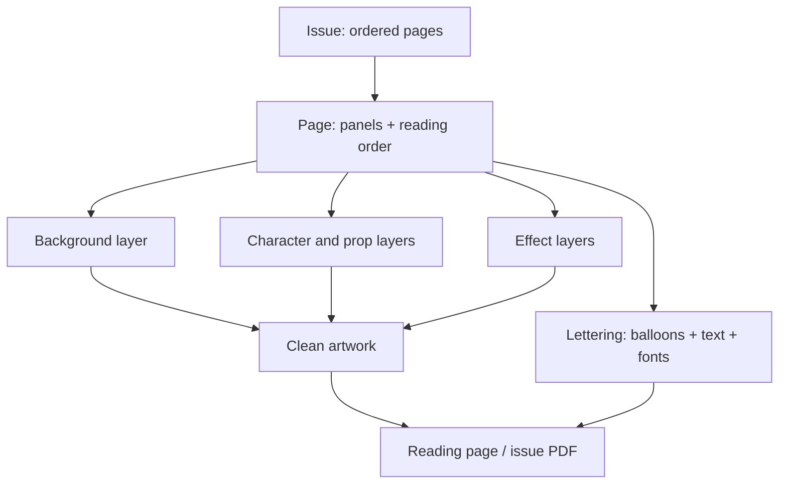

# Comic issues, pages and editable layers

[All illustrated guides](../README.md#illustrated-guides) · [Development status](../development-status.md)

Comic publication/production adapters are in the separate active workflow lane.
This walkthrough explains their source model; it does not declare those adapters
merged or qualify a complete project's issue-production lifecycle on main.

An issue orders pages. Each page declares panel geometry, reading order, art
layers and lettering. Artwork and text remain independent inputs to the reading
edition, allowing clean art and translated reading editions to coexist.

## A lettering correction

In an illustrative page, a balloon overlaps a character's hand. Correct the
balloon's position as a new lettering version, retain the exact art sources,
then compose and review a new reading page. The clean-art output can stay the
same. The surrounding page/spread and issue reading order still need review.

| Source | Owns | Example change |
| --- | --- | --- |
| Page/layout | Panel rectangles and ordered panel/utterance IDs | Change panel reading order |
| Art layers | Separate background, character, prop and effect PNG inputs | Replace a character pose |
| Lettering | Balloon/text SVG, exact words, font and placement | Move a balloon or supply a translation |
| Edition | Ordered selected page versions and output requirements | Select the corrected reading page |

A translation may need different balloon geometry while sharing clean art.
Recovering a flattened page is insufficient evidence of editability: source
recovery should also support a fresh lettering edit and recomposition.

## Where the work lives

In the active `feat/workflow-handoff` lane, `docs/publication.md` documents the
publication model and bounded comic producer. `docs/workflow-orchestration.md`
and `docs/workflow-completion.md` track task/handoff and native qualification.
These are lane-local references until their owner publishes them.

Main already supplies the [native print collection](../native-print-collections.md)
route for explicitly supplied text, score SVG and retained PDF pages. That route
can package declared inputs but does not infer panel geometry or reconstruct
editable layers from a flattened page.

Continue with [assets and revisions](assets-and-revisions.md) for retaining
source relationships, or [editions and delivery](editions-and-delivery.md) for
the distinction between reading output, selection and actual publication.
