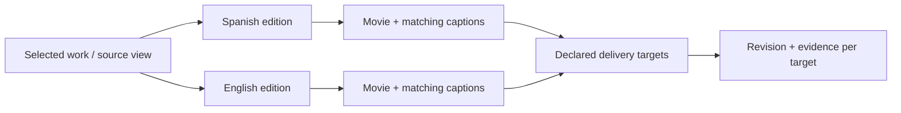

# Editions, captions, print and delivery history

[All illustrated guides](../README.md#illustrated-guides) · [Capabilities](../capabilities.md#editions-and-delivery)

A work can have several explicit editions: language-local dialogue, captions,
clean pictures, an album listening master or a PDF collection. Each output needs
its own identity and declared relationship to the selected sources.

## A movie and its captions must describe the same edition

Suppose the Spanish performance changes but the English edition does not.
The Spanish cue clock and consuming picture/caption timing need rechecking.
An earlier Spanish caption file cannot become current merely because its
filename matches the new movie. Keep the English selection independent.

| Output | Bind explicitly | Review/check focus |
| --- | --- | --- |
| Clean movie | Language/profile and selected picture/audio sources | Composition, frames, samples and duration |
| Caption sidecar or captioned movie | Exact text, language and matching edition clock | Reading speed, layout, speakers and synchronization |
| Album listening master | Ordered complete recordings and declared gaps | Audio joins, headroom and chapters |
| Print/reading PDF | Ordered selected text/pages, fonts and output policy | Pagination, glyphs, reading order and declared source content |

Clean and captioned variants are separate outputs when requested. A songbook,
manuscript or bilingual collection uses its own print contract and supported
source formats; media registration alone does not create an edition.

## Reading follows the wording and its own audio clock

A narrated reading can connect the same opening, detail and closing chapters
across original parallel text, audio and print. In the engineering example,
English ends at 10.6 seconds and Spanish at 12.3 seconds. Both point to print
chapter pages 2–4 after a separate cover; print pagination does not stretch or
shorten the audio. Each cue names its exact source byte span, and every chapter
keeps its actual sample interval.

Changing the Spanish detail creates new source/audio bindings. Keep the earlier
reading package with its original retained providers so it can still be checked.
Authored reading text stays separate from word-recognition evidence and listening
review. See the [illustrated reading contract](../narrated-reading-v1.md) for the
bindings, limits and current engineering qualification status.

## A lesson separates written and exercise positions

A [lesson or rehearsal index](../lesson-rehearsal-v1.md) can retain that complete
explanation alongside an editable score and checked guide. A pickup appears once;
bar A can have distinct first and second exercise occurrences even though both
refer to the same original written ticks. The index keeps the spoken clock,
score clock and virtual exercise positions explicit. It does not create a player
or turn a timing guide into a performance master.

## Visual companions follow the selected language

A [semantic visual companion](../semantic-visual-companion-v1.md) keeps two
shared event IDs while resolving each language's own entrances. In the synthetic
render fixture, English changes picture at frames 24/48 and Spanish at 30/60.
A replacement English take moves the first entrance to frame 25; the Spanish
clock/evidence bytes stay identical. The existing SVG adapter consumes those
clocks, and independent decoded frames and PCM check the result.

Phrase bindings require original word evidence. The synthetic render fixtures
use explicit engineering markers and retain signal labels in text access;
they are separate from the lexical phrase examples and human listening review.
The detailed contract records the bounded profile and current qualification.

## Delivery is another relationship

Rendering a movie, selecting it for release, copying it to a destination and
verifying remote contents are distinct events. Record the exact revision and
evidence for each declared target. A local mounted-file observation does not
establish independent remote sync, and a saved inventory describes its own
checkpoint rather than the target's perpetual current state.

## Follow the implementation

| Work | Detailed contract |
| --- | --- |
| Build edition-matched episode captions | [Episode captions](../episode-captions-v1.md) |
| Check readability and picture geometry | [Accessibility](../caption-accessibility-v0.2.8.md), [caption-safe layout](../caption-safe-picture-layout-v0.2.48.md), [speaker presentation](../speaker-caption-presentation-v0.2.9.md) |
| Assemble supported PDFs | [Native print collections](../native-print-collections.md) |
| Bind authored wording, audio chapters and print pages | [Narrated reading editions](../narrated-reading-v1.md) |
| Connect an explanation, editable pickup and repeated exercise passages | [Lesson and rehearsal package](../lesson-rehearsal-v1.md) |
| Follow language-local phrases with an existing SVG composition | [Semantic visual companions](../semantic-visual-companion-v1.md) |
| Plan finite offline playback, operator controls and measured device gates | [Single-device installation contract](../offline-installation-v1.md) (M11 specification; M12 player pending) |
| Export an editorial interchange | [OpenTimelineIO](../otio-export-v0.2.40.md) |
| Track selected revisions and target evidence | [Delivery use case](../use-cases.md#track-a-delivery-over-time), [history host](../tig-history.md), [delivery observation](../tig-delivery-observation.md) |
| Recheck retained movie/source correspondence | [Retained delivery checker](../tig-retained-delivery-check.md) |

Continue with [assets and revisions](assets-and-revisions.md). Rights,
creative selection and release authority remain with the producing project.
