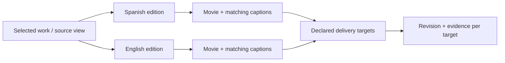

# Editions, captions, print and delivery history

[All illustrated guides](../README.md#illustrated-guides) · [Capabilities](../capabilities.md#editions-and-delivery)

A work can have several explicit editions: language-local dialogue, captions,
clean pictures, an album listening master or a PDF collection. Each output needs
its own identity and declared relationship to the selected sources.

## A movie and its captions must describe the same edition

Suppose the Spanish performance changes but the English edition does not.
The Spanish cue clock and consuming picture/caption timing need rechecking.
An earlier Spanish caption file cannot become current merely because its
filename matches the new movie. Keep the English selection independent.

| Output | Bind explicitly | Review/check focus |
| --- | --- | --- |
| Clean movie | Language/profile and selected picture/audio sources | Composition, frames, samples and duration |
| Caption sidecar or captioned movie | Exact text, language and matching edition clock | Reading speed, layout, speakers and synchronization |
| Album listening master | Ordered complete recordings and declared gaps | Audio joins, headroom and chapters |
| Print/reading PDF | Ordered selected text/pages, fonts and output policy | Pagination, glyphs, reading order and declared source content |

Clean and captioned variants are separate outputs when requested. A songbook,
manuscript or bilingual collection uses its own print contract and supported
source formats; media registration alone does not create an edition.

## Delivery is another relationship

Rendering a movie, selecting it for release, copying it to a destination and
verifying remote contents are distinct events. Record the exact revision and
evidence for each declared target. A local mounted-file observation does not
establish independent remote sync, and a saved inventory describes its own
checkpoint rather than the target's perpetual current state.

## Follow the implementation

| Work | Detailed contract |
| --- | --- |
| Build edition-matched episode captions | [Episode captions](../episode-captions-v1.md) |
| Check readability and picture geometry | [Accessibility](../caption-accessibility-v0.2.8.md), [caption-safe layout](../caption-safe-picture-layout-v0.2.48.md), [speaker presentation](../speaker-caption-presentation-v0.2.9.md) |
| Assemble supported PDFs | [Native print collections](../native-print-collections.md) |
| Export an editorial interchange | [OpenTimelineIO](../otio-export-v0.2.40.md) |
| Track selected revisions and target evidence | [Delivery use case](../use-cases.md#track-a-delivery-over-time), [history host](../tig-history.md), [delivery observation](../tig-delivery-observation.md) |
| Recheck retained movie/source correspondence | [Retained delivery checker](../tig-retained-delivery-check.md) |

Continue with [assets and revisions](assets-and-revisions.md). Rights,
creative selection and release authority remain with the producing project.
