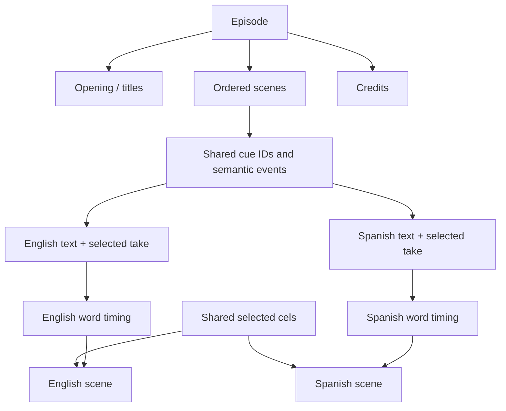

# Episodes, cues and language editions

[All illustrated guides](../README.md#illustrated-guides) · [Capabilities](../capabilities.md)

An episode is an ordered composition: opening, scenes and credits. Each scene
connects source text and performances to pictures, music and effects. Its cues
and cels have independent identities; a new cue does not require a new cel.

## One meaning, two clocks

The [README's bilingual cue](../../README.md#an-episode-scenes-cues-cels-and-effects)
uses the same three pictures with two transitions. These example times are
illustrative, not measurements from recordings:

| Shared event | English phrase / entrance | Spanish phrase / entrance |
| --- | --- | --- |
| Door opens; enter doorway cel | "the door opened" / ~2.7 s | "se abrió la puerta" / ~3.2 s |
| Grandmother smiles; enter close-up | "She smiled" / ~6.3 s | "Ella sonrió" / ~7.0 s |

The author names the event, its intended picture/sound changes and each
language's trigger phrase. Word alignment against the exact selected take
supplies its actual entrance. Repeated phrases
need an explicit occurrence. The compiler turns those measured samples into
picture spans; it does not infer a creative cut from translated word counts.

## From scene to episode

1. Author ordered cues and shared picture/sound events.
2. Bind each language's text, selected takes and measured alignment.
3. Compile and check each scene's effective pictures, sound and timing.
4. Assemble checked scenes with the declared opening, presentations and credits.
5. Check the complete edition, then review and select it in the producing project.

Changing the Spanish performance requires checking its alignment and consuming
timing against that exact selected take. The shared cel
can remain selected for both editions. Changing a cel used by both languages
affects both consuming scenes. An opening change affects the episode composition
without automatically changing every narrative scene.

## Follow the implementation

| Work | Detailed contract |
| --- | --- |
| Define scene/cue ownership and language bindings | [Scene authoring](../scene-authoring-v1.md) |
| Resolve an authored phrase against word evidence | [Semantic triggers](../authored-native-triggers-v1.md) |
| Compile exact pictures, samples and effect spans | [Scene delivery](../scene-delivery-v0.1.md) |
| Compose reusable programme sections | [Programme parts](../programme-parts-v2.md) |
| Assemble checked components | [Episode planning](../tig-episode-planning.md), [episode jobs](../tig-episode-jobs.md) |
| Package captions | [Episode captions](../episode-captions-v1.md) |

Continue with [animation and effects](animation-and-effects.md) or
[voice and sound](voice-and-sound.md). Each contract defines its runtime and
supported scope; creative and translation approval remain project decisions.
