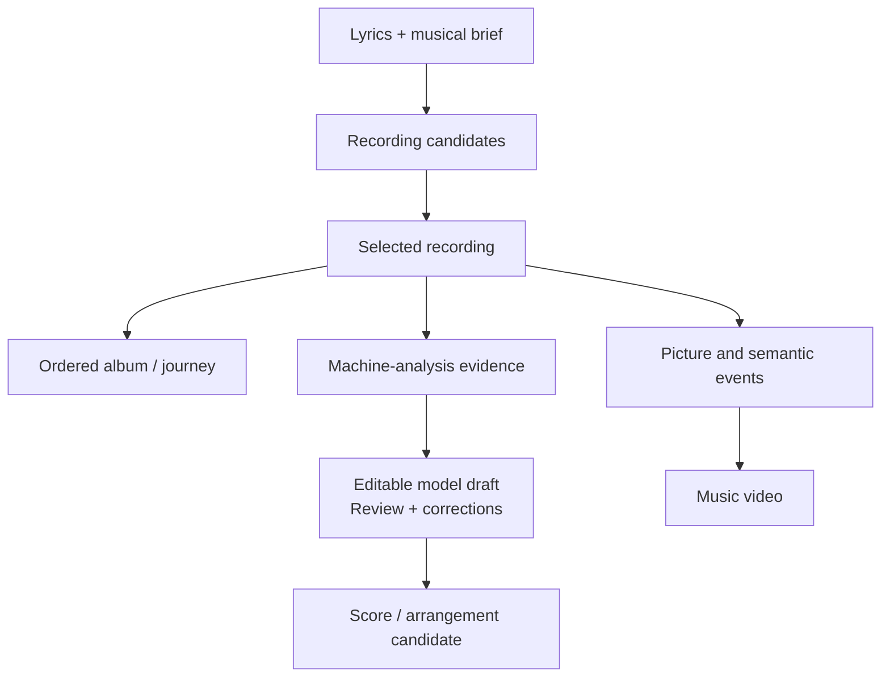

# Songs, scores, albums and journeys

[All illustrated guides](../README.md#illustrated-guides) · [Capabilities](../capabilities.md#music-production)

A song can have canonical lyrics, a generated or existing performance, analysis,
an editable musical model, arrangements and several editions. Each has its own
source relationship and review state. A selected recording is not automatically
an approved score or transcription.

## Generation and editing

The local ACE-Step adapter can generate audition candidates from explicitly
authored lyrics and musical briefs. Its separately installed runtime/model is
pinned. REEL preserves requests, source editions, candidates and evidence so a
later revision can be compared with the actual earlier performance.

Note editing and lyric underlay operate on an editable model. Song editions and
masked repair have different contracts: shortening an existing performance,
changing a note assignment and generating a new take are different operations.

Analysis and source-separation estimates need review; they are not original
studio multitracks or authoritative notation. Keep canonical lyrics, performed
words, recognition evidence and target-language text separate. A musical model
may need corrections to form, melody, harmony, rhythm or underlay before it can
guide a useful score. Arrangement proposals make preserved, developed, replaced
and omitted musical elements explicit; the project retains musical authority.

## Assemble complete recordings into an album

For an illustrative three-track album with two-second gaps:

| Track | Complete recording | Start in album |
| --- | --- | --- |
| A | 3:00 | 0:00 |
| B | 3:30 | 3:02 |
| C | 2:30 | 6:34 |

The total is **9:04**, with no final gap. The native album contract uses integer
sample-frame gaps, preserves complete recordings, applies its declared static
gain/headroom policy and checks the resulting joins. It does not invent a
crossfade or trim a tail to make the sequence fit.

An album video adds declared visuals to that checked album packet. A narrated
journey can instead compose full films and introductions in an explicit order;
compatible source clocks and reuse requirements must still be checked.
Music videos can use the selected recording clock without dialogue cues.

## Follow the implementation

| Work | Detailed contract |
| --- | --- |
| Generate audition candidates | [Generation](../song-generation-v0.2.25.md), [local auditions](../local-song-auditions.md) |
| Create a new edition or bounded repair | [Song editions](../NATIVE-SONG-EDITION.md), [masked repair](../original-song-masked-repair.md) |
| Edit notes or syllable assignments | [Note workshop](../music-note-editor-v1.md), [lyric underlay](../music-underlay-editor-v1.md) |
| Draft or export musical representations | [Model drafting](../music-model-draft-v0.3.5.md), [score export](../music-score-export-v0.3.1.md), [arrangement plans](../music-arrangement-plan-v0.3.10.md) |
| Master and check an album | [Native album mastering](../NATIVE-ALBUM-MASTER.md) |
| Produce companion visuals or longer sequences | [Album video](../NATIVE-ALBUM-VIDEO.md), [video/programme use case](../use-cases.md#make-a-music-video-or-a-sequence-of-videos) |

Optional recognition/engraving adapters have their own external runtime needs.
Continue with [editions and delivery](editions-and-delivery.md) for output families.
