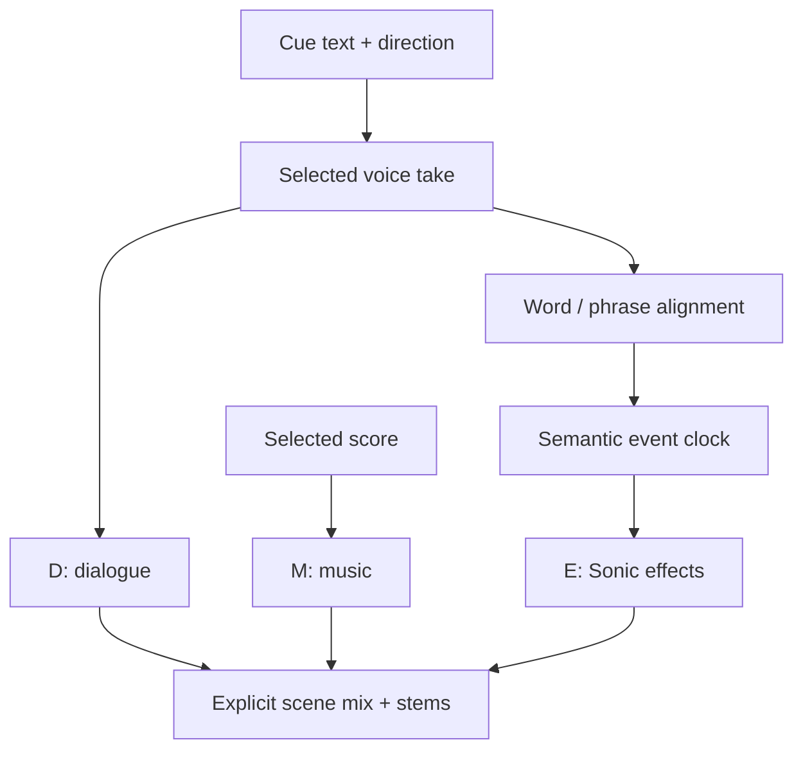

# Voice, alignment and sound layers

[All illustrated guides](../README.md#illustrated-guides) · [Capabilities](../capabilities.md#voice-and-sound)

A cue owns its spoken text and selected performance. Alignment supplies evidence
of where the words occur in that recording. Dialogue, music and Sonic effects
then enter the scene as separately controlled sound layers.

## A door creak without covering the words

The author attaches a selected creak to the door-opening event. The selected
voice remains on the dialogue bus; the creak enters on the effects bus. The mix
declares their gains and any score ducking or speech-keyed EQ. Nothing about an
event name chooses or licenses a sound automatically.

| Revision | What needs attention | What can remain selected |
| --- | --- | --- |
| Replace the spoken take | Text correspondence, word alignment and consuming event clocks | Unchanged artwork and score sources |
| Reduce the creak gain | The declared effects mix and resulting outputs | Voice recording and clean pictures |
| Change the music | Score binding, placement, mix and listening review | Unchanged dialogue source |

A new take needs its own measured alignment. Reusing another language's entrance
time or an earlier performance's word evidence would break that correspondence.
The [bilingual episode guide](episodes-and-languages.md) shows why equivalent
phrases can lead to different cel holds.

## Generation, evidence and selection

The optional ElevenLabs adapter produces explicit private speech candidates.
Existing recordings can also be supplied. Provider output, word evidence,
technical checks and the project's selected performance are separate artifacts.
Keep voice consent and creative listening decisions with the producing project.

## Follow the implementation

For reusable executive/technical spoken editions, the
[declaration contract](../spoken-edition-v1.md) keeps modules, speaker cues and
language/audience script variants explicit. The
[control compiler](../spoken-edition-compilation-v1.md) places each selected take
and its authored handoffs on a language-local sample clock. It produces a private
plan and checks alignment metadata; it does not assemble audio or verify consent.
The [bounded candidate producer](../spoken-edition-production-v1.md)
reuses exact PCM windows to assemble selected takes
with explicit pauses, overlap and processing. Its final local receipt closes a
candidate package; independent checking and authority remain separate.
The [phased plan](../media-expansion-pr-plan.md) tracks merged scope and remaining
qualification work.

The [independent checker and text-access contract](../spoken-edition-check-v1.md)
reopens source/output PCM, recomputes the declared processing and derives exact
speaker-role transcripts, pauses, word evidence and chapters. Selected script
and recognition evidence stay separate; actual listening remains a project gate.

The [retained-edition adapter](../spoken-edition-history-v1.md) connects those
checks to existing git-asset contexts and publication. For example, replacing
Spanish technical detail changes that edition's consumed recipe and review
binding while the two executive editions and English technical edition stay
exact. Original WAVs and text can be checked again from retained inputs with
the source checkout unavailable. M05 qualification remains tracked in the plan.

The [two-speaker module example](../spoken-edition-qualification-v1.md) adds a
host question and expert answer inside one detail module. Its EN technical
edition lasts 12.2 seconds and ES lasts 14.45 seconds under the declared signal
clock; both executive editions keep their earlier bytes. The example shows exact
cue/gap/chapter intervals and a separately authored reordered version. These are
engineering signals; real speech and natural handoffs still need listening.

The [spoken music/effects adapter](../spoken-edition-layers-v1.md) retains that
checked dialogue as D, adds an explicitly ducked bed as M and anchors a selected
Sonic effect as E. For the executive signal example, the closing effect begins
at 3.35 seconds in EN and 4.05 seconds in ES. Its independent check reopens all
four WAVs and evaluates the declared mix; it does not grant listening approval.
The contract states its one-millisecond clock and current qualification status.

| Work | Detailed contract |
| --- | --- |
| Capture or execute a speech attempt | [Speech adapter](../tig-speech-generation.md) |
| Preserve performance direction across scenes | [Direction](../voice-performance-v0.2.15.md), [prosody](../voice-prosody-evidence-v0.2.16.md), [consistency](../voice-consistency-v0.2.17.md) |
| Resolve phrases and native clocks | [Word triggers](../authored-native-triggers-v1.md), [audio-event clocks](../audio-event-clocks-v0.1.md) |
| Resolve selected Sonic sources | [Sonic library](../sonic-asset-library-v0.3.18.md) |
| Mix dialogue, music and effects | [Mixing and stems](../dialogue-score-mixing-v0.3.12.md), [speech-keyed EQ](../speech-keyed-dynamic-eq-v0.3.13.md) |
| Check or recover audio | [Audio quality](../audio-quality-v0.2.11.md), [exact native recovery](../tig-scene-audio-recovery.md) |

Continue with [music and albums](music-and-albums.md) or
[editions and delivery](editions-and-delivery.md).
