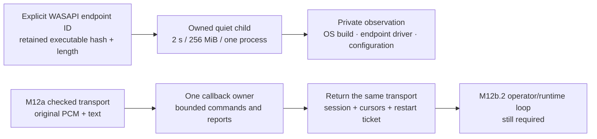

# Explicit endpoint observation and callback ownership

**Status:** M12b.1 native foundation. The playback/operator loop is still M12b.2;
station/capture measurements remain M12c. This component does not expose a Run
command or construct/start an audio stream.

M12a already checks original programme PCM/text and provides a finite transport.
The next boundary is one selected Windows output: learn its exact configuration
without following the default device, and preserve the same transport when an
audio callback returns ownership for Stop or Restart.

## What is callable now

Build explicitly with `--features installation-native`. No feature or repository
startup probes a device. The new `reel-installation` binary offers:

| Command | Scope |
| --- | --- |
| `validate-binding <private-binding.json>` | Check declared shape only. It needs no device and reports `endpoint_probed=false`, `device_playback_checked=false`. |
| `probe <private-request.json> --output <new-private-observation.json>` | On Windows, hold the exact current executable, start one owned quiet metadata worker, query only the explicit WASAPI output and persist a new private observation. No stream or capture is created. |

The internal `__probe-worker` entry is a child implementation detail; directly
invoking it is not a bounded foreground installation. The launcher enforces
process ownership, deadline and exact executable protection.

The probe request schema is `reel.installation-endpoint-probe.v1`. It contains
`endpoint_id` and a `runtime` FileRef with an absolute executable path, exact
SHA-256 and byte length. IDs use CPAL's persisted `wasapi:{0.0.0.00000000}.{GUID}`
form. Empty/default/other-backend identifiers refuse before native access. The
binding and observation remain local private machine data, not shared project
definitions or an asset-admission receipt.

Bindings carry the exact `profile` value
`reel.installation.win11-wasapi-pcm24.v1`; another or missing profile refuses.
The native worker requires an observed Windows 11 x86-64 workstation, including
the workstation product type so a recent Windows Server build is not admitted.
It also checks the native AMD64 architecture, rather than admitting an x64
process running under ARM64 emulation as an x86-64 station.
Private output is written and synchronized in a temporary file beside its
destination, then published without replacing an existing observation.

An observation records the exact endpoint ID, observed Windows build, the
endpoint software device's actual Windows `DriverVersion` property, and a hash
of its sorted configuration description. CPAL's friendly interface label is
not used as a driver version. This identifies the endpoint software driver;
it does not claim an exhaustive physical driver/DSP chain.

Require an explicit output, 48 kHz stereo float32 native mix and compatible
480-frame stream request. No default-device or alternate-backend retry occurs.
The reported request is **not an observed effective stream buffer**: both
`effective_buffer_checked` and `device_playback_checked` remain false. Actual
callbacks and device measurements must prove those later.

## Callback ownership

`callback_pair(Box<Transport>)` allocates its channels before activation: eight
commands, 256 reports and one returned transport. A callback owns the transport
exclusively and only performs bounded channel operations, frame copying and
M12a state transitions. Commands precede the first Opened notice and each sample
boundary. Overflow faults instead of overwriting commands or source history.

Stop/Restart/Fault returns the **same Box** through the bounded ownership
channel. Its source cursor, interval cursor, session and restart ticket remain
intact. Moving the box does not allocate or free its storage. The callback
emits silence after returning it; a controller cannot create a competing clock
or replace a sealed restart permit with a serialized success report.

An isolated allocator fixture counts allocation and deallocation calls during
callback execution, including report overflow and ownership return. Separate
sample/cursor tests verify the content of the output and preserved context.
These are application-callback claims; they do not assert that OS/driver code
is realtime-safe or that predicted timestamps prove physical output.

## Process and evidence boundary

Native probing stays under the existing guarded-executable and Windows Job
Object runner. Its application controller polls cancellation independently of
the worker, and the owned child is reaped before its executable/workspace
guards are released. The session workspace is private and bounded to three
files / 32 KiB; it is not an asset cache, reservation or custody claim.

Tests hold an actual process handle, cancel or time out a deliberately stalled
worker, and assert that the process is signaled before return. That proves the
controlled child case. It does not certify bounded physical-driver cleanup on
an untested station, or close M11's measured playback/latency gates.

## Dependencies and later gates

| Dependency | Pinned use / terms |
| --- | --- |
| CPAL `0.18.2` | Optional Windows-only WASAPI metadata/backend dependency, default features disabled; Apache-2.0. |
| rtrb `0.4.1` | Optional bounded SPSC handoff; MIT OR Apache-2.0. Allocated before callback use. |
| windows `0.62.2` | Optional Windows-only API bindings for actual OS/driver observations and process checks; MIT OR Apache-2.0. |

Original direct-dependency license texts are retained in
[the native notice directory](licenses/installation-native/). The existing
assembly license inventory describes its browser/WASM dependencies; it must not
be represented as a complete native-executable notice bundle. A native binary
release still needs its full resolved transitive/Rust notices and exact runtime
evidence; this change publishes no runtime or media release.

M12b.2 still owes explicit playback startup, owned native open/close/reopen,
terminal geometry and text presentation, command/EOF/Ctrl+C handling, original
source rechecks and measured control deadlines through that actual boundary.
M12c owes isolated station/capture evidence and separately recorded listening,
usability and authority decisions. Full M12 remains open; M13 cannot inherit a
device-qualified result from this foundation.
