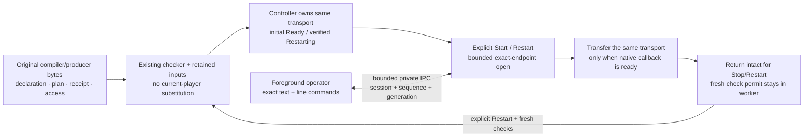
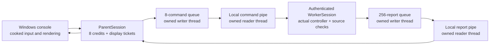
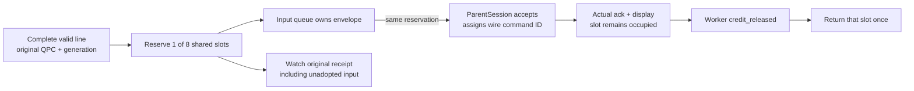
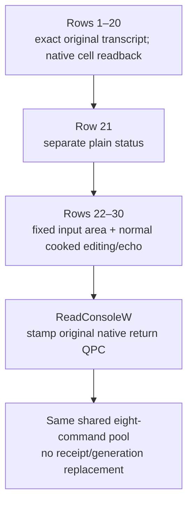

# From checked originals to explicit playback

**Status: M12b.2 implementation in progress.** The merged
[M12b.1 foundation](installation-native-foundation-v1.md),
[#403](https://github.com/giodl73-repo/REEL/pull/403), supplies metadata and
callback ownership. This document maps the remaining native session boundary.
It does not qualify a playback command, terminal or actual audio endpoint.
The [M11 limits](offline-installation-v1.md) remain authoritative.



## Private invocation, existing programme

`reel.installation-session.v1` is a private invocation request, not another
authoring, storage or programme manifest. Its maximum encoded size is 16 KiB.

| Field | Meaning |
| --- | --- |
| `edition_id`, `passes` | Exactly one original edition; one to three passes. |
| `original` | Exact FileRefs for declaration, plan, production receipt, optional processing policy, access manifest and retained original compiler/producer bytes; explicit source/candidate/access roots. |
| `playback` | Separate retained executable FileRef, independently bound source commit/Cargo.lock context and pinned CPAL version. A declared build context is not an inferred source attestation. |
| `endpoint` | M12b.1's exact private profile/device/build/driver/configuration binding. Shape validation does not probe it. |

Never fill the original compiler identity from the current player or from the
receipt being checked. Original runtime bytes may have been produced on another
platform: retain and hash them without executing them or demanding a Windows
executable suffix. Only the actual native player/worker is an executable binding.

The source loader holds mandatory Windows file and parent-path guards using the
existing runtime protection primitive. Metadata is read under its exact pin;
providers retain the corresponding guards for source/candidate/access reads.
They reject changed roots, conflicting pins, missing/case-mismatched names,
escapes and excessive inputs. Each provider admits at most 128 held files / 64
MiB; no source lookup, cache initialization, restoration or fallback is added.
Unsupported guarding refuses rather than claiming cooperative native custody.

`SessionRequest::check_originals` is an explicit read-only source operation.
Its counts-only result distinguishes checked original runtime bytes and guarded
reads from **unchecked** playback build, host, endpoint and device playback. It
does not open the declared player, probe a device or create a success artifact.
Original checking stays within one aggregate 30 s cooperative deadline.

The CLI exposes `validate-session <private-request.json>` for shape only and
`check-session <private-request.json>` for those original checks. Neither
command is playback. Protected original file checking currently requires
Windows; unsupported platforms refuse rather than reporting protected reads.

Fresh checks still run before transport creation and restart. Once their seals
match, Prepared and Transport share the same frozen sample/text allocations;
the active session does not retain a second identical playback PCM buffer.

## Ownership before and after native readiness

The controller must retain the actual transport while native probe/open/play
is pending. An output callback can submit zeros before receiving the transport;
only explicit Start may create that stream. After native readiness, transfer
the same object once. A startup Stop can therefore update the real transport
without waiting for a blocked native call or losing the context needed for an
explicit later Restart. Late native completion cannot acquire a cancelled box.

The source-check port now owns LoadedProgramme and Prepared on a dedicated
thread for the session. Guarded load, initial preparation and fresh seal checking
share one absolute deadline of at most 30 seconds. The returned Ready transport
uses the Run origin, so setup counts toward its 120-second lifetime. Restart
tickets and permits move through bounded in-process queues; they are never JSON
or another authority inferred from an observation. Event reception checks for
cancellation/expiry again to reject a success queued just before cancellation.
The actual transport independently rejects an otherwise checked permit after
Stop or a generation change. The source port opens no endpoint and does not
qualify the distinct playback executable or host. Its destructor joins the
source thread and retained guard destruction; complete process containment is
still required to handle a blocked OS operation.

While active, M12b.1's callback owns the sole source/interval clock. Stop,
Restart, completion or failure must return that object before replacement.
Neither a private wire status nor a deserialized success flag creates a restart
permit. Prepared and the opaque ticket/permit exchange stay in one native
worker; original checking and native open/drop stay off the control/callback
threads. A failed native cleanup remains a failed profile, not a timer success.

## Controller and operator obligations

### Private local channel

The low-level channel now uses two distinct one-way Windows named-pipe file
objects. A blocked read therefore cannot serialize an unrelated write on the
same synchronous handle. Its owned reader/writer threads exchange bounded
packets; controller/callback code polls queues. The worker now routes guarded
admission and real transport events. `ParentSession` routes foreground protocol
and command credits. The Windows Run command drives both the console and the
contained worker.



The server creates a cryptographically random 16-byte run context and derives
both local pipe names from it. There is no caller-selected path/remote host.
Pipes reject remote clients, require first-instance creation and use a protected
DACL containing only the current process user's allow entry. The OS-visible
pipe descriptor is checked in a native test. Clients request identification
security quality of service. Neither an invitation nor a peer-ID observation
grants programme, restart or release authority.

The server must verify **both** actual pipe client PIDs against the child PID
observed by the existing contained runner. The client checks each actual pipe
server PID against its invitation. A contained-child test exercises that exact
PID relationship with the retained test image; same-process tests additionally
cover bidirectional progress while readers are blocked. No caller-provided PID
file substitutes for the runner's held process handle.

Each frame is at most **8192 bytes total**, with this 40-byte little-endian header:

| Bytes | Meaning |
| --- | --- |
| 0–3 | `RIPC` magic |
| 4 | Private framing version `1` |
| 5 | Command/report direction |
| 6–7 | Payload length, 1–8152 bytes |
| 8–23 | Exact random run context |
| 24–31 | Per-direction sequence, starting at 1; no gaps/replay/wrap |
| 32–39 | Generation metadata; applicability still belongs to the session/core |

The reader checks the fixed header before reading its bounded body. A malformed,
foreign, duplicated, truncated or closed stream poisons that receiver; it cannot
resynchronize/reconnect with a later valid frame. Queue overflow is terminal.
Generation metadata is preserved, not treated as a restart permit or blanket
authority. The strict message/admission components below now bind that metadata
to commands; the complete session controller must connect them and obtain real
text-display acknowledgement. Raw framing success alone does not satisfy those
gates.

Shutdown repeatedly calls `CancelSynchronousIo` on the actual owned thread
handles until both threads finish, then joins them before dropping their I/O
resources. Repeating matters when cancellation races entry into a synchronous
read/connection wait. Controlled tests cover unconnected waits, blocked reads,
closed peers, unread pipe backlog and both queue limits. A two-second cleanup
success is reported only after those actual joins; a broken OS operation cannot
be relabeled successful by abandoning its thread/buffers. This port's cleanup
measurement does not replace the complete foreground/session cleanup deadline.

### Guarded runtime and message admission

`RuntimeBinding::bind` is an explicit blocking operation, separate from
`validate-session` and original-source checking. It pins the declared player,
requires that it is the current retained executable, and holds the declared
Cargo.lock file under native read/path guards. The lock bytes must match those
embedded in this compiled player. Expected request/image hashes are computed
from those actual inputs. The declared source commit remains a declared build
context, not an invented source attestation. Original compiler/producer identity
is unchanged and is still independently checked by the source worker.

Cloned admission contexts retain the runtime/lock guards, so dropping the initial
binding cannot make those files mutable while a gate is still using its hashes.
Binding this player does not read originals, probe an endpoint or admit playback.
A real test succeeds with the original declaration absent, then rejects a
byte-correct wrong player path and an independently pinned incorrect lock.

The private JSON bodies use strict tagged enums and reject unknown fields and
commands. They are bounded by the same frame limit:

| Direction / message | Required relationship |
| --- | --- |
| Worker `hello` → parent `authorize` | Both actual OS pipe peers, random run context, exact request hash and actual image hash agree with the held runtime/worker. Bootstrap is accepted once. |
| Worker `transcript` → parent `text_shown` | The Windows renderer writes the exact admitted text and reads back its cells before acknowledgement. The acknowledgement carries the original hash and observed UTF-8 code pages and dimensions of at least 80×30. |
| Parent `control` | Canonical command, consecutive unique ID and nondecreasing complete-receipt counter within the Run clock domain. The worker retains each of eight outstanding IDs through actual application/refusal and matching display acknowledgement. |
| Worker `ack` / `preparation_ack` → parent `ack_shown` | Match an actually emitted command report, its ID and frame generation. Display counter cannot precede that report or be in the future. A parsed display claim is not console-rendering evidence. |
| Worker `credit_released` → parent credit pool | Only after the worker accepts `ack_shown`. ID/generation must match an acknowledged and displayed command; its counter cannot precede display. Queueing `ack_shown` alone does not free foreground credit. |
| Worker `ready`, `state`, `ack`, `ended` | Immutable bounded observations; snapshot generation agrees with the frame. They cannot deserialize or construct a transport, prepared programme or restart permit. |
| Worker `session_fault`, `resources_closed` | Generation-bound lifecycle metadata without a fabricated snapshot. Resource closure means source/output owners joined; it does not mean IPC delivery or process-tree reaping. |

Before text acknowledgement, Status/Quit remain admissible and other supported
controls receive an InvalidState refusal without advancing source state. Bad
context, malformed messages, replay or an exhausted command budget end admission;
the complete operator must present that failure and preserve its local
Status/Quit/cleanup behavior. No parsed acknowledgement by itself proves that
the console rendered the text or that the device played a frame.

Stateful commands now retain their expected generation through the callback's
queue and ownership return. The **actual core** checks it when applying the
command, after earlier queued commands may have changed generations. A stale
Pause/Resume/Start/Restart records StaleGeneration without changing state/cursors.
Stop/Quit/Status are run-wide safety controls and survive an old observed
generation. The controller must use this stamped path end to end and enforce
the same eight outstanding IDs across its UI/IPC/core buffers; multiple bounded
queues do not authorize additional unique commands.

These are implemented admission components, not the complete session loop.
Actual SourceWorker/OutputWorker orchestration, receipt-to-output deadlines,
parent report ordering and persistent-console proofs still gate the Run command.

### Real transport/output controller

`native::controller::Controller` now connects the actual transport owner to the
output backend. Its nonblocking tick drains callback observations, applies
stamped commands to the sole real core, and schedules native operations off
that thread. Construction creates no stream. The outer session still needs to
route authenticated messages, confirm actual display and deliver acknowledgements.

```mermaid
flowchart LR
    accTitle: The same transport moves through native output and restart
    accDescr: The controller retains the prepared core during native startup. A valid silent callback precedes handoff. Stop and restart return the identical core before physical close. A restart ticket goes to source checking; its checked permit is held through probing and consumed by the actual core immediately before opening.
    core["Controller owns real core"] --> ack["Actual command record<br/>Starting acknowledgement"]
    ack --> probe["Bound endpoint probe"] --> open["Owned native open"]
    open --> silent["Valid silent callback"] --> callback["Move same core<br/>into data callback"]
    callback --> returned["Return identical core"] --> close["Actual old-stream close"]
    close --> ticket["Opaque restart ticket"]
    ticket -.-> check["Source/runtime checking thread"]
    check -.-> permit["Stage checked permit"] --> probe
```



`Controller::drive_source` now connects the dashed checking links to the
retained source worker: it issues tickets only after actual close, cancels
obsolete checks and discards stale completions. The complete authenticated
session still needs to call that orchestration in its control loop.
`SourceWorker::with_runtime` supplies the source-thread path:
current-player/lock rechecks run alongside original checks, off the controller,
using the same absolute checking budget. The existing original-only constructor
retains its narrower scope and does not start validating a missing player.

Startup Stop/Quit updates the core while a native open is blocked and cancels
the operation. Late completion cannot attach that core. Restart tickets are
unavailable until the old stream actually closes. A checked permit is staged
through probing; the real core consumes it just before stream opening, so the
core's two-second open window is not spent on the preceding probe. The external
Start/Restart aggregate remains tied to complete foreground command receipt.

The controller also checks each pending command against that original receipt
with a 100 ms acknowledgement deadline, including while Paused. It checks before
consuming actual records or refusals, so a late arrival cannot erase the missed
deadline. Failure cancels startup and requests callback/native teardown; a late
actual acknowledgement may still be reported as history after the Fault notice.
It cannot clear the failure or authorize reopening. Status/Quit remain usable.
This is the controller-side gate; foreground display and IPC delivery still need
to enforce the same original receipt budget end to end.

Callback delivery records now carry fixed-size command tags and the actual
enqueue sequence/refusal. This prevents a rejected command during Fault from
stealing a later Status acknowledgement. The 16-entry delivery-record channel
does not expand the eight outstanding-command budget. Delivery overflow faults
before another source frame. Tags, overflow and actual ownership return are
covered by the isolated data-callback allocation check (tagged enqueue, report
overflow and actual return); delivery-overflow refusal has its own source-cursor
test. A refused pre-handoff
attachment may box its returned Callback off that data path.

The controller can report a watchdog failure immediately, then fault the actual
core when native teardown returns it. It does not invent a mutable core snapshot
while the callback owns the transport. Destruction joins actual output teardown
while keeping the callback return receiver alive; only then can ownership and
buffers be released. This join may block a broken driver and still belongs
inside the externally contained native worker.

Preparation/status/end message variants represent Checking/Fault before any
transport exists. They contain no fabricated Ready snapshot. The worker routes
them now; parent acknowledgement visibility/order, global foreground command
admission, console behavior and process-wide cleanup deadlines remain required.

### Authenticated worker: checking through actual controls

`native::worker::WorkerSession` connects the channel, runtime binding, source
thread and controller. Setup receives an already guarded current-image binding,
an established channel and the shared Run clock. The enclosing owner must choose
that origin before setup so setup counts against the same lifetime.

```mermaid
sequenceDiagram
    accTitle: Exact originals and two acknowledgements precede output
    accDescr: The worker verifies both parent peers, then exchanges Hello and Authorize. Only then does source checking run. The exact transcript is sent and its display acknowledged before endpoint metadata probing and Ready. Start produces an actual core acknowledgement. Its display acknowledgement must return before stream startup. The real callback receives the same prepared core.
    participant P as Foreground
    participant W as WorkerSession
    participant S as Guarded source thread
    participant C as Actual controller/core
    P->>W: Matching held peers + Authorize
    W->>S: Runtime/lock and original checks (Run ≤30 s)
    S-->>W: Actual prepared core + retained guards
    W-->>P: Exact original transcript
    P->>W: TextShown for that hash/layout
    W->>W: Background exact-endpoint probe (≤2 s)
    W-->>P: Ready; no stream
    P->>W: Start, ID, generation, original receipt counter
    W->>C: Apply actual scoped command
    C-->>W: Actual Starting trace
    W-->>P: Ack with actual trace observation
    P->>W: AckShown for that ID/generation
    W->>C: Release startup fence; bounded probe/open/handoff
```

The worker reads QPC immediately before each packet admission, rather than
rejecting a command that arrived after the tick's first clock sample. It keeps
the eight-ID budget until an actual report and matching `ack_shown`; expired
receipt-to-return budgets fault even if an old acknowledgement later arrives.
Start/Restart cannot schedule output startup while their display fence is held.
Neither that fence nor an IPC claim replaces actual foreground display evidence.
At most eight packets are admitted per tick; continuous valid traffic cannot
turn queue draining into an unbounded loop ahead of native/core polling.

No endpoint is queried while checking or waiting for exact text display. Initial
check/probe deadlines and unexpected source-thread exit fault without waiting for
the blocked task. They request cancellation; actual destruction still requires
the contained owner. Worker Fault reports preserve Status/Quit for valid
admission. A terminal channel wins over queued old commands.

`finish` is an explicit blocking source/output destruction step **outside the
controller loop**. It returns a `WorkerClosure` owning the still-live channel,
runtime guards and final observation only after those actual joins. The caller
still owes final report delivery/acknowledgement, IPC shutdown and actual process
reaping under one cleanup budget. There is no automatic final-send-and-drop
success path. Unwinding also closes native output before dropping original
guards and before channel destruction. No CLI/console or complete two-second
cleanup qualification follows from this worker component.

### Foreground protocol: one credit follows one command

`native::parent::ParentSession` now owns the foreground channel, guarded runtime
and bounded observation/display queues. Its worker PID must come from the
existing held process owner. It checks actual peers and Hello before sending
Authorize, then checks report order, original-clock counters, pending IDs,
generation changes and terminal state. It stores observations, never a mutable
transport or restart permit.

```mermaid
sequenceDiagram
    accTitle: A command credit stays owned through the worker's display receipt
    accDescr: Complete foreground line receipt reserves one of eight credits. The worker applies or refuses the actual command. ParentSession issues a display ticket. Only after rendering confirmation does it send AckShown; the worker accepts it and returns CreditReleased. ParentSession then frees that credit. All deadlines retain the original foreground receipt time.
    participant P as ParentSession (8 credits)
    participant W as WorkerSession
    participant D as Console actor
    P->>P: Complete line receipt; reserve ID and original QPC
    P->>W: Control with ID/generation/receipt
    W-->>P: Actual application/refusal acknowledgement
    P->>D: Ordered opaque display ticket + observation
    D-->>P: Rendering complete (same ticket)
    P->>W: AckShown; foreground still owns credit
    W->>W: Validate actual report, ID, generation and counter
    W-->>P: CreditReleased
    P->>P: Validate return; release that one credit
```

The foreground checks the original 100 ms receipt budget before draining late
reports and before accepting rendering completion. A late acknowledgement
cannot erase that failure. The worker independently bounds receipt through its
display-return path. Parent credit returns may not be guessed from queue
acceptance. The eighth displayed command still occupies a credit until its
worker return arrives; a ninth outstanding command faults without sending it.

Display tickets are private, ordered and accepted once. Transcript confirmation
requires the layout/UTF-8 observation and names the exact original hash. Ready
cannot precede that confirmation. Bad acknowledgements are rejected before
replacing the last admitted snapshot; a new generation requires an actual
pending Start/Restart. A worker Fault remains visible over late historical
snapshots. Protocol Fault clears obsolete queued display work, preserves the
last admitted observation and keeps local Status/Quit available. After Quit,
new transport controls refuse and Status is local; no extra ID is stranded in
the exiting worker's queue.

A final observation must follow Quit or lifetime termination. Receiving it does
not mark it displayed. The display ticket still needs confirmation before
`final_displayed` becomes true. That flag is **not** final worker delivery
acknowledgement, native/process reaping or a complete cleanup receipt.
`shutdown_channel` is a blocking IPC barrier for the enclosing cleanup owner;
it must remain off the control loop and inside the shared cleanup budget.

Parent/worker integration tests still use synthetic rendering confirmations.
The native console primitives below have separate actual Windows API coverage;
their owned I/O actors, Ctrl+C and blocked-output integration remain open. No
end-to-end console/control timing qualification follows from the protocol tests.

### Completed lines and IPC share one reservation

`native::input::CommandPool` supplies the same eight slots to the bounded input
queue and `ParentSession`. The future cooked reader calls `InputSender::line`
with the original complete-receipt QPC. ASCII/case/32-byte parsing precedes
reservation; invalid syntax retains no raw line and consumes no command slot.
The accepted envelope owns a private reservation, its receipt and the observed
generation captured before enqueue. It is neither cloneable nor serializable.



For example, **four queued lines plus four commands awaiting credit return are
eight total**. Adopting a queued line leaves the total at eight. Displaying its
acknowledgement still leaves eight; the matching worker return reduces it to
seven. No independent eight-line allowance can sit beside the protocol pool.

Ownership and original receipt are published in one atomic slot operation.
The watchdog samples those receipts before sampling QPC, including queued lines
that no consumer has adopted. A stalled consumer therefore cannot postpone the
100 ms gate. Actual display marks the slot acknowledged for timing while keeping
it occupied until worker credit return. Rejection, final close and destruction
return the owned reservation once; no numeric lease is reconstructed from IPC.

Parent adoption checks pool identity and preserves receipt/generation. A Pause
queued under generation zero still carries zero after the parent observes
generation one; the real core's existing stale-generation check decides its
refusal. Queue delay cannot be replaced with a fresh receipt time. Overflow is
terminal, queued old commands are discarded after closure/fault, and local
Status/Quit remain available. Parent destruction closes input admission.

This completes the shared queue/protocol reservation mechanism. Wiring the
native reader/renderer actors to it and completing cleanup/lifetime integration
remain open; synthetic line producers are not console qualification.

### Native console cells and ordinary cooked echo

`native::console::ConsoleSurface` now supplies explicit **blocking** primitives
for an already attached Windows console. It opens `CONIN$`/`CONOUT$` directly,
so redirected standard handles cannot be mistaken for console handles. It does
not allocate a replacement console. The surface observes UTF-8 input/output
code pages and at least 80×30, enables line/echo/processed input, disables VT
input and keeps processed output. It saves the earlier modes/code pages for
restoration on destruction.



Transcript writes use native wide console cells and check that the requested
rectangle was not clipped. Readback compares every original cell, including
precomposed Spanish. Status writes touch only their own row. The input cursor
and lower area reset between complete reads; no alternate screen or raw input
is used. A VT scrolling-margin prototype failed the actual cooked-echo test and
was removed: the implemented behavior does not depend on those margins.

The reader retains at most a 64-code-unit native chunk and 32 command bytes,
handles partial/pasted chunks without dropping later lines, and stamps each
native return before parsing. Unknown, non-ASCII and overlong commands return
Invalid without a reservation. Conventional Ctrl+Z/Enter returns EOF, retaining
the original read counter for the owner's eventual Quit handling. Unsupported
geometry or changed modes/code pages refuses rather than truncating text.

An owned **headless Windows pseudoconsole** test now exercises forty echoed
Status lines, three invalid lines, EOF, exact twenty-row Spanish preservation,
an actual resize to 79×29 refusal and restoration from deliberately different
1252/console-mode settings. Its independent output reader captures bounded
UTF-8 output. This is real console-buffer/API behavior, not a physical font,
terminal usability, playback or complete actor/cleanup pass.

The pseudoconsole attachment extends the existing atomic Job Object runner;
the old quiet/log paths keep their existing setup. A lifetime-bound borrowed
HPCON is supplied explicitly; its owner retains it through actual process/tree
barriers and drains output independently before closing it. This follows the
[Windows pseudoconsole session API](https://learn.microsoft.com/en-us/windows/console/creating-a-pseudoconsole-session).
No second process launcher, visible console window or media device is started.

After source and output teardown, the worker can send its final report and
hold the channel open for `FinalShown`. The foreground sends that receipt
after rendering succeeds. The worker checks the report counter and generation
before closing IPC. Teardown and delivery share a two-second budget measured
from the original Quit receipt, capped by the session lifetime plus its cleanup
allowance. The contained missing-original fixture measures through child
reaping and foreground IPC shutdown. Production process ownership still needs
to enforce that budget if a native operation blocks.

The private Windows `__session-worker` entry point takes the bounded session
request and bootstrap files. The bootstrap carries the authenticated channel
invitation and the foreground's performance counter origin. The child binds
its runtime before entering the authenticated worker loop, then tears down its
resources and waits for the final display receipt.

On Windows, `reel-installation run REQUEST` starts that worker under the
existing Job Object runner and drives the attached console. The foreground
uses the runner's held PID to authenticate the channel and shares the Quit
deadline with the runner. The runtime binding and private bootstrap files stay
owned until the runner returns from reaping the child.
The command exits with status 0 after a session closes without a fault. Status
2 means a session fault was displayed and cleanup finished. Status 1 means
startup, communication, or cleanup failed.
The runner samples both processes' Windows peak working sets and rejects a
combined total above 512 MiB. The foreground checks the total again after
console shutdown using the recorded worker peak. Summing the separate peaks
is conservative because they may occur at different times.
At the 120-second lifetime limit the foreground closes input admission and
keeps rendering worker reports during the remaining cleanup allowance. It
waits for the worker's own lifetime transition, then confirms the final report
without sending an extra Quit command.

The reader and renderer own their blocking operations on separate threads.
`ParentSession::tick_with_renderer` polls the renderer and acknowledges each
ticket only after a successful console operation. The headless fixture verifies
that this sends `TextShown` over the channel and that a resize error leaves the
command credit outstanding. The foreground owner coordinates Ctrl+C and joins
both console threads before restoring the saved modes and code pages. Explicit
shutdown reports restoration errors. Blocked output cancellation and shared
cleanup deadlines still need verification on the target station.

### Existing runner and output ports

The existing contained process runner now offers an explicit observer port.
It obtains the primary worker PID and peak working set from its own held process
handle, rather than trusting a child-written PID or message. `exit_observed`
means the runner observed that process handle signaled; a separate `Reaped`
event follows actual job shutdown and descendant-handle barriers. An observer
error cancels through the existing tree cleanup before the call returns. The
original `run_quiet` callers keep their existing path and incur no new process
memory queries. No second launcher, cache or telemetry store was added.

The production launcher uses these observations to verify the worker's private
pipe peer and measure its peak working set. It measures the foreground peak
separately and enforces the combined 512 MiB envelope. Job committed-memory
limits also apply.
The observer runs on the existing runner thread, whose 250 ms monitor cadence
cannot replace the session's 20 ms controller or 100 ms acknowledgement rules.

The Windows output port now implements explicit probe/open/close on one serial
backend thread. Construction opens no endpoint. Real opens resolve the bound
WASAPI endpoint again, request 480 stereo float32 frames at 48 kHz and check the
reported period plus every actual callback's whole-frame/2048-frame bound.
`play()` returning is insufficient: a valid silent callback must establish
readiness before the controller can attach the actual transport. Cancellation
also travels with the sink, so a late open cannot acquire it.

The application data callback records fixed-size atomic observations and actual
source-frame submissions, excluding pause, interval, fault and padding silence.
Its QPC clock shares the pinned CPAL WASAPI timestamp domain. A predicted output
timestamp remains a prediction. Closing reports completion only after the actual
stream is dropped; the port's destructor joins its backend thread. This can
block on a broken driver and therefore belongs inside the still-required owned
worker process. This port alone is not a contained foreground runtime.

Controlled-backend tests compare every float through variable callback sizes,
pauses in both source and interval, cancellation and oversized buffers. A separate
isolated allocator fixture covers the complete application data-fill wrapper,
including real report overflow and ownership return. It does not establish the
allocation behavior of CPAL internals, driver/error callbacks or teardown.
At 120 seconds the actual core stops; only Close may use the two-second cleanup
tail. Probe/Open cannot extend playback into that tail.

The session's 120 s lifetime starts at invocation, including preparation and
pauses. Initial checks share a 30 s budget; Start has a 2 s aggregate bound and
Restart has 35 s including old close, checking, probe and open. Stage limits do
not reset those aggregates. The 20 ms controller tick, 100 ms acknowledgement,
250 ms watchdog and 2 s cleanup limits remain unchanged.

Console/IPC work must not block that controller. The operator needs the actual
UTF-8 terminal geometry and exact original text before Ready/Start. Standard
line editing, echo and EOF/Ctrl+C must work while the checked transcript remains
visible above the status/input area. No raw terminal mode or text normalization.
Any proposed scrolling/display mechanism needs an actual Windows console test;
a simulated screen alone cannot qualify it.

The core's 256 diagnostic entries and callback's 256 transient report slots
serve different purposes. Native observations must be bounded too: retain
explicit aggregates and a declared sample of boundary/control records, without
claiming that a sampled timeline contains every callback. Physical capture
and device measurements remain M12c.

## Requirement/test map

The checked engineering fixture in `tests/support/spoken_installation.rs`
uses synthetic stereo PCM. Each edition has 4,800 zero frames at each end
and two distinguishable 240-frame markers. The first marker begins at frame
5,040, and the last begins 5,280 frames before the source ends. In the
144,000-frame English edition, the last marker begins at frame 138,720.
Across consecutive passes, the nominal last-to-first marker span is
22,320 frames at 48 kHz (465 ms). Subtracting the two known source offsets
leaves the specified 12,000 transport frames (250 ms). The transport test
checks the exact markers, silent seams and full sample sequence. Capture and
clock comparison on an enrolled endpoint remain M12c evidence.

To retain the synthetic originals on Windows, set
`REEL_INSTALLATION_FIXTURE_PARENT` to an existing absolute directory and run:

```powershell
cargo test --locked --all-features --test spoken_programme_media installation::export_synthetic_station_originals -- --ignored --exact --nocapture
```

The test prints the new fixture directory. Its `original.json` contains the
exact `original` object for a private session request, including absolute roots
and the retained producer image. Keep the fixture at those paths. Use
`en-technical` and two passes for the marker sequence above. The station
request also requires the separately pinned player build and the explicitly
enrolled endpoint. The export runs the original checker and prepares the
transport without opening a device. With the environment variable unset, the
test uses a temporary directory and removes it when finished.

On the development Windows 11 host, the contained `probe` command accepted
two explicitly named stereo 48 kHz float32 outputs and refused an eight-channel
mix without writing an observation. The probe retains the full format list in
the configuration fingerprint and bounds it by the pinned CPAL WASAPI
enumerator's maximum. These are metadata observations. The effective callback
period, submitted samples and capture timing still require a station run.

### Stage the private station request

1. Build and retain the Windows player. Record its exact file reference, source
   commit, Cargo.lock file reference and CPAL version. Use that same player for
   the metadata probe and the session.
2. Probe the explicitly named candidate endpoint and take the `binding` object
   from the private observation. Combine it with the exported `original` object
   and the separately recorded `playback` context in a
   `reel.installation-session.v1` request. Set `edition_id` to `en-technical`
   and `passes` to `2`.
3. Run `validate-session REQUEST` and `check-session REQUEST`. Require two
   passes of 144,000 source frames, guarded original reads, and the original
   PCM, access and producer-image checks. These commands leave the endpoint
   unopened.
4. Confirm isolation on the selected output and declare the capture point
   before running the [station measurements](offline-installation-v1.md).
   Retain exact capture and runtime evidence privately. Metadata for candidate
   endpoints can be staged in advance of choosing the station output.

The opt-in Windows CLI test `actual_station_run_exercises_playback_commands_and_reaps_worker`
opens the selected request in a pseudoconsole and follows the visible Start,
Pause, Resume, loop, completion, Restart, Stop and Quit sequence. Set
`REEL_INSTALLATION_STATION_SESSION` to the absolute path of the enrolled
request before invoking the test by its exact name with `--ignored --exact`.
Keep its player image and exact build lockfile in retained paths outside the
build directory and working checkout. Recompiling can replace the executable,
and updating the checkout can replace the lockfile. This test checks the visible control
sequence and process exit. M12c also requires independent capture and numeric
timing evidence.

The test passed on the development host with the explicitly pinned Dell
output and the two-pass synthetic English fixture. The visible sequence
included Playing, Paused, LoopWait, Completed, Restarting, a new Playing
pass and Stopped. Quit returned success after the owned worker exited.
The test did not capture the output, establish physical onset or quiescence,
or exercise device disconnect. The total test duration is not a measurement
of any individual control deadline.

For a continuous 48 kHz stereo digital capture of the uninterrupted two-pass
fixture, retain the original recording and its clock/configuration evidence.
Set `REEL_INSTALLATION_CAPTURE_F32LE` to the exact interleaved float32 PCM
analysis input and run the CLI test `capture::measure_retained_station_capture`
with `--ignored --exact --nocapture`. Retain any conversion command and its
tool identity. Keep channel order and sample rate unchanged and preserve
leading silence and packet gaps. The analyzer prints the input hash, the
inferred loop gap and both marker spans. It checks the 250 ±50 ms loop gap
and ≤20 ms source-span error. Invoke
`actual_station_run_plays_uninterrupted_marker_passes` by its exact name with
`--ignored --exact` and the same `REEL_INSTALLATION_STATION_SESSION` binding.
This run sends only Start and Quit so the two passes and loop interval are
continuous. Start the separate recorder before invoking the test and retain its
state and recording after the test exits.

To exercise the two-minute lifetime with a live paused stream, invoke
`actual_station_expiry_closes_paused_playback_without_quit` by exact name
with `--ignored --exact` and the same station request. It starts and pauses
the fixture, sends no further command, and checks for Stopped and clean exit.
The pinned Dell development session passed this test in 120.39 seconds total.
The test's outer wall clock includes setup. For the independent cleanup gate,
retain the expiry and process-exit timestamps from a synchronized clock.

`actual_station_closes_live_playback_on_interrupt_and_eof` sends Ctrl+C
and cooked Ctrl+Z/Enter in separate sessions while the stream is Playing.
The pinned Dell runs confirmed complete process exit within 402.4 ms
and 226.8 ms respectively, measured from before sending the input. These
upper bounds include input delivery and process observation. They do not
measure how long source audio remained at the physical output.

The final Stopped row retains the numbered Quit acknowledgement when ConPTY
coalesces the display updates. Three pinned Dell runs observed the numbered
reply within 22.3–31.2 ms and confirmed process exit within 180.3–619.5 ms
of sending Quit. Earlier runs showed only the unnumbered final Stopped row.

The opt-in `actual_station_refuses_changed_endpoint_configuration` test
changes only the configuration fingerprint in a temporary request. On the
same Dell output whose valid request completed playback, the changed request
displayed Fault and exited with status 2 after Quit. No Start was sent and
the system's endpoint settings were untouched. Actual disconnect remains a
separate station check.

For the physical disconnect check, use an enrolled removable endpoint and a
checked synthetic session. Start playback and confirm the Playing state before
removing the endpoint. Keep the session running until the fault is visible or
the observation deadline passes. Record the endpoint-removal observation and
the visible fault in the same monotonic clock, along with the worker and
stream closure observations. Check that no other endpoint starts playing, then
Quit and confirm process exit. Record whether endpoint removal was observed
by the OS or timestamped by the operator, since those observations have
different precision. An endpoint absent at startup covers admission only.
The opt-in `actual_station_displays_fault_after_operator_disconnect` fixture
prints the operator cue after observing Playing and writes the private console
trace. Run it with `--ignored --exact --nocapture` and a fresh absolute trace
path. The physical removal observation and stream closure need independent
evidence alongside that trace.
With the CA-2890 deliberately left connected, the fixture observed Ready and
Playing but no Fault. The containing job terminated on its deadline and the
fixture failed as expected. This run checks the fixture's failure behavior.

The opt-in test `actual_station_exits_while_terminal_output_is_undrained`
starts the pinned synthetic playback under ConPTY, stops reading terminal output
after observing `Playing p1`, and sends EOF. It checks for successful process
exit within two seconds before resuming output draining. The fixture opens no
audio capture. A pass establishes cleanup while the host is withholding reads.
Whether a particular console write blocked still requires direct observation.

In the follow-up station run, neither pinned Dell runtime reached the first
console marker, and the silent WASAPI fixture could not open the Dell stream.
The pinned source independently passed `check-session`. Windows enumerated
the Dell endpoint only as a non-present device. The same silent fixture on the
enrolled CA-2890 opened successfully and reported a 480-frame period, five
callbacks, a largest observed callback of 1,056 frames and zero submitted
source frames. A dedicated check with the unchanged Dell request observed
Fault before Start, then confirmed exit status 2 within 175.73 ms of Quit.
The earlier playback harness waited for Ready and therefore missed that
startup outcome. These checks establish absence before playback.

A new private session retained the exact `f42b864` runtime and checked source
and selected the previously enrolled CA-2890 endpoint. After `check-session`
passed, the undrained-output test reached live playback and observed successful
process exit 248.96 ms after EOF. A separate two-pass run on that same pin
submitted 288,000 source frames across 625 of 630 callbacks, with a reported
480-frame period and a 1,056-frame largest observed callback. A control run on
that pin measured 14.37 ms to the Start acknowledgement, 61.07 ms to visible
Playing and 28.27 ms to the Stop acknowledgement. A separate Restart run
measured 12.59 ms to acknowledgement and 475.75 ms to visible pass-one Playing.
These are stream, console
and process measurements from synthetic playback. Live disconnect and isolated
render-mix measurement remain open.

The opt-in test `capture::record_isolated_station_loopback` records the pinned
render endpoint's WASAPI loopback. On an isolated synthetic test output, set
`REEL_INSTALLATION_CAPTURE_SCOPE=isolated-synthetic-render` and
`REEL_INSTALLATION_CAPTURE_OUTPUT` to a new absolute `.f32le` path, in
addition to the station request variable. Invoke the recorder by exact name
with `--ignored --exact --nocapture`. After it reports that capture started,
run the uninterrupted playback test in a separate process. The recorder
saves up to 45 seconds of stereo samples and a packet clock sidecar. The
observation point is the Windows render mix before physical output.

The contained `actual_station_observes_native_period_and_silent_callbacks`
test opens the pinned render stream without attaching source PCM. Four Dell
runs requested a 480-frame buffer, reported a 480-frame native period, and
observed a largest callback of 1,056 frames among the first five callbacks.
Each run submitted zero source frames and closed the stream. The callback
size remained below the 2,048-frame limit. These observations cover silent
startup. The separate contained
`actual_station_observes_callbacks_through_two_native_passes` test attaches
the transport after guarded original checks. The Dell run reported a
480-frame period and a largest observed callback of 1,056 frames across
630 callbacks. The source was attached for 625 callbacks, and both passes
submitted exactly 288,000 source frames. These are native submission
observations. Render-mix capture and physical timing remain separate.
Keep the sidecar next to the PCM with the same basename. The analyzer binds
the sidecar to the exact audio hash and length, checks packet coverage and
timestamp continuity, then measures both source spans and the loop gap again
against the WASAPI capture clock. Without the sidecar it reports sample
positions only.

Keep the evidence for each station measurement tied to the clock and
observation point that produced it:

| Gate | Evidence required |
| --- | --- |
| Loop interval and source-span error | The uninterrupted two-pass PCM, bound packet clock and marker analysis. WASAPI loopback measures the render mix. |
| Start and Restart onset | Complete command receipt time and first source onset on the declared capture path. Use a synchronized clock and retain the observed marker offset. |
| Command acknowledgement | Complete cooked-line receipt and actual visible acknowledgement timestamps. A test process sending a line only gives an earlier outer bound. |
| Pause and Stop quiescence | Command receipt and the final captured source boundary, with any queued output accounted for. |
| Disconnect and expiry | The fault or stopped transition, actual worker and stream closure, and elapsed time from the event that triggered cleanup. |

Record human listening, operator usability and rights review separately from
these measurements.

For the opt-in station console tests, set `REEL_INSTALLATION_CONSOLE_TRACE`
to a new absolute JSON path to retain command send, visible status and
process-exit timestamps. The private trace includes the session-request hash.
Its Windows QPC nanosecond timestamps share the WASAPI packet clock domain.
The command send timestamp precedes the application's cooked-line receipt,
and the console observation comes after rendering. Use these as outer bounds
when comparing them with capture.
Pass the trace path to the retained-capture analyzer through the same
variable. It verifies that the trace and recording came from the same
session request. The Start-to-first-marker check gives a conservative
onset bound at the render mix because the marker follows the source's
initial silence. It allows up to two seconds and needs both clock files.
For Restart, use `actual_station_restart_leaves_a_fresh_onset_observation_window`
in a separate capture. The fixture holds the original and restarted playback
long enough for each head marker, then quits before the tail marker. The
analyzer requires exactly two head markers, one before Restart and one after.
The CA-2890 playback-only rehearsal reached visible Playing after Restart in
507.99 ms. The render-mix measurement still needs an isolated recording.
For a dedicated Pause or Stop capture, the same analyzer requires the first
source marker before the command and packet coverage through the next 250 ms.
It measures from before sending the command to the first frame of sustained
digital silence.
Missing packets or a recording that ends before that window cannot establish
quiescence. This is a render-mix measurement.
Use `actual_station_pause_leaves_a_quiescence_observation_window` and
`actual_station_stop_leaves_a_quiescence_observation_window` in separate runs
with the recorder and console trace enabled. Each waits 300 ms after visible
Playing before sending its command, and another 350 ms after the numbered
reply before sending Quit. The Dell playback-only Stop test verified both
delays in the trace. A CA-2890 playback-only Pause run measured 302.01 ms
before Pause, 24.68 ms to the visible acknowledgement and 351.46 ms from the
reply to Quit. A capture still has to prove packet coverage.

`actual_station_status_acknowledgement_meets_outer_deadline` times from
before typing Status into the pseudoconsole to the reader observing its
numbered Ready acknowledgement. This bounds the application's receipt-to-display
time from above. Three Dell runs measured 12.9–14.4 ms after eliminating a
duplicate Ready report that could overwrite the acknowledgement. These
measurements cover Status while Ready, with no stream open.

The live Pause/Resume test uses the same outer clock and reads the numbered
replies while the stream is open. The pinned Dell player measured 29.2 ms for
Pause and 30.7 ms for Resume in a successful run. A diagnostic build measured
30.8 ms and 30.5 ms. Earlier runs on the same candidate were inconclusive:
one exited before the numbered Pause reply and two timed out waiting for Ready.
The successful timings establish individual observations while station
repeatability remains open.

`actual_station_start_and_stop_acknowledgements_meet_outer_deadline`
measured 20.3 ms for the numbered Start reply and 34.9 ms for the numbered
Stop reply on the pinned Dell session. Start's numbered reply records
Starting. Stop's reply records Stopped. Physical onset and quiescence still
require independently synchronized capture.
On a repeat run the console reported Playing 101.0 ms after Start. The
numbered Start and Stop replies took 14.2 ms and 25.2 ms on that run.

`actual_station_restart_acknowledges_and_returns_to_pass_one` exercises a
fresh check and native reopen after Stop. On the pinned Dell session,
Restart's numbered acknowledgement took 15.0 ms. The console reported
Playing on pass one 923.7 ms after sending Restart. The latter bounds the
return to visible Playing. Physical onset still requires capture.

An uninterrupted Dell run exposed a foreground display queue overflow.
The callback's cursor was being sent to the console at audio callback rate.
The controller still tracks every callback cursor, but publishes cursor-only
changes at most every 100 ms. State transitions, pass changes, command
acknowledgements and faults remain immediate. With the corrected player pinned,
three consecutive uninterrupted runs completed both passes and quit cleanly.
This checkpoint measured no captured audio or physical timing.
A separate control-sequence rerun on the corrected player displayed Fault
after Resume during pass one. A later diagnostic run reached the worker
acknowledgement watchdog. The foreground and worker now wake on incoming
pipe packets, and the foreground also wakes on cooked input and renderer
completion. The original 100 ms acknowledgement limit is unchanged. The
Windows installation suite passed 110 tests, and three consecutive Dell
control runs passed Start, Pause, Resume, loop completion, Restart, Stop
and Quit with the updated player. These reruns did not measure the individual
command timings independently.

A later console timing run measured an outer send-to-visible bound of
12.9–14.4 ms for Status while Ready. On an active Dell stream, one successful
run measured 29.2 ms for Pause and 30.7 ms for Resume. Duplicate snapshots
following a numbered acknowledgement could overwrite the reply in ConPTY.
The controller retains the latest cursor internally and avoids sending that
duplicate console row. Other runs missed Ready or exited before the numbered
Pause reply. Repeatability and physical capture remain open.

The final Stopped row retains the numbered Quit reply. Three pinned Dell
runs displayed that reply within 22.3–31.2 ms and confirmed process exit
within 180.3–619.5 ms of sending Quit. Separate live Ctrl+C and cooked EOF
runs confirmed exit within 402.4 ms and 226.8 ms. These are console and
process observations. Physical audio quiescence remains a capture gate.

One assistant applies Platform/Audience, Editor, Sound and Rights/Provenance
checklists. These are review lenses, not independent reviewers or approvals.

| Obligation | Named proof / status |
| --- | --- |
| Original and player identities remain separate | `native_original_check_preserves_producer_identity_separately_from_player`: real original programme checks, including a different CLI executable, pass with an unavailable declared player; a correctly pinned replacement producer still fails the original receipt relationship. Passed locally. |
| Guarded original reads and strict bounded invocation | `held_original_input_denies_mutation_and_rename_without_executable_requirement`, request-shape/cancellation/deadline and CLI cases. Passed locally. |
| Startup Stop retains the actual session | Native-ready handoff, Stop before first owned fill and cancelled blocked-open controlled-backend cases passed locally. Foreground/contained-process integration remains pending. |
| Callback teardown returns pending ownership | Drop-before-first-fill, queued Stop, completion, preempted writer and racing return cases passed locally. Actual native error/close integration remains pending. |
| Exact private wire context | Framing, actual peers, strict bodies, held runtime/request authentication and scope at actual core application passed locally. The headless Windows CLI test waits for the missing-source Fault, verifies that Start is refused and Status displays the fault, then sends Quit and checks exit status 2. Pipe writers wake when a packet is queued, preserving the original 100 ms acknowledgement deadline. |
| Aggregate clocks and source verification cancellation | Source port shares the Run origin and one initial/fresh-check deadline; queued cancellation/expiry and real original rechecks passed locally. Complete foreground Start/Restart aggregates, Stop/Quit integration and blocked-operation containment remain pending. |
| Exact persistent text and line commands | Headless Windows fixtures cover Spanish cells, repeated cooked lines, resize refusal, EOF, Ctrl+C and console restoration. `renderer_shutdown_cancels_and_joins_a_blocked_windows_write` verifies that the renderer cancels a synchronous write to an unread Windows pipe and joins its output thread. In a separate CA-2890 station run with the pinned synthetic player, EOF to successful process exit was 249 ms while the ConPTY host left output unread. Station usability and direct observation of a blocked terminal write during playback remain open. |
| Real contained lifecycle and unchanged PCM | Controlled native output port passed source/interval sample oracles, allocation/free, cancelled handoff, oversized period/buffer and actual mock-stream close tests. Actual contained worker/driver lifecycle remains pending. |

No complete M12b.2, actual playback, device/listening/usability or release claim
follows from these source/output ports. M13 still depends on full M12.

The Windows installation unit checkpoint passed 110 cases. The preceding
public CLI checkpoint passed all six cases. The seven ignored unit entries are child fixtures launched by
their parent tests. An earlier original-input checkpoint passed 11 cases. The
real source-worker integration retains
original file guards through Ready/rechecks, releases them at actual teardown,
and proves that a genuine later recheck permit cannot revive Stop.

At ownership return, an atomic writer/return handshake prevents a newly accepted
command from being stranded in the old callback queue. A busy writer defers
the move without blocking `fill`; late commands already accepted move in the
actual transport's core queue. Later sends receive a typed, nonfatal returned-
owner refusal so the controller can apply them locally. Teardown also returns
the same box before a first callback. Only teardown, off `fill`, may wait for a
preempted writer; its complete native cleanup still needs the contained worker.

Each report retains at most eight actual command records/refusals, selecting
the first command record for a sequence rather than a later media event with
the same sequence. Report capacity is checked before copying source frames:
overflow silence cannot advance the submitted-source cursor. The isolated
allocator fixture exercises this actual overflow with one-frame callbacks.
