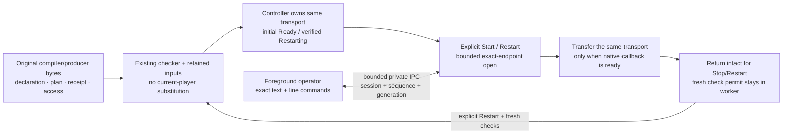
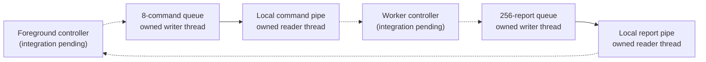

# From checked originals to explicit playback

**Status: M12b.2 implementation in progress.** The merged
[M12b.1 foundation](installation-native-foundation-v1.md),
[#403](https://github.com/giodl73-repo/REEL/pull/403), supplies metadata and
callback ownership. This document maps the remaining native session boundary.
It does not qualify a playback command, terminal or actual audio endpoint.
The [M11 limits](offline-installation-v1.md) remain authoritative.

## Private invocation, existing programme

`reel.installation-session.v1` is a private invocation request, not another
authoring, storage or programme manifest. Its maximum encoded size is 16 KiB.

| Field | Meaning |
| --- | --- |
| `edition_id`, `passes` | Exactly one original edition; one to three passes. |
| `original` | Exact FileRefs for declaration, plan, production receipt, optional processing policy, access manifest and retained original compiler/producer bytes; explicit source/candidate/access roots. |
| `playback` | Separate retained executable FileRef, independently bound source commit/Cargo.lock context and pinned CPAL version. A declared build context is not an inferred source attestation. |
| `endpoint` | M12b.1's exact private profile/device/build/driver/configuration binding. Shape validation does not probe it. |

Never fill the original compiler identity from the current player or from the
receipt being checked. Original runtime bytes may have been produced on another
platform: retain and hash them without executing them or demanding a Windows
executable suffix. Only the actual native player/worker is an executable binding.

The source loader holds mandatory Windows file and parent-path guards using the
existing runtime protection primitive. Metadata is read under its exact pin;
providers retain the corresponding guards for source/candidate/access reads.
They reject changed roots, conflicting pins, missing/case-mismatched names,
escapes and excessive inputs. Each provider admits at most 128 held files / 64
MiB; no source lookup, cache initialization, restoration or fallback is added.
Unsupported guarding refuses rather than claiming cooperative native custody.

`SessionRequest::check_originals` is an explicit read-only source operation.
Its counts-only result distinguishes checked original runtime bytes and guarded
reads from **unchecked** playback build, host, endpoint and device playback. It
does not open the declared player, probe a device or create a success artifact.
Original checking stays within one aggregate 30 s cooperative deadline.

The CLI exposes `validate-session <private-request.json>` for shape only and
`check-session <private-request.json>` for those original checks. Neither
command is playback. Protected original file checking currently requires
Windows; unsupported platforms refuse rather than reporting protected reads.

Fresh checks still run before transport creation and restart. Once their seals
match, Prepared and Transport share the same frozen sample/text allocations;
the active session does not retain a second identical playback PCM buffer.

## Ownership before and after native readiness

The controller must retain the actual transport while native probe/open/play
is pending. An output callback can submit zeros before receiving the transport;
only explicit Start may create that stream. After native readiness, transfer
the same object once. A startup Stop can therefore update the real transport
without waiting for a blocked native call or losing the context needed for an
explicit later Restart. Late native completion cannot acquire a cancelled box.

The source-check port now owns LoadedProgramme and Prepared on a dedicated
thread for the session. Guarded load, initial preparation and fresh seal checking
share one absolute deadline of at most 30 seconds. The returned Ready transport
uses the Run origin, so setup counts toward its 120-second lifetime. Restart
tickets and permits move through bounded in-process queues; they are never JSON
or another authority inferred from an observation. Event reception checks for
cancellation/expiry again to reject a success queued just before cancellation.
The actual transport independently rejects an otherwise checked permit after
Stop or a generation change. The source port opens no endpoint and does not
qualify the distinct playback executable or host. Its destructor joins the
source thread and retained guard destruction; complete process containment is
still required to handle a blocked OS operation.

While active, M12b.1's callback owns the sole source/interval clock. Stop,
Restart, completion or failure must return that object before replacement.
Neither a private wire status nor a deserialized success flag creates a restart
permit. Prepared and the opaque ticket/permit exchange stay in one native
worker; original checking and native open/drop stay off the control/callback
threads. A failed native cleanup remains a failed profile, not a timer success.

## Controller and operator obligations

### Private local channel

The low-level channel now uses two distinct one-way Windows named-pipe file
objects. A blocked read therefore cannot serialize an unrelated write on the
same synchronous handle. Its owned reader/writer threads exchange bounded
packets; controller/callback code only polls queues. The dotted links below are
the **still-pending session integration**, not an implemented Run command.

The server creates a cryptographically random 16-byte run context and derives
both local pipe names from it. There is no caller-selected path/remote host.
Pipes reject remote clients, require first-instance creation and use a protected
DACL containing only the current process user's allow entry. The OS-visible
pipe descriptor is checked in a native test. Clients request identification
security quality of service. Neither an invitation nor a peer-ID observation
grants programme, restart or release authority.

The server must verify **both** actual pipe client PIDs against the child PID
observed by the existing contained runner. The client checks each actual pipe
server PID against its invitation. A contained-child test exercises that exact
PID relationship with the retained test image; same-process tests additionally
cover bidirectional progress while readers are blocked. No caller-provided PID
file substitutes for the runner's held process handle.

Each frame is at most **8192 bytes total**, with this 40-byte little-endian header:

| Bytes | Meaning |
| --- | --- |
| 0–3 | `RIPC` magic |
| 4 | Private framing version `1` |
| 5 | Command/report direction |
| 6–7 | Payload length, 1–8152 bytes |
| 8–23 | Exact random run context |
| 24–31 | Per-direction sequence, starting at 1; no gaps/replay/wrap |
| 32–39 | Generation metadata; applicability still belongs to the session/core |

The reader checks the fixed header before reading its bounded body. A malformed,
foreign, duplicated, truncated or closed stream poisons that receiver; it cannot
resynchronize/reconnect with a later valid frame. Queue overflow is terminal.
Generation metadata is preserved, not treated as a restart permit or blanket
authority. The strict message/admission components below now bind that metadata
to commands; the complete session controller must connect them and obtain real
text-display acknowledgement. Raw framing success alone does not satisfy those
gates.

Shutdown repeatedly calls `CancelSynchronousIo` on the actual owned thread
handles until both threads finish, then joins them before dropping their I/O
resources. Repeating matters when cancellation races entry into a synchronous
read/connection wait. Controlled tests cover unconnected waits, blocked reads,
closed peers, unread pipe backlog and both queue limits. A two-second cleanup
success is reported only after those actual joins; a broken OS operation cannot
be relabeled successful by abandoning its thread/buffers. This port's cleanup
measurement does not replace the complete foreground/session cleanup deadline.

### Guarded runtime and message admission

`RuntimeBinding::bind` is an explicit blocking operation, separate from
`validate-session` and original-source checking. It pins the declared player,
requires that it is the current retained executable, and holds the declared
Cargo.lock file under native read/path guards. The lock bytes must match those
embedded in this compiled player. Expected request/image hashes are computed
from those actual inputs. The declared source commit remains a declared build
context, not an invented source attestation. Original compiler/producer identity
is unchanged and is still independently checked by the source worker.

Cloned admission contexts retain the runtime/lock guards, so dropping the initial
binding cannot make those files mutable while a gate is still using its hashes.
Binding this player does not read originals, probe an endpoint or admit playback.
A real test succeeds with the original declaration absent, then rejects a
byte-correct wrong player path and an independently pinned incorrect lock.

The private JSON bodies use strict tagged enums and reject unknown fields and
commands. They are bounded by the same frame limit:

| Direction / message | Required relationship |
| --- | --- |
| Worker `hello` → parent `authorize` | Both actual OS pipe peers, random run context, exact request hash and actual image hash agree with the held runtime/worker. Bootstrap is accepted once. |
| Worker `transcript` → parent `text_shown` | Exact admitted UTF-8 text/hash; acknowledgement names that same hash and at least 80×30 / UTF-8 input and output observations. Actual console measurement/display still belongs to the pending operator implementation. |
| Parent `control` | Canonical command, consecutive unique ID and nondecreasing complete-receipt counter within the Run clock domain. At most eight IDs remain outstanding until actual worker/core application or refusal. |
| Worker `ready`, `state`, `ack`, `ended` | Immutable bounded observations; snapshot generation agrees with the frame. They cannot deserialize or construct a transport, prepared programme or restart permit. |

Before text acknowledgement, Status/Quit remain admissible and other supported
controls receive an InvalidState refusal without advancing source state. Bad
context, malformed messages, replay or an exhausted command budget end admission;
the complete operator must present that failure and preserve its local
Status/Quit/cleanup behavior. No parsed acknowledgement by itself proves that
the console rendered the text or that the device played a frame.

Stateful commands now retain their expected generation through the callback's
queue and ownership return. The **actual core** checks it when applying the
command, after earlier queued commands may have changed generations. A stale
Pause/Resume/Start/Restart records StaleGeneration without changing state/cursors.
Stop/Quit/Status are run-wide safety controls and survive an old observed
generation. The controller must use this stamped path end to end and enforce
the same eight outstanding IDs across its UI/IPC/core buffers; multiple bounded
queues do not authorize additional unique commands.

These are implemented admission components, not the complete session loop.
Actual SourceWorker/OutputWorker orchestration, receipt-to-output deadlines,
parent report ordering and persistent-console proofs still gate the Run command.

### Real transport/output controller

`native::controller::Controller` now connects the actual transport owner to the
output backend. Its nonblocking tick drains callback observations, applies
stamped commands to the sole real core, and schedules native operations off
that thread. Construction creates no stream. The outer session still needs to
route authenticated messages, confirm actual display and deliver acknowledgements.

```mermaid
flowchart LR
    accTitle: The same transport moves through native output and restart
    accDescr: The controller retains the prepared core during native startup. A valid silent callback precedes handoff. Stop and restart return the identical core before physical close. A restart ticket goes to source checking; its checked permit is held through probing and consumed by the actual core immediately before opening.
    core["Controller owns real core"] --> ack["Actual command record<br/>Starting acknowledgement"]
    ack --> probe["Bound endpoint probe"] --> open["Owned native open"]
    open --> silent["Valid silent callback"] --> callback["Move same core<br/>into data callback"]
    callback --> returned["Return identical core"] --> close["Actual old-stream close"]
    close --> ticket["Opaque restart ticket"]
    ticket -.-> check["Source/runtime checking thread"]
    check -.-> permit["Stage checked permit"] --> probe
```

`Controller::drive_source` now connects the dashed checking links to the
retained source worker: it issues tickets only after actual close, cancels
obsolete checks and discards stale completions. The complete authenticated
session still needs to call that orchestration in its control loop.
`SourceWorker::with_runtime` supplies the source-thread path:
current-player/lock rechecks run alongside original checks, off the controller,
using the same absolute checking budget. The existing original-only constructor
retains its narrower scope and does not start validating a missing player.

Startup Stop/Quit updates the core while a native open is blocked and cancels
the operation. Late completion cannot attach that core. Restart tickets are
unavailable until the old stream actually closes. A checked permit is staged
through probing; the real core consumes it just before stream opening, so the
core's two-second open window is not spent on the preceding probe. The external
Start/Restart aggregate remains tied to complete foreground command receipt.

The controller also checks each pending command against that original receipt
with a 100 ms acknowledgement deadline, including while Paused. It checks before
consuming actual records or refusals, so a late arrival cannot erase the missed
deadline. Failure cancels startup and requests callback/native teardown; a late
actual acknowledgement may still be reported as history after the Fault notice.
It cannot clear the failure or authorize reopening. Status/Quit remain usable.
This is the controller-side gate; foreground display and IPC delivery still need
to enforce the same original receipt budget end to end.

Callback delivery records now carry fixed-size command tags and the actual
enqueue sequence/refusal. This prevents a rejected command during Fault from
stealing a later Status acknowledgement. The 16-entry delivery-record channel
does not expand the eight outstanding-command budget. Delivery overflow faults
before another source frame. Tags, overflow and actual ownership return are
covered by the isolated data-callback allocation check (tagged enqueue, report
overflow and actual return); delivery-overflow refusal has its own source-cursor
test. A refused pre-handoff
attachment may box its returned Callback off that data path.

The controller can report a watchdog failure immediately, then fault the actual
core when native teardown returns it. It does not invent a mutable core snapshot
while the callback owns the transport. Destruction joins actual output teardown
while keeping the callback return receiver alive; only then can ownership and
buffers be released. This join may block a broken driver and still belongs
inside the externally contained native worker.

Preparation/status/end message variants represent Checking/Fault before any
transport exists. They contain no fabricated Ready snapshot. Actual full-worker
routing, parent acknowledgement visibility/order, global command admission,
console behavior and process-wide cleanup deadlines remain required.

### Existing runner and output ports

The existing contained process runner now offers an explicit observer port.
It obtains the primary worker PID and peak working set from its own held process
handle, rather than trusting a child-written PID or message. `exit_observed`
means the runner observed that process handle signaled; a separate `Reaped`
event follows actual job shutdown and descendant-handle barriers. An observer
error cancels through the existing tree cleanup before the call returns. The
original `run_quiet` callers keep their existing path and incur no new process
memory queries. No second launcher, cache or telemetry store was added.

These observations supply the ownership facts needed for private-pipe peer
verification; that integration is still pending. They measure only the primary
process's peak working set. A zero/failed observation cannot qualify memory use,
and the session must still measure its foreground process and enforce the
combined 512 MiB envelope. Job committed-memory limits are a different metric.
The observer runs on the existing runner thread, whose 250 ms monitor cadence
cannot replace the session's 20 ms controller or 100 ms acknowledgement rules.

The Windows output port now implements explicit probe/open/close on one serial
backend thread. Construction opens no endpoint. Real opens resolve the bound
WASAPI endpoint again, request 480 stereo float32 frames at 48 kHz and check the
reported period plus every actual callback's whole-frame/2048-frame bound.
`play()` returning is insufficient: a valid silent callback must establish
readiness before the controller can attach the actual transport. Cancellation
also travels with the sink, so a late open cannot acquire it.

The application data callback records fixed-size atomic observations and actual
source-frame submissions, excluding pause, interval, fault and padding silence.
Its QPC clock shares the pinned CPAL WASAPI timestamp domain. A predicted output
timestamp remains a prediction. Closing reports completion only after the actual
stream is dropped; the port's destructor joins its backend thread. This can
block on a broken driver and therefore belongs inside the still-required owned
worker process. This port alone is not a contained foreground runtime.

Controlled-backend tests compare every float through variable callback sizes,
pauses in both source and interval, cancellation and oversized buffers. A separate
isolated allocator fixture covers the complete application data-fill wrapper,
including real report overflow and ownership return. It does not establish the
allocation behavior of CPAL internals, driver/error callbacks or teardown.
At 120 seconds the actual core stops; only Close may use the two-second cleanup
tail. Probe/Open cannot extend playback into that tail.

The session's 120 s lifetime starts at invocation, including preparation and
pauses. Initial checks share a 30 s budget; Start has a 2 s aggregate bound and
Restart has 35 s including old close, checking, probe and open. Stage limits do
not reset those aggregates. The 20 ms controller tick, 100 ms acknowledgement,
250 ms watchdog and 2 s cleanup limits remain unchanged.

Console/IPC work must not block that controller. The operator needs the actual
UTF-8 terminal geometry and exact original text before Ready/Start. Standard
line editing, echo and EOF/Ctrl+C must work while the checked transcript remains
visible above the status/input area. No raw terminal mode or text normalization.
Any proposed scrolling/display mechanism needs an actual Windows console test;
a simulated screen alone cannot qualify it.

The core's 256 diagnostic entries and callback's 256 transient report slots
serve different purposes. Native observations must be bounded too: retain
explicit aggregates and a declared sample of boundary/control records, without
claiming that a sampled timeline contains every callback. Physical capture
and device measurements remain M12c.

## Requirement/test map

One assistant applies Platform/Audience, Editor, Sound and Rights/Provenance
checklists. These are review lenses, not independent reviewers or approvals.

| Obligation | Named proof / status |
| --- | --- |
| Original and player identities remain separate | `native_original_check_preserves_producer_identity_separately_from_player`: real original programme checks, including a different CLI executable, pass with an unavailable declared player; a correctly pinned replacement producer still fails the original receipt relationship. Passed locally. |
| Guarded original reads and strict bounded invocation | `held_original_input_denies_mutation_and_rename_without_executable_requirement`, request-shape/cancellation/deadline and CLI cases. Passed locally. |
| Startup Stop retains the actual session | Native-ready handoff, Stop before first owned fill and cancelled blocked-open controlled-backend cases passed locally. Foreground/contained-process integration remains pending. |
| Callback teardown returns pending ownership | Drop-before-first-fill, queued Stop, completion, preempted writer and racing return cases passed locally. Actual native error/close integration remains pending. |
| Exact private wire context | Framing, actual peers, strict bodies, held runtime/request authentication and scope at actual core application passed locally. Whole-session orchestration, parent observation ordering and actual display proof remain pending. |
| Aggregate clocks and source verification cancellation | Source port shares the Run origin and one initial/fresh-check deadline; queued cancellation/expiry and real original rechecks passed locally. Complete foreground Start/Restart aggregates, Stop/Quit integration and blocked-operation containment remain pending. |
| Exact persistent text and line commands | Actual Windows console, Spanish cells, paste/scroll/resize, ordinary EOF/Ctrl+C, blocked I/O and bounded cleanup; pending. |
| Real contained lifecycle and unchanged PCM | Controlled native output port passed source/interval sample oracles, allocation/free, cancelled handoff, oversized period/buffer and actual mock-stream close tests. Actual contained worker/driver lifecycle remains pending. |

No complete M12b.2, actual playback, device/listening/usability or release claim
follows from these source/output ports. M13 still depends on full M12.

Latest controller/admission checkpoint: 73 unit cases, five CLI cases and ten
explicit original/runtime-input cases passed: **88 distinct focused cases**. The
original-input invocation ran with zero ignored cases; the five ordinary ignored
unit fixture entries are explicitly launched by their parent tests. These counts
do not include duplicate reruns. The real source-worker integration retains
original file guards through Ready/rechecks, releases them at actual teardown,
and proves that a genuine later recheck permit cannot revive Stop.

At ownership return, an atomic writer/return handshake prevents a newly accepted
command from being stranded in the old callback queue. A busy writer defers
the move without blocking `fill`; late commands already accepted move in the
actual transport's core queue. Later sends receive a typed, nonfatal returned-
owner refusal so the controller can apply them locally. Teardown also returns
the same box before a first callback. Only teardown, off `fill`, may wait for a
preempted writer; its complete native cleanup still needs the contained worker.

Each report retains at most eight actual command records/refusals, selecting
the first command record for a sequence rather than a later media event with
the same sequence. Report capacity is checked before copying source frames:
overflow silence cannot advance the submitted-source cursor. The isolated
allocator fixture exercises this actual overflow with one-frame callbacks.
