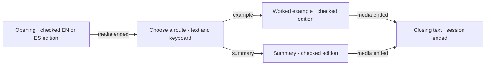

# Authored branches for spoken programmes

M13 design draft on stacked parent `a73f3a9bdde11318e09d5b41f31fe779d8eb9a46`.
The [PR plan](media-expansion-pr-plan.md) requires merged M12 evidence before
final checks and merge. This draft records contract decisions and test oracles.

## One route, two language editions

A graph declares its entry and names three kinds of node. A playback node
binds one checked programme selection for each supported language. A choice
node supplies ordered, authored text choices. An end node supplies the
authored closing text and releases the active playback session.

The graph owns order, choice labels and links to upstream selections. The
programme owns the words, performance, editorial assembly and timing. A node
reference names the edition, selected module, exact checked programme artifact
and access artifact. A module is playable only when the checked selection
provides exact media bounds and corresponding access text. A companion may
bind the same edition and selected span through its existing receipt.

Each language's selection remains exact. Missing Spanish source or access
fails Spanish admission. The runtime never translates choice labels, falls back
to another edition or interpolates timing across languages.

Use the existing [spoken programme checker](../src/spoken_programme/checker.rs)
for edition and module evidence. Its `verify_access` checks both the access
manifest and the exact source transcript before setting `access_checked`.
For retained input, use the [reopened history evidence](../src/spoken_programme/history/retained.rs)
and keep its verified object guards live for media consumption. A summary
counts verified items. The admission fixture must compare the selected edition,
module, bounds and access binding with the checked records themselves.

## Entry, exit and loops

| Node | Enter | Leave |
| --- | --- | --- |
| Playback | Verify selection and access, initialize its local media position and assign a new playback generation | On confirmed media end, take the declared completion edge and release the outgoing transport |
| Choice | Present the ordered choices in the session language, using the same IDs for text commands and keyboard operation | On one enabled choice ID, take its declared edge |
| End | Expose the closing text and finalize the local session | An explicit new session begins at entry |

Every playback node has one completion edge. Each choice ID uniquely selects
one edge from its node. End nodes have no edges. Every edge names an existing
target. Unreachable nodes, missing targets, empty choices, unused labels and
incompatible edition bindings are validation failures.

An authored repeat declares an edge traversal limit. Validation removes those
bounded repeat edges and checks the remaining graph for cycles. It also checks
that each reachable choice still has an exit after its repeat budget is
exhausted, and that each reachable path can terminate. A repeat edge returns to
a node that is also reachable through the ordinary route. An exhausted repeat stays
disabled until a new session. Failure to load, check or play a selection
stops that session visibly, preserving the failed node and source reference for
local diagnosis.

## Interaction and playback clocks

The interaction reducer consumes a monotonically ordered event stream. Each
accepted event names the current node instance. Media observations also name
their playback generation. A late event from another node visit or generation
cannot traverse the graph. For a simultaneous completion and input, the
runtime orders confirmed media completion first and then evaluates the input
against its original node instance. No timer guesses a media boundary.

For the local demo, the choice surface presents the authored labels in order
and exposes the same stable IDs to text entry. Keyboard focus moves through
enabled choices in authored order, and activating a focused choice submits its
ID with the current node instance. For example, `summary` selects the same edge
whether the listener activates “Summary” in EN, activates “Resumen” in ES, or
enters the ID as text. An exhausted repeat stays visible as disabled. Invalid
or stale input leaves the active choice available and produces visible feedback.

Each playback node uses the checked edition's local media clock. Pause holds
the cursor. Resume continues from that cursor. Seek, when admitted by the
selected runtime, stays inside the node and moves associated text or companion
position on the same clock. Entering a node through another edge starts its
declared entry position again. Graph navigation and source seeking are distinct
actions.

Language is selected at session entry. Changing language starts a fresh
session at entry using the selected language's checked bindings. Session state
is local and in memory, including node instance, playback generation, chosen
language, local cursor and repeat counts. Closing the runtime drops it.

## Validation and replay oracles

| Input | Expected result |
| --- | --- |
| Authored example choice in EN and summary choice in ES | Each route selects its matching checked edition and reaches the closing node |
| Dangling target or unused node | Validation identifies the exact offending edge or node |
| Unbounded cycle, duplicate choice ID or exhausted repeat with no exit | Validation refuses the graph |
| Edition identity, language, module span or access binding differs | Admission fails before playback starts |
| Playback ends while an old-generation event is pending | The reducer follows the declared completion edge once |
| Pause, bounded seek, Resume and a deliberate re-entry | Cursor stays inside the checked span and re-entry starts from the authored position |
| Keyboard and text choose the same ID | Both produce the same route and visible state |
| Identical input trace replayed with the same checked originals | Node visits, selected editions and media-relative event placements agree |

### Completion and repeat trace

Add a `repeat-opening` choice from `choose` to `opening` with a limit of one.
For this fixture the checked opening begins at 100 ms in EN and 200 ms in ES,
with confirmed end positions of 900 ms and 1,300 ms respectively. Run the same
logical trace separately with each language's positions.

| Ordered input | Expected session state |
| --- | --- |
| Begin and pause during the opening | Visit 1 is paused on generation 1 at the observed local position |
| Seek to the checked entry position and resume | Visit 1 resumes on generation 1 at 100 ms in EN or 200 ms in ES |
| Confirm end and submit an input addressed to visit 1 at the same boundary | Completion enters `choose` at visit 2 before the visit 1 input is evaluated and discarded |
| Select `repeat-opening` at visit 2 | Visit 3 begins on generation 2 at its language's checked entry position and consumes the repeat budget |
| Deliver another end observation from generation 1 | Visit 3 remains active |
| Confirm end for generation 2 | Visit 4 presents `choose` with `repeat-opening` disabled |
| Submit `repeat-opening`, then `summary` at visit 4 | The first input leaves visit 4 active and the second enters `summary` at visit 5 |

Record the node visits, admitted editions, accepted local positions and
ignored stale events. Compare those fields across two replays in the same
language. Check the selected media positions against the separate EN and ES
bindings when comparing across languages.

The first M14 fixture uses two choices, both languages and deliberately unequal
edition durations. Role checks apply the Story and Editor lenses to authored
order and endings, Platform/Audience to keyboard and exact text access, Sound
and Vocal Adaptation to edition clocks and upstream text, and Rights/Provenance
to exact artifact authority and local custody. Human listening, usage and
release approval require their own evidence.

The local `interactive_branch_contract` test fixture exercises the graph
shape, including missing targets, unreachable nodes, ambiguous choices,
cycles and language coverage. The `interactive_branch_admission` fixture
uses separate synthetic programme and access identities and unequal EN/ES
spans. It rejects mismatched identity or span, missing editions and
ambiguous checked records. The spoken programme media suite also feeds the
admission fixture the existing checker's results for synthesized fixture PCM
and verified EN/ES transcripts. Final M13 still needs this binding at the
branch entry point after its merged dependency is available.
