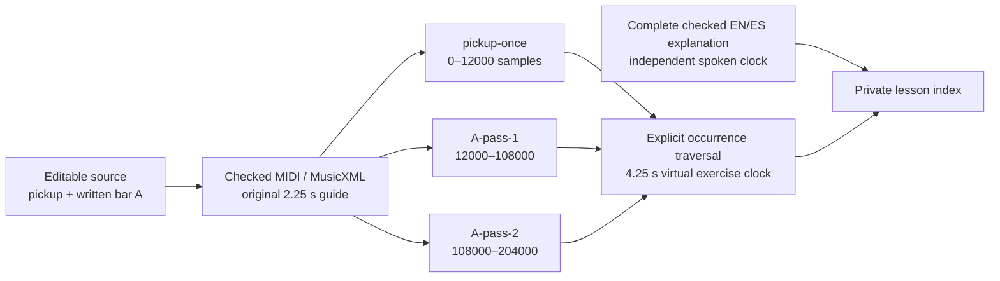

# Source-bound lesson and rehearsal package

**Status:** M09 implementation under qualification on merged M08
`d48c42722bf33e2868653872c2fe5b5939f83796`, [PR #391](https://github.com/giodl73-repo/REEL/pull/391).
Its required CI passed in 22 minutes 33 seconds. M09 implementation has started
with the admitted score-input seam, lesson index and public synthetic fixtures.
Required full regression and hosted qualification remain incomplete.

The package connects an explanation, an editable score, checked notation exports
and a selected audio reference. A repeated passage has an explicit occurrence ID;
a canonical score tick alone cannot identify its position in an exercise.

## Reuse and the actual gap

| Existing interface | Reuse / boundary |
| --- | --- |
| `spoken_programme::reading::{prepare,check}` | Check the complete original EN/ES explanation package; preserve authored wording, original audio recipes and its own chapter clock |
| `reel_music::model::{load,validate}` | Validate immutable editable `reel.music-model.v0.1` data, source/analysis bindings, provenance and review declarations |
| `reel_music::export::{build,validate}` | Preserve exact model ticks, model identity and the original export plan |
| `music_score::{render,check}` | Reuse MIDI/MusicXML/guide production and round-trip checks; do not introduce a notation renderer/editor |
| `music_score::native_note_clock` and existing private `tick_to_sample` | Reuse the integer tempo/tick conversion; expose only the narrow validated clock operation needed by the lesson |
| `PianoVocalScore::pickup_ticks` / `InstrumentalScore::pickup_ticks` | Existing editable pickup and implicit short-measure support |
| `MusicModel::form` | Named, source-ordered tick ranges; this is not a repeat traversal or repeat-barline grammar |
| `tig_music_editor` / `tig_music_underlay` | Guarded raw model/lyric authoring bytes; explicitly not complete musical/source validation |

Source: `crates/reel-music/src/{model,time,export}.rs`, `src/music_score.rs`,
`src/music_sample_clock.rs`, [native score exports](music-score-export-v0.3.1.md)
and [sample-clock playback](music-sample-clock.md). The current export plan's
rehearsal guide is **48 kHz mono PCM16**, labeled timing/pitch rehearsal only.
It is not a spoken stereo PCM24 file or a performance master.

M09 adds a small authored lesson/traversal index, not a second musical model.
The repeat exercise points to the same immutable written section twice. It does
not imply that the current model/exporter engraves repeat barlines or that a
player has executed the exercise. Editable model authority remains upstream of
MIDI, MusicXML, SVG or PDF derivatives.

The score validator/export checker currently takes filesystem paths and opens
relative source/analysis bindings. The existing music editor's protected raw
captures do not establish that complete lineage/round-trip check. The native
production context also explicitly describes declared metadata, not executable
paths or availability proof.

**Input-boundary decision:** add a narrow bounded byte-callback seam to the
existing source/analysis/model/export validation and score checker as needed.
Reuse their algorithms and preserve the old filesystem APIs. Original authored
names select exact admitted bytes; a refused provider is terminal even if a disk
file exists. Do not rewrite paths, create a filesystem projection/cache engine,
or duplicate the score validator. Unsupported absolute/outside references refuse
under the selected profile. Record the precise callback interface and byte/cap
tests before its first runtime fixture; no production adapter adoption is implied.

The seam is `reel_music::validation_inputs::ValidationInputs::admitted`, borrowing
`FnMut(&Path) -> Result<Vec<u8>>`. It captures each original relative name once
per operation, at most 32 objects, 1 MiB each and 16 MiB total. The host retains
its byte guards. `source`, `analysis` and `model` expose `load_with_inputs` and
`validate_with_inputs`; `export` additionally exposes `build_with_inputs`.
`music_score::check_with_inputs` uses the same reader for model lineage and the
actual packet. Legacy entry points select filesystem mode explicitly. Admitted
mode rejects semantic imports and lyric/lead-sheet/piano-vocal layouts in this
initial instrumental profile before those filesystem-only paths can run.

## Two independent content clocks

The complete checked explanation edition retains its spoken programme clock.
The music example has a separate source-score clock and a virtual exercise clock.
There is no implicit speech trimming, adjacency change, mixing, resampling or
automatic interleaving between them. A different spoken selection goes through
the original edition compiler and checks.

An authored `reel.lesson.v1` request will bind:

- the original reading index/edition identities and their admitted check inputs;
- the editable score, source/analysis context, export plan, receipt and actual
  checked MIDI/MusicXML/reference-guide objects;
- explicit PPQ, tempo/meter and reference-audio rate/channel/encoding policy;
- written section IDs, ordered unique occurrence IDs and source tick ranges; and
- anchors naming an occurrence, source section/note and exact source tick.

The generated private `reel.lesson-index.v1` index records those immutable
relationships and resolved source/exercise sample ranges. Portable summaries
contain counts and fixed flags, omitting titles, texts, note/source identities,
paths, private hashes and authority names. Musical/voice/language authority,
listening, device playback, selection, release and adoption remain separate.
The implementation is `spoken_programme::lesson` behind the `print` feature:
`prepare`, `produce` and `check` borrow the checked reading context and an explicit
asset provider. The request supplies the closed score-file namespace, independent
model contract pin and selected explanation editions. Each selected language has
an original UTF-8 instruction file and a separate pinned scope declaration;
these instructions are not described as performed words.

## The required pickup and repeat example

Use a tiny explicit editable one-part instrumental exercise, a short pickup and
one full 4/4 bar A, plus original EN/ES explanation text. These are public
engineering fixtures. Preserve actual source/analysis/provenance declarations;
do not invent a human correction, composer decision or listening approval.

Baseline: PPQ 480, 500000 microseconds per quarter, 48 kHz reference audio.
Every source tick is exactly 50 samples. The written source is 2160 ticks /
108000 samples / 2.25 seconds. Its pickup is the initial implicit short measure.

| Exercise occurrence | Written ticks | Reference source samples | Exercise samples |
| --- | --- | --- | --- |
| `pickup-once` | [0,240) | [0,12000) | [0,12000) |
| `A-pass-1` | [240,2160) | [12000,108000) | [12000,108000) |
| `A-pass-2` | [240,2160) | [12000,108000) | [108000,204000) |

The exercise is an explicitly declared 204000-sample / 4.25-second traversal;
the original 108000-sample reference remains unchanged. At canonical tick 720,
the source position is 36000 samples. It resolves to exercise sample 36000 in
`A-pass-1` and 132000 in `A-pass-2`. Omitting the occurrence ID is ambiguous and
must refuse. Playback, loop-boundary sound quality and playable engraving are
not established by writing this index.

Frame conversion follows the existing native guide's positive nearest-frame,
halves-up policy using integer arithmetic. Compute a source anchor on its
original absolute score clock, subtract the checked source interval's start,
then add the occurrence's exercise start. Sum the lengths of those exact source
sample intervals; do not accumulate floating durations or silently reinterpret a
different rounding policy. Model quantization policy and playback-frame rounding
must remain explicit, separate concepts.

A second clock probe must exercise rounding: PPQ 960, tempo 500010 microseconds
per quarter at 48 kHz makes tick 1000 exactly 25000.5 samples, resolving to 25001.
This is a planned arithmetic oracle, not executed evidence. A contradictory
timebase/rounding declaration must refuse rather than be guessed or normalized.

## Limits fixed before execution

The initial supported exercise profile is one instrumental part/voice, at most
32 notes, one constant tempo and 4/4 meter, an explicit pickup shorter than a full measure,
and no expressive-timing overrides or lyric adaptation. Reference audio uses the
existing 48 kHz mono PCM16 guide and contains at most 10 seconds. Allow up to
16 ordered occurrences, 64 anchors and 30 seconds of virtual exercise time.
Every range is nonempty, within its original source, and uses checked integer
arithmetic. No implicit repeat expansion or inferred note-to-word alignment.

Request/model controls are at most 256 KiB each, other declared metadata at most
1 MiB each, with at most 32 explicitly named score-context objects and 16 MiB
total score inputs/exports. The lesson index is at most 1 MiB and uses a maximum
30-second cooperative operation deadline. Trusted synchronous I/O must return.
Borrowed M08 checks retain their own declared provider/resource limits; these
lesson limits do not redefine those upstream contexts.
Instruction and scope-declaration objects are at most 64 KiB each, at most four
language pairs. The original reading index retains its upstream 4 MiB bound.
All written sections occur in source order; repeats are contiguous within their
section and the initial pickup occurs exactly once. Anchors may name an interval
endpoint but cannot point outside the named section or note. The guide reference
is an exact FileRef, separate from the virtual traversal duration.

Reserve a new output directory and publish the final index with the existing
owned no-clobber writer. Earlier indexes reopen with their original reading,
score and export providers. A changed note, pickup, tempo, wording, selected
reference or occurrence mapping stales the consuming index. Missing retained
bytes refuse without automatic restoration, selection, hydration or eviction.

## Required tests and checklist review

| Requirement | Independent expectation |
| --- | --- |
| Complete EN/ES explanation and real editable score/export bindings | Reopen the checked original reading package, model and actual MIDI/MusicXML/guide files; no diagram-only substitute |
| Pickup and two A occurrences | Hand-derived table above; unchanged source reference bytes, distinct occurrence identities and 204000-sample virtual total |
| Tick-to-sample conversion | Baseline 50 samples/tick plus the exact 25000.5 → 25001 rounding probe; compare native note clocks |
| Ambiguity and ordering | Missing/duplicate occurrence IDs, unknown source sections/notes, inconsistent pickup, reversed/outside intervals and contradictory timebase/rounding refuse |
| Stale/forged evidence | Changed model/audio/export/reading bytes or recomputed false receipts cannot replace original pinned controls |
| Failure/publication | Bounds and zero deadline, cancellation before final index, occupied output and retained-version reopening; no partial committed lesson |
| Privacy and side effects | Fixture-only canaries absent from summaries; failed provider lookup is terminal; no generation service, player, cache, upload or daemon starts |

Apply Platform/Audience, Score/Arrangement, Music Reconstruction, Vocal Adaptation,
Sound and Rights checklists, explicitly as one assistant's technical review.
The [pre-implementation checklist review](reviews/2026-11-21-m09-lesson-design-review.md)
records the input-boundary decision, source provenance and repeat-sidecar meaning.
The five focused lesson tests and three admitted-input tests pass locally; see
the review for exact cases and remaining checks. Musical/linguistic accuracy,
listening, device acceptance and actual authority remain separate and unperformed.
