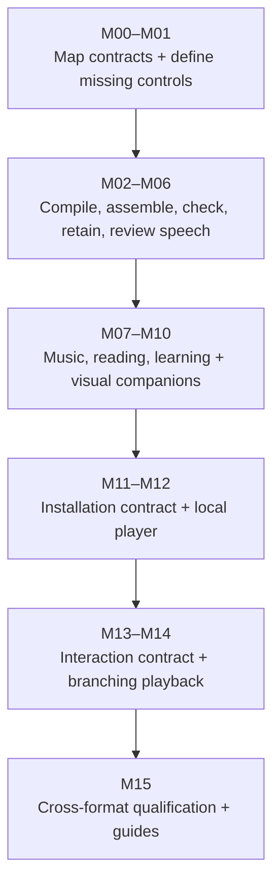

# Media expansion: phased PR plan

**Status:** active implementation sequence, started 2026-11-20. The progress
tables link actual revisions and evidence. Future acceptance criteria describe
required work; they do not themselves establish a passed gate.
It operationalizes the [format-expansion plan](media-format-expansion.md) and its
[six role-review findings](reviews/2026-11-20-spoken-plan-role-review.md).

The [test and evidence matrix](media-expansion-test-matrix.md) is part of each
PR's exit criteria. The [PR-plan role review](reviews/2026-11-20-media-pr-plan-role-review.md)
records the expectation/test gaps corrected in this sequence.

The first deliverable is a reusable spoken programme: three semantic modules,
two speaker roles, English and Spanish performances, and executive and technical
editions. Subsequent phases reuse that foundation for music, reading/learning,
visual companions, installations and interactive experiences.

## Rules for every PR

1. **One bounded outcome per PR.** Use the IDs below in titles and review records;
   they are planning IDs, not GitHub PR numbers. Start from current main in an
   isolated worktree. Do not modify the active comic/workflow lane or copy its
   unmerged contracts. Recheck its published status before choosing integration
   points. If a needed interface is unavailable, use an existing admitted port or
   stop that dependency with a precise gap record.
2. **Map before adding.** M00 must identify exact source modules, schemas, CLI
   surfaces, checkers and fixtures. Existing scene, cue, programme, publication
   and asset contracts remain authoritative for their supported scope. No new
   universal manifest, storage engine or scheduler. If an existing path satisfies
   a planned PR, submit its proof and documentation instead of duplicate code.
3. **Contract before execution.** Each runtime PR depends on a merged contract
   and failure policy. Schema changes are additive/versioned; existing fixtures
   and pinned contexts retain their meaning. No automatic migrations.
4. **Evidence before closure.** Each PR supplies its scope/non-goals, dependencies,
   requirement-to-test map, positive and rejection fixtures, exact checks run and
   review disposition. Use applicable `.roles` as checklists, identifying who
   actually reviewed; do not invent independent reviewers or approval.
5. **Small, relevant validation.** Run focused native Rust tests and relevant
   media/checker fixtures, formatting/lint checks required by the repository,
   `git diff --check` and required hosted checks. Keep fixtures short and bounded;
   the CI target is at most 30 minutes, not permission to remove required checks
   or a claim that CI optimization has landed. Split broad work instead of
   bundling unrelated production/render suites. Never cancel another lane's run.
6. **No hidden production.** Engineering fixtures use tiny controlled signals or
   admitted public/sanitized inputs. Real recording, provider egress, private
   source selection and delivery require the producing project's explicit scope
   and authority. Do not initialize caches, hydrate, render production media,
   upload, start services or delete assets as a side effect of planning/checking.
7. **Retain history.** Work through admitted git-asset interfaces; no private cache
   inventories or large media in Git. Never overwrite retained performances,
   contexts or editions. Reverting selection restores an earlier pointer; it
   does not delete later versions. No deployment, project cutover or release is
   implied by merging a REEL implementation PR.
8. **Stop on a failed gate.** Do not mark downstream work qualified while a
   prerequisite is incomplete. Fix an unresolved correctness/authority finding
   or explicitly rescope the dependent PR before merging it. Documentation must
   distinguish implemented, technically checked, listening-reviewed and adopted.

Every runtime PR must name runnable commands, expected results and the applicable
numeric limits/tolerances before implementation begins; see the test matrix.
Missing runtime coverage is recorded as **not run**, not a passing test.
Documentation-only rows use source/contract/fixture inspection and link checks;
they do not need a new test harness merely to repeat the prose.

## Sequence and checkpoints

The table gives merge order. Design notes and preparatory local tests with tiny
test-owned signals may use an exact, recorded stacked parent. They cannot qualify
a phase or authorize production execution. Final technical checks and merge wait
for the listed merged dependencies and run again on that parent. Every row starts **planned**.
An **in progress** entry links its branch/PR; a merged or qualified entry links the
exact revision and evidence. A phase checkpoint is a recorded conclusion, not an
additional approval role. Engineering dependencies refer to merged technical
evidence. Listening/device acceptance and project adoption are separate gates:
later controlled-fixture engineering may proceed without those decisions, but
cannot claim or inherit them for real performances or delivery.

| Phase | PR ID / bounded outcome | Depends on | Status |
| --- | --- | --- | --- |
| 0 — map | M00: reuse/gap map and fixture briefs | Current main | Documented in [PR #378](https://github.com/giodl73-repo/REEL/pull/378) |
| 1 — spoken core | M01: minimal edition/handoff contract | M00 | Merged [#379](https://github.com/giodl73-repo/REEL/pull/379), `f473431` |
| 1 | M02: edition planning and sample-clock compilation | M01 | Merged [#380](https://github.com/giodl73-repo/REEL/pull/380), `cc099b4`; required hosted checks passed |
| 1 | M03: bounded audio-only assembly | M02 | Merged [#381](https://github.com/giodl73-repo/REEL/pull/381), `a8b481b`; required hosted checks passed |
| 1 | M04: independent output check and accessible text | M03 | Merged [#382](https://github.com/giodl73-repo/REEL/pull/382), `c59b490`; required hosted checks passed ([CI](https://github.com/giodl73-repo/REEL/actions/runs/44881625182)) |
| 1 | M05: retained editions and selective invalidation | M04 | Merged [#383](https://github.com/giodl73-repo/REEL/pull/383), `027164f`; required hosted checks passed ([CI](https://github.com/giodl73-repo/REEL/actions/runs/44916089006)) |
| 1 checkpoint | M06: spoken fixture qualification and multi-cue coverage | M05 | Merged [#384](https://github.com/giodl73-repo/REEL/pull/384), `cef69f7`; required hosted checks passed; spoken checkpoint awaiting listening evidence |
| 2 — companion formats | M07: declared music/Sonic layers | M06 | Merged [#387](https://github.com/giodl73-repo/REEL/pull/387), `1db7679`; required [CI](https://github.com/giodl73-repo/REEL/actions/runs/44933453094) passed in 21m07s; [layer contract](spoken-edition-layers-v1.md) |
| 2 | M08: narrated reading package | M07 | Merged [#391](https://github.com/giodl73-repo/REEL/pull/391), `d48c427`; required [CI](https://github.com/giodl73-repo/REEL/actions/runs/44935951265) passed in 22m33s; [reading contract](narrated-reading-v1.md), [checklist/test map](reviews/2026-11-21-m08-narrated-reading-review.md) |
| 2 | M09: lesson/rehearsal package | M08 | Merged [PR #394](https://github.com/giodl73-repo/REEL/pull/394), `b95a6c2`; [contract](lesson-rehearsal-v1.md), [source/role/test review](reviews/2026-11-21-m09-lesson-design-review.md). Final required CI passed in 23m34s; assembly/source replay passed |
| 2 checkpoint | M10: semantic visual companion | M09 | Merged [#395](https://github.com/giodl73-repo/REEL/pull/395), `d7602b2`; [contract](semantic-visual-companion-v1.md), [role/test evidence](reviews/2026-11-21-m10-semantic-companion-design-review.md); final required CI passed in 16m48s, assembly/source replay passed |
| 3 — installations | M11: installation playback contract | M10 | Merged [#398](https://github.com/giodl73-repo/REEL/pull/398), `81be1db`; [profile](offline-installation-v1.md), [role/test map](reviews/2026-11-21-m11-installation-contract-review.md). Documentation-only CI passed in 16s; player/device gates remain open |
| 3 checkpoint | M12: single-device offline player | M11 | M12a checked transport under qualification in [bounded branch](https://github.com/giodl73-repo/REEL/tree/feat/media-m12-player); [scope/role/test map](reviews/2026-11-21-m12a-checked-transport-review.md). M12b native adapter and M12c actual device evidence remain required before M12 closes |
| 4 — interaction | M13: branching/state contract | M12 | Planned |
| 4 checkpoint | M14: bounded interactive player | M13 | Planned |
| 5 — qualification | M15: cross-format compatibility and illustrated guides | M14 | Planned |

## Phase 0: identify reuse before coding

### M00 — map contracts and pin the fixture

**Change:** write a source-backed reuse/gap matrix covering semantic modules,
speaker cues, selected performances, joins, edition identity, output checks,
retention and publication. Consult native scene/episode planning,
[cue-relative assembly](cue-relative-assembly-v0.1.md),
[prefix composition](programme-prefix-compositions.md),
[voice direction](voice-performance-v0.2.15.md),
[native publication](tig-publication.md) and the current asset SDK.
Prefix composition currently accepts exactly two complete source sets with no
caller trims/subsets/crossfades; it is not proof of arbitrary spoken assembly.

**Required evidence:** exact symbols/files and supported limits; reuse/extend/new
decision per requirement; proposed checker boundaries; concrete fixture scripts
and delivery briefs. Use an original short explanation, three modules
(host opening / expert detail / host closing), EN/ES and four editions. Name two
speaker roles, context dependencies, target duration ranges and output/mix/text
requirements. Choose deterministic signal fixtures for automated tests; keep
them distinct from speech/listening evidence. Enumerate scope exclusions.
Pin the core test inventory, commands, tool/platform matrix, duration/resource
caps, sample/channel policy, timebase/rounding and numeric mix/quality thresholds.
Give each expected result an independent oracle; no unresolved threshold may be
deferred into M03/M04 execution. M11/M13 similarly pin later runtime profiles.

**Exit:** every M01 requirement has an existing owner or a bounded missing
behavior. No code, generation, cache changes or production output in this PR.
Review lenses: Editor, Sound, Platform/Audience, Vocal Adaptation, Rights, Story.

## Phase 1: reusable spoken programme

### M01 — define only the missing edition and handoff controls

**Change:** using M00's map, specify ordered module/version selections,
language/audience variants, stable speaker roles, context dependencies, selected
take/alignment identity, protected intervals, and explicit handoff policy.
Distinguish recorded silence, added pause and intentional overlap. Specify
integer sample timebases, rounding, incompatible-input rejection, output closure
and review bindings. Reuse existing controls; version any necessary extension.
Represent multiple speaker-scoped cues inside a module from this contract onward;
M06 adds a qualification fixture, not an unplanned schema change.

**Exit:** schema/contract fixtures accept all four declared combinations and
reject unknown/duplicate IDs, unresolved required context, stale source links,
invalid intervals and undeclared overlap. Separate script, as-performed evidence
and translation/correction authority. No audio execution or provider integration.
Review lenses: Editor, Sound, Vocal Adaptation, Rights, Story.

### M02 — compile the four editions without media execution

**Change:** resolve explicit inputs and compile placements, handoffs, duration,
consumed-source identities and transcript/chapter placement instructions. Keep
English/Spanish performance clocks independent. Diagnostics identify the failing
module/cue/join. Compiler output does not imply that audio bytes were checked.

**Exit:** golden plans for four editions; exact sample arithmetic and deterministic
ordering; retained breaths/tails; distinct host → expert → host and host → host
joins. Reject missing/extra inputs, invalid protected-region trims, stale markers,
unsupported timebases and out-of-scope reuse declarations. No file discovery,
hidden time stretch, provider execution or dummy picture dependencies.
Context tests enforce authored dependency declarations; they cannot prove factual
truth or infer a missing qualification. That remains source/story review.
Review lenses: Editor, Sound, Vocal Adaptation, Rights.

### M03 — assemble bounded audio-only candidates

**Change:** consume the compiled recipe with the admitted native execution path.
Declare decoding/conversion, sample/channel policy, gain/fade envelopes and all
scratch/output limits. Preserve original takes. Publish a candidate atomically
only after required structural checks; use new output locations.

**Exit:** short controlled signals prove exact placement, added silence versus
recorded silence, protected intervals and explicitly permitted overlaps. Compare
decoded output against an independently calculated expected signal, including
boundaries and unchanged regions. Reject changed inputs, unsupported formats,
resource overrun and interrupted output without a usable final package. No
speech generation, storage-engine changes, music beds or visual renderer.
Prove neutral lossless assembly first. Container and decoded-signal identities
are separate; encoded-byte equality is not a cross-platform audio oracle.
Review lenses: Sound, Editor, Rights.

### M04 — independently check outputs and produce matching text access

**Change:** checker reopens the candidate and verifies input/runtime bindings,
sample count/placements, output identities and declared processing. Produce
speaker-aware transcript and chapter data from that exact edition clock;
include relevant non-speech information without exposing private voice identity.

**Exit:** all four editions have matching audio/text/chapter packages. Tampering
with audio, order, offsets, text, speaker mapping or source/runtime bindings is
detected. A self-consistent producer receipt alone cannot pass. Check language,
word fidelity evidence and time bounds separately; automated checks do not prove
naturalness, translation correctness or consent. No public upload or UI player.
Tamper tests must also recompute superficial receipt hashes after altering a
placement/source reference, so rejection exercises semantic/media checks.
Review lenses: Sound, Platform/Audience, Vocal Adaptation, Rights.

### M05 — retain editions and prove selective change propagation

**Change:** connect checked candidates and exact consumed-source relationships
to existing admitted asset/publication/history interfaces. Keep runtime pins and
source selections sufficient to reopen the earlier context. No global cache or
custody refactor; if SDK behavior is missing, track it upstream in git-asset.

**Exit:** replace only Spanish technical-detail take v1 with v2. Only the Spanish
technical recipe changes; both executive recipes and English technical recipe
retain their consumed identities. Reopen/check v1 with its original pins. Changes
stale only affected review bindings. Inject missing retained input and stale
review cases and report them honestly; no automatic restoration or deletion.
Check consumed-recipe identity separately from an aggregate fixture index or
selection log: the latter may change while an unaffected edition remains exact.
Review lenses: Editor, Rights, Sound.

### M06 — qualify the spoken slice and add within-module speaker coverage

**Change:** add a small multi-cue module exercising two speaker roles inside it,
using the same contracts. Demonstrate reuse at cue/module boundaries and the
changed adjacency when detail is omitted. Assemble a reproducible review pack
for the original four-edition fixture, with exact versions and measured durations.

**Exit:** technical evidence covers all acceptance cases in the parent plan,
including negative cases. A real spoken demonstration additionally needs scoped
source/voice authority, actual per-language word checks, full-programme/transition
listening and explicit selection decisions. If those inputs or decisions are not
available, merge only the demonstrated engineering scope and leave the spoken
checkpoint **awaiting listening evidence**. Do not promote later delivery claims.
No new TTS engine: any authorized recording uses existing admitted adapters.
Review lenses: all six spoken-plan lenses; record unresolved findings explicitly.

## Phase 2: additional authored packages

These PRs may begin engineering after M06's technical evidence. Any reuse of real
performances still depends on their own authority and listening decisions; an
unfinished listening checkpoint cannot be inherited as a pass.

### M07 — add declared music and Sonic layers to spoken editions

**Change:** bind selected music/effects to authored semantic events or the
appropriate audio-event clock, with explicit gains, envelopes and dialogue
priority. Use existing mix/stem contracts. Music generation, stem reconstruction
and new arrangements are outside this PR.

**Exit:** one short bed plus one event effect follows the correct language-local
edition clock. Check decoded mix/stem expectations, tail policy and clipping;
reject stale events, undeclared overlap and missing source scope. A revised bed
changes the mix identity without changing selected dialogue takes. Listening
checks intelligibility. Lenses: Sound, Editor, Rights; music lenses if actual
reconstruction or arrangement is proposed, requiring a separately scoped PR.

### M08 — package a narrated reading edition

**Change:** bind a small approved manuscript/parallel-text source to the selected
audio edition, transcript and chapter/navigation references using existing
[print collection](native-print-collections.md) and edition interfaces.

**Exit:** EN/ES text stays source-ordered and independent of recognition evidence;
one text/audio change invalidates the affected package. Reopen an earlier package.
Reject mismatched chapter IDs, stale language/text hashes and audio-only dangling
visual references. This is an authored package, not EPUB support or an audiobook
store integration. Lenses: Story, Editor, Vocal Adaptation, Platform/Audience, Rights.

### M09 — package a lesson or rehearsal example

**Change:** compose a small lesson from explanation, selected reference audio and
editable score/songbook references. Preserve corrected-model
authority and explicitly declared musical timebases/anchors; PDF is a derivative.
Use existing notation/underlay exports rather than inventing a score editor.
The required fixture includes a tiny explicit editable score with a pickup and
repeat traversal, plus a text explanation and selected reference audio. A
diagram-only lesson does not satisfy the score/songbook coverage in this PR.

**Exit:** a source-bound lesson index connects the correct text, score/diagram
section and audio interval. Validate anchor ordering, repeat/pickup policy and
sample/musical-clock conversions; reject ambiguous/stale mappings. Actual musical
and language accuracy need the relevant human decisions. No automated grading,
inferred pedagogical approval or new musical arrangement. Lenses: Platform/Audience,
Score/Arrangement, Music Reconstruction, Vocal Adaptation, Sound, Rights.

### M10 — derive a semantic visual companion

**Change:** one admitted SVG/diagram/cel companion consumes the spoken edition's
authored events and measured phrases through existing browser/scene adapters.
Keep audio-only production independent; picture requirements belong to this
companion target. Add caption/text access appropriate to the target.

**Exit:** two phrase-triggered transitions resolve independently in EN and ES;
a replaced take updates consuming picture/text timing while retaining authored
event intent. Check frames/samples and accessibility requirements. Reject stale
alignment and missing visual sources. No inferred transparency: overlays require
an explicitly compatible alpha source and derivation evidence. Lenses: Animation,
Story, Editor, Sound, Platform/Audience, Vocal Adaptation, Rights.

## Phase 3: exhibition and installation delivery

### M11 — specify installation playback before implementing it

**Change:** define one single-device, offline installation profile: selected
checked programme, display/audio configuration, loop boundaries, startup,
pause/resume, failure/restart policy, retained runtime/source versions and local
operator controls. Define accessible text/alternative access for its real context.

**Exit:** contract examples cover normal completion, loop join, missing media,
incompatible device/output and interrupted playback with explicit safe behavior.
No multi-device synchronization, hardware acquisition, daemon or deployment.
Lenses: Platform/Audience, Editor, Sound, Rights; Animation for visual output.

### M12 — implement the bounded offline installation player

**Change:** add only M11's explicit local playback/control surface using the
chosen existing runtime or a narrowly defined adapter. It is started explicitly,
not during validation or repository setup.

**Exit:** deterministic state/clock tests and a bounded local demonstration show
start/loop/pause/resume/restart without silent source substitution. Missing media
and runtime incompatibility fail visibly. Device and loop/listening review remain
separate evidence; no unattended installation claim from a unit test. No fleet
manager, remote control service or automatic content delivery. Lenses: M11 panel.

## Phase 4: interactive delivery

### M13 — define authored branches and state

**Change:** specify a small finite graph of module/edition choices, explicit
entry/exit conditions, interaction versus media clocks, pause/seek/re-entry,
language choice and session-state policy. Keep text/source meaning upstream.

**Exit:** validate unreachable nodes, missing targets, undeclared loops, ambiguous
transitions and incompatible selected editions. Define accessible keyboard/text
alternatives and deterministic event ordering. No inferred narrative branch,
personalization service, learner tracking or new general workflow scheduler.
Lenses: Story, Editor, Platform/Audience, Sound, Vocal Adaptation, Rights.

### M14 — execute one bounded interactive story or lesson

**Change:** a local demonstration offers two authored paths and EN/ES selection,
reusing checked speech and companion packages. Consume M13's graph through one
explicitly selected runtime. Do not repurpose an installation loop as a branch
clock without its declared adapter.

**Exit:** replay the same input trace to reproduce the same route, source choices
and media/event placements; test pause/re-entry, language changes, end states and
missing branches. Check keyboard/text access and declared session persistence.
No analytics, automatic uploads, public hosting or arbitrary game engine.
Lenses: M13 panel plus Animation when pictures are used.

## Phase 5: qualification and presentation

### M15 — publish an honest cross-format support map

**Change:** update illustrated guides, capability/development status and linked
examples with the exact merged contracts and qualified scope. Add one compact
cross-format compatibility matrix, preserving historical references.

**Exit:** the same declared semantic source can be followed through its audio,
reading/lesson, companion, installation and interactive relationships without
conflating output identities or review gates. Link evidence for retention,
selective changes, failed inputs, accessibility and any actual listening/device
review. Label unperformed checks and project adoption explicitly. Full relevant
regression checks pass; diagrams and local links validate. No retroactive claim
that every project, device, language or musical work is qualified.
Review with all relevant `.roles`; unused lenses have an explicit scope reason.

## Progress record

For each PR, add a row below and update the sequence table. Use **planned → in
progress → merged / technically checked → listening or device reviewed (where
applicable) → project adopted** as separate recorded facts, not one readiness flag.
Skipped gates remain visible. A blocker records the exact missing interface,
input or decision and its owning project/lane; it does not justify widening the PR.
Record engineering/technical, listening/device, selection and adoption states in
separate fields. In particular, M06 can be technically checked while listening
remains not run; that is not a completed spoken-performance acceptance checkpoint.

| Planning ID | PR / exact revision | Evidence and review | Remaining gate |
| --- | --- | --- | --- |
| M00 | [PR #378](https://github.com/giodl73-repo/REEL/pull/378), merged `bee948e` | [Source map and review](media-expansion-m00.md); [fixture/test specification](media-expansion-spoken-fixture.md) | Technical planning complete; no runtime tests or listening performed |
| M01 | [PR #379](https://github.com/giodl73-repo/REEL/pull/379), merged `f473431` | [Contract](spoken-edition-v1.md); [checklist review](reviews/2026-11-20-m01-spoken-contract-review.md) | Full required hosted checks passed; media/authority remain unverified |
| M02 | [PR #380](https://github.com/giodl73-repo/REEL/pull/380), merged `cc099b4` | [Compiler contract](spoken-edition-compilation-v1.md); [checklist review](reviews/2026-11-20-m02-spoken-compiler-review.md); hosted run `44874211442` | Required Windows/Linux checks passed; media/listening/authority remain unverified |
| M03 | [PR #381](https://github.com/giodl73-repo/REEL/pull/381), merged `a8b481b` | [Producer contract](spoken-edition-production-v1.md); [checklist review](reviews/2026-11-20-m03-spoken-producer-review.md); hosted run `44879307969` | Required Windows/Linux checks passed; independent checking is M04; listening/authority unperformed |
| M04 | [PR #382](https://github.com/giodl73-repo/REEL/pull/382), merged `c59b490` | [Checker/access contract](spoken-edition-check-v1.md); [checklist review](reviews/2026-11-20-m04-spoken-checker-review.md); hosted run `44881625182` | Required Windows/Linux checks passed; acoustic fidelity/listening/authority remain unverified |
| M05 | [PR #383](https://github.com/giodl73-repo/REEL/pull/383), merged `027164f`, tested head `704cec7` | [Native retention contract](spoken-edition-history-v1.md); [checklist review](reviews/2026-11-21-m05-spoken-history-review.md); hosted run `44916089006` | Required Windows/Linux checks passed in 22m23s; no global custody, listening or project adoption claim |
| M06 | [PR #384](https://github.com/giodl73-repo/REEL/pull/384), merged `cef69f7`, tested head `d884463` | [Multi-cue clocks/pack](spoken-edition-qualification-v1.md); [acceptance trace and role review](reviews/2026-11-21-m06-spoken-qualification-review.md); hosted run `44918400598` | Required Windows/Linux checks passed in 23m32s; spoken checkpoint awaiting listening evidence |
| M07 | [PR #387](https://github.com/giodl73-repo/REEL/pull/387), merged `1db7679`, tested head `6ee8262` | [Layer contract](spoken-edition-layers-v1.md); [checklist review](reviews/2026-11-21-m07-spoken-layers-review.md); [CI](https://github.com/giodl73-repo/REEL/actions/runs/44933453094) | Required hosted checks passed in 21m07s; listening, authority and native mix retention remain separate |
| M08 | [PR #391](https://github.com/giodl73-repo/REEL/pull/391), merged `d48c427`, tested head `aee988c` | [Reading contract](narrated-reading-v1.md); [checklist review](reviews/2026-11-21-m08-narrated-reading-review.md); [CI](https://github.com/giodl73-repo/REEL/actions/runs/44935951265) | Required hosted checks passed in 22m33s, including five explicit reading tests on both operating systems; actual listening and PDF/device review remain open |
| M09 | [PR #394](https://github.com/giodl73-repo/REEL/pull/394), merged `b95a6c2`, tested head `550dffe` | [Lesson contract](lesson-rehearsal-v1.md); [checklist/test map](reviews/2026-11-21-m09-lesson-design-review.md); [CI](https://github.com/giodl73-repo/REEL/actions/runs/44947459345) | Final required CI passed in 23m34s; all five lesson tests explicitly passed on Linux/Windows; musical, listening, authority and device review unperformed |
| M10 | [PR #395](https://github.com/giodl73-repo/REEL/pull/395), merged `d7602b2`, tested head `3816901` | [Companion contract](semantic-visual-companion-v1.md); [role/test map](reviews/2026-11-21-m10-semantic-companion-design-review.md); [CI](https://github.com/giodl73-repo/REEL/actions/runs/44980260341) | 66 distinct local tests and all-feature Clippy pass; final required CI passed in 16m48s; six explicit companion tests on both OSs and two native cases on Windows; actual speech/listening and device review unperformed |
| M11 | [PR #398](https://github.com/giodl73-repo/REEL/pull/398), merged `81be1db`, tested head `711acf1` | [Installation profile](offline-installation-v1.md); [role/test map](reviews/2026-11-21-m11-installation-contract-review.md); [CI](https://github.com/giodl73-repo/REEL/actions/runs/44981748053) | Documentation-only CI passed in 16s with compilation/media jobs correctly skipped. M12 implementation and device/listening/authority gates remain unperformed |
