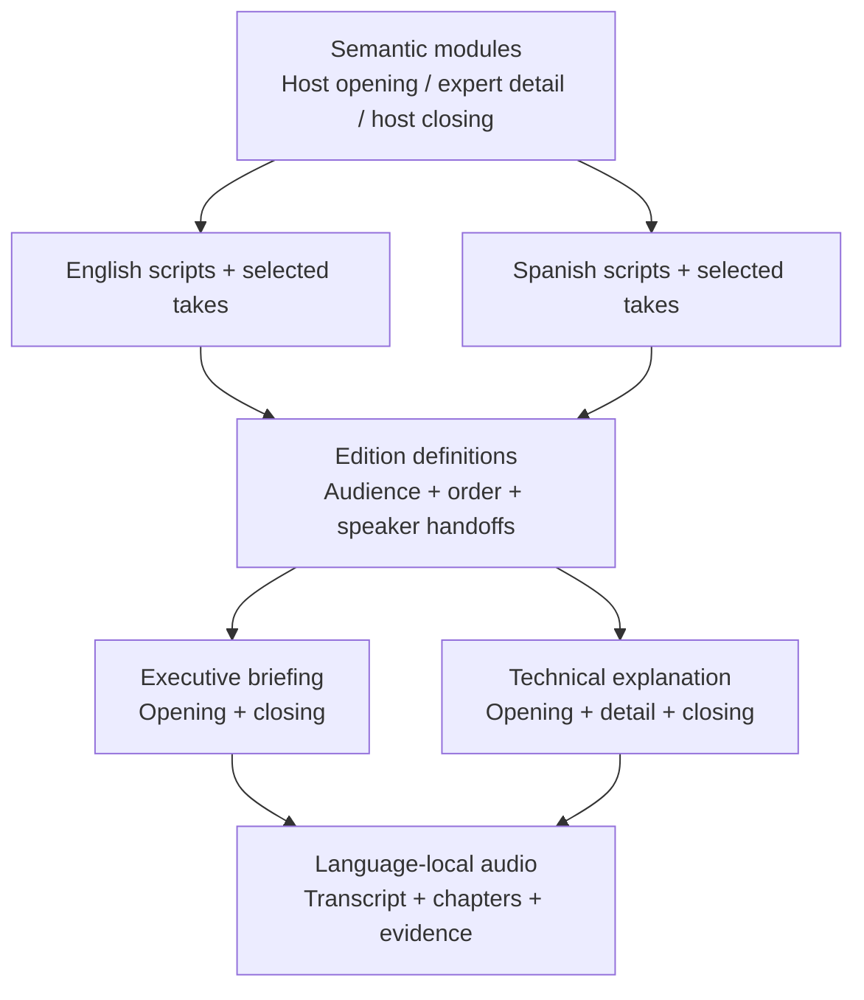

# Media format expansion plan

**Status:** planning record, requested 2026-11-20. No implementation, recording,
provider execution or project cutover is claimed by this plan.

The [role-checklist review](reviews/2026-11-20-spoken-plan-role-review.md)
records the planning gaps corrected below and the remaining production gates.

The [phased PR plan](media-expansion-pr-plan.md) defines the implementation order,
bounded scopes, acceptance/rejection cases and checkpoints across all four areas.

REEL's reusable foundation is authored meaning, semantic events, source layers,
versions and editions. Extend that foundation to additional delivery forms while
keeping content authority in producing projects and generic asset management in
[git-asset](https://github.com/giodl73-repo/git-asset).

## First focus: reusable semantic spoken content

The owner-selected direction is **programmatic spoken-word production**: author
reusable content units, then assemble different combinations for purpose,
audience, depth and language. A technical explanation, an executive briefing,
a narrated lesson and a spoken project update may share selected material while
remaining distinct editions with their own review and delivery identities.

### Content model to investigate

| Unit | Owns | Reuse rule |
| --- | --- | --- |
| Semantic module | Stable identity, communicative purpose, content/source authority and context requirements | Reuse the selected meaning/source version explicitly |
| Language/audience script | Exact authored words, pronunciation/delivery direction and adaptation authority | Translation and executive-summary wording are separately authored versions |
| Speaker-scoped cue | Stable cue ID, speaker role, exact language text and selected performance | A module may combine cues from several speakers; retain who speaks each cue |
| Performance | Selected recording, source-script relationship, measured word/phrase timing and voice scope | Reuse exact compatible takes; changed words or performances require their own evidence |
| Handoff | Previous/next cue, recorded breath/tail, authored pause or overlap and context | Recheck the actual adjacent speakers and language rather than applying one global gap |
| Edition | Purpose, audience, language, depth, ordered module/version choices, handoffs and sound/output policy | Compose a declared selection rather than silently rewriting a master |
| Delivered result | Exact audio, transcript/chapter clock, source/runtime lineage and target relationship | Keep each edition and previous selection independently addressable |

These are planning concepts, not new serialized schemas. First map them to
existing cue, scene, composition, publication and asset contracts. Add the
smallest missing reusable behavior in REEL rather than inventing another timing
or storage system.

### Illustrative combinations

| Edition | Selected modules | What differs |
| --- | --- | --- |
| Executive / English | Opening → concise conclusion | English performances and a short outcome-focused sequence |
| Technical / English | Opening → technical explanation → concise conclusion | Additional detail with declared joins and chapter positions |
| Executive / Spanish | Opening → concise conclusion | Independently authored Spanish words, takes and timing |
| Technical / Spanish | Opening → technical explanation → concise conclusion | Spanish detail and its own complete edition clock |

Shared module names describe intent, not necessarily identical words. A common
opening can reuse one exact language-local take across the two audience editions
when it fits both contexts. A separately phrased executive opening is a distinct
script/performance variant. Reordering or omitting a module still needs coherent
joins, references and narrative review; recording fragments are not universally
interchangeable.

Declare each module's required context, factual qualifications and references.
An edition that omits supporting detail must still preserve the source claim's
meaning and uncertainty. Resolve missing dependencies with an explicitly authored
bridge or a different selection; reject an unresolved reference rather than
silently rewriting the source or implying an exchange that never occurred.

### Integrated speakers and natural pausing

Treat a speaker change as an authored conversational handoff. Stable speaker
roles map to explicitly selected voices/performers for each language and reuse
scope. Keep delivery direction and source identity consistent when combining
previously recorded cues from different speakers.

| Join | Intended treatment |
| --- | --- |
| Host opening → expert detail | Let the host's thought finish, retain its breath/tail, then place the expert's entrance with an appropriate handoff pause |
| Expert detail → host closing | Preserve the explanation's ending and give the host an authored response/reflective pause |
| Host opening → host closing in the executive edition | Review this new adjacency and its pause directly; do not inherit a gap or spoken reference to the omitted expert module |

Distinguish silence already recorded in a take from an additional assembly
pause, so joins do not accidentally double the silence. Pause policy should
reflect continuation, emphasis, response, interruption or reflection; timing can
differ by language, speaker and audience. Preserve declared breaths and tails.
Intentional overlaps need explicit placement, intelligibility/mix rules and
review. Fades, trimming and normalization must not silently clip words or breaths
or alter an immutable selected performance.

Naturalness requires listening across the joins, not merely checking that files
abut on a sample clock. Technical checks should expose cue entrances, gaps,
overlaps and protected regions so that review is concrete and reproducible.

Keep requested script, observed as-performed words, alignment/transcription
evidence and any approved correction distinct. Mark uncertain words explicitly.
Input text and successful alignment do not prove that the selected take says
every intended word; check pronunciation, stress and wording by listening in
each language before selecting a performance.

Semantic markers inside a spoken module can also drive cels, diagrams, captions,
Sonic or visual effects in a companion visual edition. The proposed audio-only
path should use the same declared content/performance relationships without
requiring dummy pictures.
Visual-only references such as "as shown here" must be resolved by the edition's
authored context policy. Narration-word markers and music/audio-event clocks
retain their existing distinct semantics.

## Existing foundations and potential applications

| Media family | Existing building blocks | Expansion to investigate |
| --- | --- | --- |
| Voice and sound | Speaker cues, selected takes, performance direction, word timing and mixing | Reusable multi-speaker programmes, audio drama, podcasts and audiobooks |
| Songs and albums | Generation/audition adapters, editions/repair, ordered masters and chapters | Reuse selected music in explicitly authored audio-programme editions |
| Scores and songbooks | Editable music models, notation/underlay, arrangement plans and score/print exports | Rehearsal/teaching packages with synchronized reference audio |
| Books and reading editions | Manuscripts, poetry, parallel text and supported PDF assembly | Narrated reading editions, multilingual lessons and companion materials |
| Graphics and presentations | SVG/browser compositions, editable titles and frame/event clocks | Exhibition sequences, narrated diagrams and installation delivery adapters |
| Interactive experiences | Source/event/edition models and browser-rendered visual sources | Interactive stories or learning experiences with an additional interaction runtime |

The table separates foundations from proposed applications. It does not claim a
complete podcast/audiobook product, installation controller or interactive-story
runtime. Comic/workflow development continues in its existing separate lane;
coordinate interfaces without changing that lane as part of this planning task.

## Proposed order

1. **Spoken programme editions:** prove semantic module reuse, language-local
   timing and executive/technical combinations through a bounded audio-only path.
2. **Learning and reading packages:** connect selected audio editions to existing
   text, captions, print and diagram contracts.
3. **Exhibition/installation delivery:** define target-specific playback,
   synchronization and recovery requirements around existing media sources.
4. **Interactive delivery:** define interaction state, branching, timing and
   accessibility contracts before adding an execution runtime.

## First bounded spoken-programme milestone

**Proposed fixture:** an original three-module explanation (host opening, expert
technical detail, host closing), with English and Spanish script versions.
Select one take per module/language when recording is explicitly authorized:
six performances can feed four audience/language editions. Use distinct host and
expert speaker roles, explicitly mapped per language. This fixture proves
between-module handoffs; multiple speakers within one module remain a later
case. Existing selected audio or controlled synthetic fixtures can exercise
engineering first; synthetic evidence must not
be described as a listening-reviewed real performance.

Before producing the fixture, author a delivery brief for each edition: audience,
purpose, target duration range, listening device/context, output format and
sample/channel policy, mix/loudness target, and accessible transcript/chapter
requirements. Choose concrete values in that brief rather than assuming one
podcast or video profile suits every use. Check the whole programme and its joins
on the declared listening setup; text access must retain speaker roles, relevant
non-speech information and edition-local timing without requiring pictures.

Before selecting or generating any take, record the actual text/adaptation and
speaker/voice authorities for its language, audience and reuse scope. Permission
to record one cue does not automatically authorize a new assembly or imply a
speaker endorsed its surrounding claims. Provider use additionally needs the
declared service/runtime, model/license, retention and outbound-transfer scope.
Keep private authority/voice details in governed local evidence; portable review
receipts follow REEL's privacy-safe contract. Listening acceptance, creative
selection, private delivery and public release retain separate decision records.

Acceptance for this slice:

- Inspect the source/edition model and plan all four combinations before output.
- Check each combination's context dependencies and factual qualifications;
  resolve or reject omissions and reordered references explicitly.
- Reuse exact opening/closing takes where compatible, preserving full declared
  words, breath/tail policy and sample placement without hidden time stretching.
- Compose the technical host → expert → host exchange with speaker-specific,
  language-local handoffs. Review the executive host → host join separately.
  Expose recorded silence versus added pause, intentional overlaps and protected
  word/breath/tail intervals; retain speaker identities in the transcript.
- Derive each edition's transcript/chapter timing from its actual selected
  performances and declared joins. Never copy English times into Spanish.
- Build and independently check audio without opening or inventing picture inputs.
- Exercise rejection cases: missing required context, stale script/take alignment,
  a trim through a protected word/breath/tail, an undeclared overlap, and reuse
  outside the declared speaker scope. The proposed producer must report the
  failing relationship and publish no final edition package for invalid input.
  These are future acceptance cases, not checks executed by this planning review.
- Change one language's technical-detail performance, then show that only its
  consuming technical edition updates. Executive editions and the other
  language's edition retain their consumed-source identity.
- Retain/reopen the earlier edition and source/runtime evidence using admitted
  asset interfaces; make no global custody or removal claim from this fixture.
- Review word fidelity, intelligibility, context/joins, mix priority, audience fit
  and source/voice rights through the applicable REEL checklists. Technical
  completion, listening approval, selection and delivery remain distinct.
- Bind listening findings and decisions to the exact edition, selected takes,
  scripts, handoffs and mix version. A changed bound input makes the affected
  review stale; untouched editions retain their existing evidence.

This plan does not choose a voice, generate speech, select private source text,
initialize caches, enroll a publisher or commit to a delivery service.

## Starting references

- [Voice and sound walkthrough](guides/voice-and-sound.md): selected takes,
  semantic timing and dialogue/music/effects layers.
- [Authored word triggers](authored-native-triggers-v1.md) and
  [audio-event clocks](audio-event-clocks-v0.1.md): preserve clock-domain meaning.
- [Voice-performance direction](voice-performance-v0.2.15.md),
  [cue-relative assembly](cue-relative-assembly-v0.1.md) and
  [speaker-aware presentation](speaker-caption-presentation-v0.2.9.md): inspect
  existing pause, speaker and protected-performance semantics before extending them.
- [Dialogue/score mixing](dialogue-score-mixing-v0.3.12.md),
  [sample-clock controls](tig-sample-clock.md) and
  [native audio recovery](tig-scene-audio-recovery.md): existing producer/checker
  mechanisms to examine; recovery of an old stem is not a new programme producer.
- [Music/album](guides/music-and-albums.md),
  [editions/delivery](guides/editions-and-delivery.md) and
  [asset/revision](guides/assets-and-revisions.md) walkthroughs.
- [Development status](development-status.md) and [architecture](architecture.md):
  coordinate with active work and keep ownership boundaries explicit.
- [REEL role checklists](../.roles/ROLE.md): apply the relevant production,
  sound, language, audience and provenance lenses without inventing reviewers.
