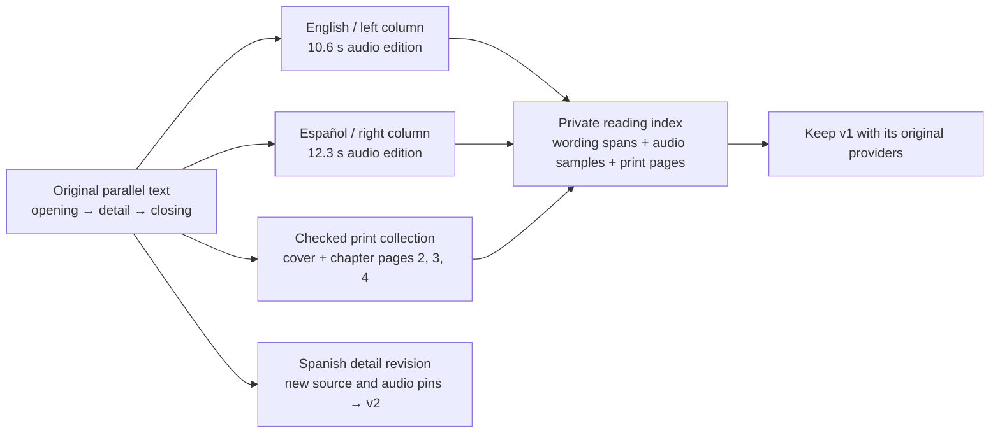

# Narrated reading editions

**Status:** M08 implementation under engineering qualification, dependent on
M07 PR #387. Its prerequisite merge is required before final M08 qualification.
This is an authored index over admitted assets, not EPUB/store integration or a
new storage, publishing, narration or print-rendering engine.

## A bilingual chapter has three distinct bindings

| Binding | Owner and exact evidence |
| --- | --- |
| Authored source | Original UTF-8 manuscript/parallel-text file pin and explicit byte spans; selected script hash stays separate from recognition |
| Audio | M04 checked dialogue and access package, original producer identity and compiled/execution recipes; optional M07 checked mix retains the same dialogue clock |
| Print/navigation | Existing `reel.print-collection.v1` request and rebuilt packet, exact PDF/receipt pins, ordered entry IDs and page numbers |

A reading request maps each declared language to a source column (`text`,
`left` or `right`). Printed labels are presentation; they do not infer language
or approve a translation. Every edition names its language, exact parent recipe
pins and ordered chapter bindings. Each chapter names the parent module and
print entry, plus one source byte span per selected cue.
The authored request uses `reel.narrated-reading.v1`; the generated index uses
the distinct `reel.narrated-reading-index.v1` schema. They are not interchangeable.

The full-reading profile requires all text entries in source order. Spans must
be nonempty UTF-8 boundaries, monotonic, nonoverlapping, and exactly equal to
their selected authored scripts. Only whitespace may occur between/outside the
declared cue spans. Required chapters/cues cannot be silently dropped or reordered.
A shorter source selection requires its own authored print/source request.

The request pins declaration, original producer, optional processing, dialogue
receipt, access manifest, print request and print receipt. Providers resolve
those exact names; failure never falls back to a checkout, latest version or
ambient asset search. Producer identity is independently verified from its
declared bytes. Checking an earlier contract does not execute an older binary.
Within one provider namespace, a name binds one immutable hash and byte count.
Conflicting pins refuse; simultaneous versions require distinct declared names.

## Existing interfaces and the narrow print seam

The Rust API is `spoken_programme::reading`, enabled with `--features print`.
This phase adds no CLI command. A host supplies explicit `assets`, `dialogue`,
`access` and `print` providers, plus any selected M07 prepared mixes by edition ID.

| API | Result |
| --- | --- |
| `prepare(request, inputs, timeout)` | Read-only independent checks and a sealed expected index; no output directory |
| `produce(prepared, new_directory, control)` | Revalidate original bindings; publish ordinal text files and the final private index |
| `check(prepared, directory, timeout)` | Revalidate original bindings and compare the complete actual packet |

Retained input guards belong to the host and remain borrowed through these calls.
To check an old package after reopening, prepare its original request with the
original retained providers first; an index's own rewritten hashes are no oracle.

The spoken compiler and M04 checker validate the parent and actual access files.
The selected source wording is read from manuscript bytes, not substituted from
recognition evidence or engineering-signal transcript labels. A layered selection
additionally invokes M07's independent check and binds its mix identity, output
WAV and matching parent dialogue/recipe pins.

The print crate gains a callback-based checker over the same snapshot/rebuild
logic as its filesystem checker. It verifies every supplied source byte against
the original pin and compares the complete rebuilt output packet. Its old path
API remains unchanged. This lets an asset provider supply retained fonts/text
without rewriting original authored paths or inventing a parallel print format.

Only `text` and `parallel-text` print entries are supported here. Score/PDF visual
entries or unresolved visual references refuse in this audio-only profile.
Chapter page numbers are derived from the checked print receipt, not guessed
from text length. Cover/front-matter pages stay separate from narrated chapters.

## Private package and prior versions

The package contains a bounded `reading.json` index and one UTF-8 authored
reading-text file per edition. The index binds audio/access/print/source assets
through their explicit provider namespaces and exact FileRefs; payloads remain
in the existing asset system. It includes chapter sample intervals, cue spans,
source hashes and checked print pages. Detailed titles, text, IDs and hashes are
private. Portable summaries contain counts/fixed flags only.

Publication uses a new directory, fixed ordinal filenames and a final no-clobber
index marker. Preparation independently derives the expected content from original
controls. A sealed result records every consumed pin in its provider namespace;
each subsequent production/check rereads those original assets and compares the
actual package with that expected content. Selected M07 mixes are independently
checked again, with their original receipts pinned. Reopening in a new process
requires preparing again from the original request and retained providers.
A changed source/audio/print pin stales the affected
package; no root selection or dependent regeneration happens automatically.
Reopen an earlier index using its original retained providers and source versions.
Missing old bytes refuse; there is no hydration, source substitution or deletion.
This is a local authored-package proof, not global custody or project adoption.

## Bounds and checks fixed before execution

At most four reading editions, sixteen text chapters and sixty-four cues per
edition. The original declaration is capped at 256 KiB; print request at 64 KiB,
each selected text at 256 KiB, other control files at 4 MiB, original producer at
64 MiB, and declared print input/output at 32 MiB/32 pages. Reading package output
is at most 4 MiB and execution uses the existing cooperative 30-second controls;
the four reading-provider namespaces have at most 4096 distinct consumed bindings
totaling 256 MiB, with no individual binding larger than 64 MiB. Selected M07
checks additionally retain their own [source/runtime limits](spoken-edition-layers-v1.md#clock-bounds-and-independent-checks);
the reading limit does not redefine the borrowed FFmpeg runtime's admitted pin.
These are bounded operation dependencies, not a cache inventory.
Trusted synchronous I/O must return. No model, provider, production render,
cache initialization, daemon, upload or automatic eviction occurs.

The initial engineering example uses the existing three source chapters and
English/Spanish technical editions:

| Edition | Opening | Detail | Closing | Duration |
| --- | --- | --- | --- | --- |
| EN | [0,144000) | [158400,350400) | [364800,508800) | 508800 samples / 10.6 s |
| ES | [0,168000) | [187200,403200) | [422400,590400) | 590400 samples / 12.3 s |

Three parallel-text print entries bind the exact EN/ES source sentences. For the
small fixture each has one page after the separate cover, so chapter navigation
uses pages 2, 3 and 4 (one-based). Actual receipt page counts remain authoritative.
Synthetic PCM is not speech; authored text, word evidence, language authority and
listening are still separate layers.

For the detail chapter, the fixture binds these complete authored byte spans:

| Language / print column | Original wording | UTF-8 span | Audio interval |
| --- | --- | --- | --- |
| EN / left | Each edition selects exact takes and declares its speaker handoffs. | [0,67) | [158400,350400), 4.0 s |
| ES / right | Cada edición selecciona tomas exactas y declara los cambios de hablante. | [0,73) | [187200,403200), 4.5 s |

Both refer to print page 3. The accented `ó` occupies two UTF-8 bytes; a span
ending inside that character refuses rather than silently repairing the wording.
These are authored text and controlled-signal clocks, not recorded performances.

Required cases cover source-ordered EN/ES text/clock/page bindings; M07 mix
selection; stale language/source/recipe; invalid UTF-8/reordered spans; missing or
mismatched chapters; dangling visual entries; rehashed false print/audio/index;
no overwrite/interruption; and original v1 reopening after separate v2 assets.
The print seam must reject false source bytes even if its callback claims success
and must not retry a refused provider through the filesystem.

Run the focused print-feature reading cases, existing print/Sonic/spoken/native
regressions, all-target/all-feature Clippy, formatting, local links and diff
checks. Story, Editor, Vocal Adaptation, Platform/Audience and Rights are required
checklist lenses. Print byte checking does not close the existing independent
PDF raster QA requirement; page appearance, listening, source/voice rights,
selection, delivery and adoption remain separate decisions.
