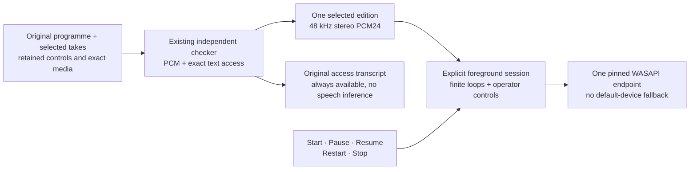

# A checked programme on one offline listening station

**Status: M11 contract merged in [#398](https://github.com/giodl73-repo/REEL/pull/398), `81be1db`.**
M12a provides the checked transport core (merged [#400](https://github.com/giodl73-repo/REEL/pull/400)).
The [M12b.1 foundation](installation-native-foundation-v1.md) covers explicit
endpoint metadata and callback ownership. The actual native/operator loop
and measured station demonstration remain M12b.2/M12c. See the
[bounded implementation and test map](reviews/2026-11-21-m12a-checked-transport-review.md).
M12 implements and measures this profile; this specification is not a device,
listening, accessibility or unattended-operation pass.

A visitor hears one selected, independently checked edition. An operator can
start it, pause, resume, restart from the beginning or stop. The same retained
edition repeats at most three times with an explicit quiet interval. Its exact
transcript remains available on the station even while audio is paused or off.

## Follow one edition

For example, the English engineering fixture lasts 144000 sample frames
(3 seconds). Three passes submit exactly 432000 source frames plus two quiet
intervals of 12000 frames each. Spanish's 168000-frame edition is a different
selection with its own access text. Language switching requires a stopped,
newly checked session; it cannot splice another edition into a running loop.
These M10 durations illustrate frame arithmetic only: its original signal
fixtures are not admitted installation fixtures unless they independently meet
the quiet-seam requirement below. M12 authors a new public controlled fixture
with explicit quiet head/tail regions and known interior measurement markers.

## Reuse before adding a playback adapter

| Owner | M11/M12 use |
| --- | --- |
| [Spoken checker](../src/spoken_programme/checker.rs) | Recompute the selected plan and independently verify original candidate PCM. Call `verify_access` on caller-held original access controls and transcript bytes. A producer receipt or previously green summary alone is insufficient. |
| Existing `InputFiles` and immutable `FileRef` | Read exact source/candidate/access objects. Preserve original names, hash/length and selected edition. Missing retained bytes refuse; no cache discovery, restoration or substitute source. |
| [Semantic companion](semantic-visual-companion-v1.md) | Remains a separately checked visual derivation. This first listening-station profile does not animate it or assume that a render worker is a realtime player. |
| [Native editor host](editor-host-v1.md) | Its explicit startup, bounded resource exposure and exact frontend identity are precedents. Do not start or expand its HTTP service merely to play one checked PCM buffer. |
| New, narrow output port | Submit already checked interleaved samples to one native audio endpoint and report transport state/errors. No mixer, source compiler, decoder framework, media renderer, store or scheduling service. |

Repository search found browser review/audition surfaces and offline renderers,
but no admitted installation transport. M12's proposed output adapter is
**CPAL 0.18.2, Windows WASAPI only**, compiled into the retained REEL runtime.
Use its explicit device-ID lookup, declared stream configuration and output
callback; do not select a default output or capture any input.
[CPAL's host contract](https://docs.rs/cpal/0.18.2/cpal/traits/trait.HostTrait.html)
and [stream controls](https://docs.rs/cpal/0.18.2/cpal/traits/trait.StreamTrait.html)
describe those interfaces. This is a dependency proposal, not an installed or
qualified dependency. If the pinned adapter cannot meet the limits below,
record the specific gap and revise M11 before qualifying M12.
M12 must pin `=0.18.2` in an optional Windows-only dependency, with default
features disabled and no ASIO/JACK/realtime extras. Keep platform-neutral state
tests independent of that dependency so Linux CI needs no audio SDK/device.
Record its Apache-2.0 license and applicable transitive notices through the
existing source/dependency distribution checks before shipping a runtime; see
the [published package manifest](https://docs.rs/crate/cpal/0.18.2/source/Cargo.toml).

### Proposed local control surface

M12 adds one bounded `spoken_programme::installation` module with `prepare`
and explicit `run` operations. `prepare` accepts the original `CheckRequest`,
source/candidate/access providers, exact access-manifest bytes, selected edition
ID, finite pass count and caller-held private runtime/device binding. It returns
sealed checked controls; arbitrary deserialized success summaries cannot become
a prepared session. It does not enumerate or open devices. `run` rechecks those
subjects, then explicitly probes the bound endpoint and enters Ready. Only a
subsequent Start command may submit nonzero audio. Neither operation produces
assets, promotes a source or invokes the renderer.

The CLI must expose preparation/checking separately from explicit foreground
playback. Exact command spelling and file-to-provider wiring are implementation
details, but parsing/validation must never run playback as a side effect. Any
private report is opt-in, bounded, newly reserved without overwrite and kept
separate from a portable counts-only summary. A report records observed facts;
it cannot set listening/device/authority/release flags merely because the
process exited successfully.

## One deliberately narrow profile

Profile ID: `reel.installation.win11-wasapi-pcm24.v1`. All values below are
requirements, not measurements. A private device binding completes this profile
for one actual station before playback; a generic machine name is insufficient.

| Layer | Required configuration |
| --- | --- |
| Host | Windows 11 x86-64; record the exact OS build, REEL commit, executable hash/length, Cargo.lock hash and CPAL 0.18.2 resolution in the private session evidence. No other host/backend claim. |
| Endpoint | One explicit WASAPI output `DeviceId`, endpoint configuration fingerprint and driver version in the private binding. Resolve that ID only. Absent, changed, ambiguous or unsupported endpoints refuse before Start. Never retry through default/Bluetooth/another endpoint. |
| Source | Exactly one edition, 48000 Hz, two channels, signed PCM24, 9600–480000 sample frames. Only the original whole edition; no seek, trim, gain, crossfade, resample, downmix, overlap or live language change. |
| Native stream | 48000 Hz stereo `f32`; each signed PCM24 integer `s` maps to `s / 8388608`. This conversion is exact in binary float32. No application DSP or volume change. OS mixer, driver processing and physical gain remain separate device evidence. |
| Buffer | Request 480 frames. The effective callback buffer must be at most 2048 frames; reject unsupported configuration or oversized callbacks. Validate whole stereo frames and bounded callback sizes. No allocation, file I/O, hashing, locks or console writes in the callback. |
| Display | Local UTF-8 terminal, at least 80 columns by 30 rows; static checked transcript plus separate plain-text status/control area. No timed captions, animation, fullscreen or kiosk claim. If the transcript cannot fit the admitted text area, refuse this profile rather than silently truncate it. |
| Text | Exact UTF-8 access transcript, at most 4096 bytes and 20 display lines, with no terminal escape/control sequences other than LF. Preserve Spanish. Overlong or unsupported terminal layout refuses; do not rewrite original text to fit. Engineering signals retain their signal label. |
| Session | Explicit foreground invocation, initially Ready with no audible output. One to three total passes, chosen before Start; a finite 250 ms quiet interval separates passes. Stop at completion. No autostart, auto-relaunch, persistence, network, background service, server or deployment. |
| Resources | One session, one selected PCM buffer (at most 2.88 MB before f32 conversion), one output stream; bounded 8-entry command queue and 256-entry diagnostic trace. At most one foreground controller and one owned native output worker, 512 MiB combined working-set envelope. Maximum foreground lifetime 120 s, including pauses. No unbounded telemetry or retained event database. |

Keep source and runtime versions restorable through the existing asset system.
The programme's original compiler/producer identities stay in its original
controls; the playback executable has a separate session runtime binding.
Upgrading the player cannot rewrite the programme's production lineage.
M12 reads a caller-provided private binding; it must not write machine endpoints
into shared project definitions or change another lane's profile. Runtime or
endpoint changes require a new binding and a fresh session. Process exit drops
the stream; the application must not alter system volume or endpoint settings.
Checking has a 30 s cooperative deadline and opens no stream. Any original
checker's tighter bound remains in force. Explicit endpoint capability probing
has a 2 s deadline and opens no stream. Native stream creation also has a 2 s
timeout; controller operation has a maximum 20 ms tick interval. Blocking native
calls must stay off the controller and under an owned worker's cancellation /
process-lifetime control, reusing the existing bounded native-runner pattern.
An unsupported or unbounded backend operation fails adapter qualification
rather than silently expanding these limits.

## Clocks and limits that M12 must measure

The integer **source frame** cursor counts frames submitted from the checked
edition. A separate **transport** cursor counts quiet interval frames. Pausing
freezes source and interval cursors at the next accepted callback boundary;
resume starts at that exact boundary. Wall time controls deadlines, never source
selection or frame arithmetic. Buffer padding after completion is silence and
cannot count as additional source frames.
Pause is an application cursor operation: the output callback continues to
submit silence while paused. It does not depend on backend hardware-pause
support. A callback that crosses a source/interval boundary must fill both
segments exactly; callback padding cannot lengthen an inter-pass interval.

CPAL exposes predicted output timestamps, not proof of physical loudspeaker
output. Record callback time, predicted playback time, submitted frame spans and
the corresponding monotonic observation. Do not label submitted or predicted
frames as heard frames. See the
[output timestamp definition](https://docs.rs/cpal/0.18.2/cpal/struct.OutputStreamTimestamp.html).

| Requirement | Numeric gate and independent measurement |
| --- | --- |
| Sample sequence | A fake output sink compares every submitted source frame/channel against hand-derived PCM24-to-f32 values; no skipped, duplicated or reordered frame across pause/resume. |
| Loop interval | Exactly 12000 zero frames in the transport sequence. A device capture must observe 250 ms ±50 ms between declared source boundaries; otherwise that device fails qualification. This is a deliberate pause, not a gapless loop. |
| Seam policy | The first and last 4800 source frames (100 ms) must all be digital zero in both channels. Refuse a nonquiet seam; never fade, edit or approve musical continuity automatically. M12's public fixture must meet this policy explicitly. |
| Controls | From complete command-line receipt to state acknowledgement ≤100 ms. Paused/Stopped produces no further source frames after one accepted callback boundary; measured physical output quiescence ≤250 ms after command receipt. Already queued output must be accounted for. |
| Rate/drift | Over a 10 s controlled device probe, captured first/last boundary elapsed time differs from the authored span by ≤20 ms. Over a shorter probe use the same 20 ms absolute limit; do not claim long-run drift from a short test. |
| Startup/restart | Validated Ready → first predicted output ≤2 s after Start. Restart includes a fresh ≤30 s check and ≤2 s stream/probe stages, with a 35 s aggregate deadline. Record actual device onset separately with the same 2 s Start / 35 s Restart gates. Never hide rechecking inside a 2 s restart claim. |
| Watchdog | No output callback for 250 ms while Playing/LoopWait triggers Fault. Callback/error notices reach controller-visible Fault within 100 ms of observation. No source progress can be inferred during the stall. |
| Lifetime/cleanup | At 120 s enter Stopped, cease accepting Start/Resume, drop stream and exit within 2 s. Test Ctrl+C and ordinary EOF. A blocked driver that defeats bounded shutdown fails this profile; a software timer alone is not a successful cleanup measurement. |

Private device qualification uses an explicitly chosen loopback/capture path and
original public signals, not a microphone, private speech or inferred listening.
Record capture runtime/configuration, exact captured bytes and clock analysis
under the existing evidence system. No recording or new capture dependency is
introduced or started in M11. A human listening pass is a separate named review.
Physical source boundaries are inferred only from the fixture's independently
known interior marker offsets, not from finding a transition in digital silence.
The audible quiet interval includes the source's quiet tail/head as well as the
12000 added frames; subtract those known source regions when measuring the
transport interval. Use an isolated test endpoint so capture contains only the
controlled fixture.

## Operator state, including failure

Commands are complete case-insensitive ASCII lines: `start`, `pause`, `resume`,
`restart`, `stop`, `status`, `quit`. No single-key global hooks or terminal raw
mode. Each accepted input gets a monotonic sequence number. Drain commands at
the next controller tick, before processing a coincident media boundary; a
pending `stop`/`quit` prevents another pass. Queue overflow faults rather than
dropping a command. Unsupported commands return a bounded diagnostic and leave
state unchanged. Input EOF or Ctrl+C acts as Quit.

| State | Valid controls / resulting state |
| --- | --- |
| Checking | No stream; missing/stale source, access or runtime → Fault. Success → Ready. `quit` exits. |
| Ready | `start` → Starting. `stop` → Stopped. |
| Starting | Acknowledge the command before opening the stream. Success within 2 s → Playing at source frame 0/pass 1; mismatch/error/deadline → Fault. `stop`/`quit` cancel startup; a late worker response cannot begin playback. |
| Playing | `pause` → Paused; `restart` → Restarting; `stop` → Stopped. Last source frame → LoopWait if another pass is declared, otherwise Completed. |
| LoopWait | Submit the declared silence interval. `pause` → Paused with interval cursor retained; `restart` → Restarting; `stop` → Stopped. Interval end → Playing at frame 0 of the next pass. |
| Paused | Emit silence without source/interval progress. `resume` returns to the saved Playing/LoopWait state; `restart` → Restarting; `stop` → Stopped. |
| Restarting | Silence and close the old stream, recheck retained controls/runtime/endpoint, open a fresh stream within the 35 s aggregate; success → Playing at frame 0/pass 1. Any mismatch/deadline → Fault. `stop`/`quit` cancel the operation. No leftover old callbacks may advance the new generation. |
| Completed / Stopped | No source output; `restart` may explicitly recheck and begin pass 1 within the original session deadline. `start`/`resume` refuse. |
| Fault | Terminal for that session: silence/drop the stream, retain a bounded diagnostic, allow only `status`/`quit`. Recovery is a new explicit invocation with corrected retained inputs/binding. No automatic reconnect or replay. |

`status` and `quit` apply in every state; quitting closes the stream and process.
All unlisted state/control pairs refuse without moving either cursor. Fault
dominates commands and media events in the same controller tick. Every state
includes the original edition identity and stream generation privately, so late
callbacks cannot switch editions or revive an old run.

## Concrete traces before any implementation

| Case | Expected trace / oracle |
| --- | --- |
| One pass | Ready → Start → Starting → Playing `[0,N)` → Completed; source sink receives exactly N frames, no loop interval. |
| Three passes | Playing `[0,N)` → LoopWait `[0,12000)` → Playing `[0,N)` → LoopWait `[0,12000)` → Playing `[0,N)` → Completed. |
| Pause during speech | At next boundary `k`, pause freezes source at k; any number of silence callbacks does not consume source. Resume begins at k, not 0 or wall-clock-derived position. |
| Pause during interval | Pause at interval frame j; resume emits the remaining `12000-j` zeros before the next pass. |
| Interrupted playback | Ctrl+C/EOF/Stop closes the generation; late callbacks cannot consume source. Starting the process later begins Ready, not at an inferred resume point. |
| Missing media | Original selected WAV or transcript missing → Fault before stream creation; no cache lookup/download or substitute language. |
| Wrong output | Wrong endpoint ID, 44.1 kHz-only stream, missing stereo/f32, oversized callback, changed binding/runtime → Fault, no default-device retry. |
| Disconnect | Observed backend device/invalidation error → Fault; callback stall also triggers watchdog. Replugging cannot resume. Physical detection/quiescence must be measured on the selected station. |
| Restart | Pass 2/frame k → Restarting → Playing pass 1/frame 0 only after fresh checks. Old-generation callbacks and mismatched hashes refuse. |
| Exact simultaneous boundary | Stop at end-of-pass tick → Stopped with no next pass; device error plus Restart → Fault. |

## M12 qualification and remaining gates

Before implementation closes, write named tests for each trace and limit in the
[M11 review/test map](reviews/2026-11-21-m11-installation-contract-review.md).
The deterministic sink, fake monotonic clock and injected device notices run
without sound hardware on both CI operating systems. Windows-only adapter tests
must require explicit device enrollment and report nonexecution honestly; a
missing device cannot return a successful skip disguised as playback proof.

An actual bounded device demonstration must include start, all finite loops,
pause/resume in source and interval, restart, completion, Stop, EOF/Ctrl+C,
disconnect and incompatible-output refusal. Measure the table's limits with the
declared capture method. Keep device evidence separate from deterministic tests.
No M12 device-qualified claim or unattended installation claim without it.

Engineering may proceed with controlled signals. Actual project speech,
translation, vocal consent, comfortable level, intelligibility, seam aesthetics,
terminal/screen-reader usability and audience acceptance need their own recorded
reviews. The exact transcript offers text access, not proof of universal
accessibility. This profile does not close M06's spoken listening gate or grant
public exhibition/release authority.
