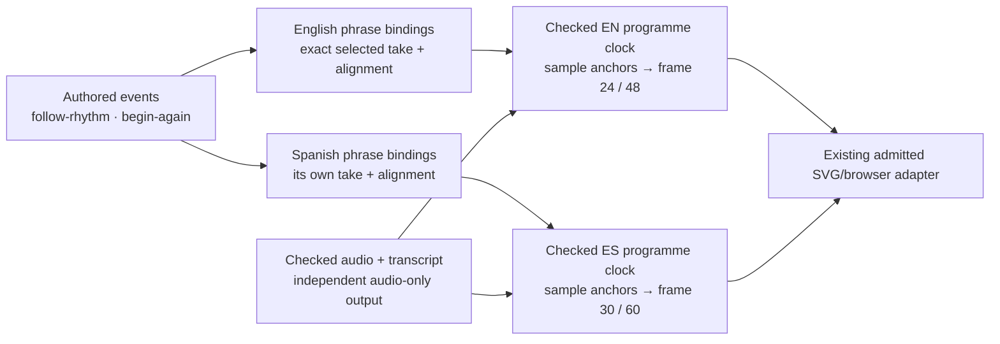

# Semantic visual companion: M10 contract draft

**Status:** source audit and test design only, based on merged M09 [#394](https://github.com/giodl73-repo/REEL/pull/394), `b95a6c2`. No M10 implementation, picture render, speech recording or human review is claimed here.

The [role/test review](reviews/2026-11-21-m10-semantic-companion-design-review.md)
maps proposed bounds and executable expectations to C01–C07.

A companion connects the same authored event intent to language-specific measured phrases, then to an existing SVG/browser composition. An audio edition remains useful and independently producible when no companion is requested.

## Reuse before adding an interface

| Existing code | Responsibility retained |
| --- | --- |
| `spoken_programme::compiler::{compile_with_inputs, CompiledEdition}` | Recompile exact selected takes, script/alignment subjects, joins and placed markers using the existing programme clock |
| `AlignmentEvidence`, `WordBinding`, `check_alignment` | Keep word evidence, selected-script text, source recording and phrase-marker ranges bound together; engineering markers do not establish spoken words |
| `spoken_programme::checker::{check, CheckedPackage}` | Independently check the produced audio and access package against original source inputs and the caller-bound runtime |
| `browser_composition::source_clock_event` | Validate exact clock/audio/evidence subjects and derive shared frame boundaries once with integer arithmetic |
| `reel.presentation-source-clock.v1` | Existing audio hash, sample rate/count, evidence reference and named sample anchors |
| `tig_browser::{Prepared, capture, render::native}` | Existing admitted resources, no-network capture and bounded Windows worker; preserve host enrollment, held inputs/programs and cancellation requirements |
| Existing transcript/access outputs | Preserve wording and distinguish authored script, recognition evidence and engineering signals; a diagram is not a substitute for text access |

Sources: [spoken compiler](../src/spoken_programme/compiler.rs), [independent checker](../src/spoken_programme/checker.rs), [measured browser clock](browser-source-clock.md), [authored native triggers](authored-native-triggers-v1.md), [native browser worker](../src/tig_browser/render.rs). Do not route this through the unbounded legacy browser renderer or start a production cache/daemon to make a fixture work.

## Two events, independently resolved in two languages

The original authored intent contains two event IDs. Each language supplies its own exact phrase and explicit occurrence where necessary. A performance replacement changes derived sample/frame positions, not the event ID or the author's visual intention.

| Event | English phrase | Spanish phrase | Planned EN sample / frame | Planned ES sample / frame |
| --- | --- | --- | --- | --- |
| `follow-rhythm` | “Now follow the rhythm” | “Ahora sigue el ritmo” | 48000 / 24 | 60000 / 30 |
| `begin-again` | “Then begin again” | “Después vuelve a empezar” | 96000 / 48 | 120000 / 60 |

This is a hand-derived **test-design oracle**, not measured speech. At 48 kHz and 24 fps, these positions are respectively 1/2 seconds in English and 1.25/2.5 seconds in Spanish. The eventual fixture must preserve actual alignment subjects and exact source words; it must never describe a synthetic signal as a recording of these phrases. Actual speech/listening acceptance remains an explicitly separate gate.

Resolve a phrase with the existing `reel_assembly::scene_authoring::spoken_phrase_sample` operation against the existing word-evidence representation. The binding must select exactly one language/cue/performance/marker occurrence; repeated phrases without explicit disambiguation refuse. Do not infer timing from translated character counts, copy EN timing into ES or trust a receipt's own replacement hashes as the original oracle.

The first visual profile should use an opaque original SVG with three simple states and two visible changes. No inferred alpha, generative asset work, new compositor, camera grammar or animation engine belongs in M10. Existing SVG frame listeners consume the validated source-clock event. If a later profile supports overlays, require an explicitly compatible alpha source and exact derivation evidence.

## Qualification obligations before implementation

| ID | Evidence required |
| --- | --- |
| C01 | Two authored IDs map to distinct EN/ES phrases and independently derived sample/frame positions. Test exact source subject, script/observation word sequence and marker word ranges through the existing compiler; preserve uncertainty about actual acoustic word fidelity. |
| C02 | Replace only the EN take/alignment. Recompile and independently check audio; EN consuming clock/picture/text timing changes, ES and event intent remain unchanged. Reopening the old companion uses the old retained subjects; missing bytes refuse. |
| C03 | Explicit real native browser qualification captures the before/between/after SVG states. Independently inspect decoded frames around both boundaries and decoded PCM against the checked audio. A successful metadata plan alone is insufficient. Public synthetic signals may qualify clock/picture/PCM plumbing, with no spoken-performance claim. |
| C04 | Missing/ambiguous phrases or markers, wrong language/take, stale alignment/audio/clock, unknown visual input and changed SVG/evidence refuse. Include a changed receipt/hash case checked against original caller-held controls. |
| C05 | Preserve exact language text and usable transcript/caption access. Test silent-context textual access and distinguish engineering-signal labels from spoken captions. Actual font size, reading pace, language and device review remain open until inspected. |
| C06 | Fix bounded geometry/frame count, input/control bytes, workspace/output/process limits and cooperative deadlines before the first render. Exercise cancellation after output reservation, no-clobber output and cleanup of owned intermediates. No real cache initialization, census, hydration, upload, selection or eviction. |
| C07 | Portable summaries omit private titles, phrases, speaker/authority identities, paths and private hashes. Original scope declarations stay private and pinned; technical success never grants voice, translation or release authority. |

Use an isolated M10 Cargo target, not M09's target directory. Enroll explicit runtime qualification in CI; ordinary ignored tests must not be mistaken for executed coverage. Keep required Linux/Windows checks and the under-30-minute CI objective visible. Set concrete profile limits and name executable tests in the review record before claiming C01–C07 satisfied.

## Role checklist findings

This is one assistant applying repository checklists, not independent review.

- Animation: reuse one opaque SVG and its existing deterministic frame listener. Prove actual visible state changes; no diagram-only render claim.
- Story: preserve the same two authored intentions across languages and take replacement.
- Editor: language-local measured entrances control transitions; inspect boundary frames and preserve original leading silence/tails.
- Sound: derive picture from checked audio without changing the selected signal or pause/overlap contract.
- Platform/Audience: keep transcript/text access and audio-only delivery independent; device acceptance stays open.
- Vocal Adaptation: bind exact phrases to original language evidence. Synthetic timing data is no proof of words, pronunciation, translation or listening approval.
- Rights/Provenance: preserve original scopes, held subjects and private identities; do not activate a voice provider, manufacture consent or publish by default.

Open implementation decision: choose the narrow companion API that bridges a recompiled/independently checked spoken package to the existing source-clock/browser adapter, without allowing an arbitrary unverified `CompiledEdition` or self-reported receipt to establish lineage. Document that seam and its trust boundary before runtime work.
### Candidate seam from source inspection

The independent checker already recompiles `CompiledPlan` from the original
`CheckRequest` and source inputs, then compares the exact supplied plan bytes
before checking the PCM. Prefer exposing that internally computed plan through a
read-only accessor on sealed `CheckedPackage`, rather than accepting a freely
constructed compiled edition or decoding a receipt as an authority.

A companion preparation operation can retain the original borrowed check request,
source/candidate providers and exact visual pins. Preparation and reopening must
run the independent checker, then derive events from its recomputed plan and the
original pinned alignment. Existing `spoken_phrase_sample` resolves exact
language-local phrases and repeated occurrences. Convert the resolved source
entrance through the selected take placement, then emit the existing browser
source-clock vocabulary bound to the checked edition WAV. Validate the resulting
clock with the existing adapter before a worker receives it.

The initial exact-PCM profile should require the full selected audio duration to
fit a whole number of picture frames. Refuse unsupported duration geometry rather
than silently pad/trim the checked audio. Distinct language editions may have
different frame counts. Frame/sample rounding is performed once by the existing
clock adapter. Concrete API, resource caps and executable test names remain a
pre-implementation obligation; this candidate seam is not implemented evidence.
