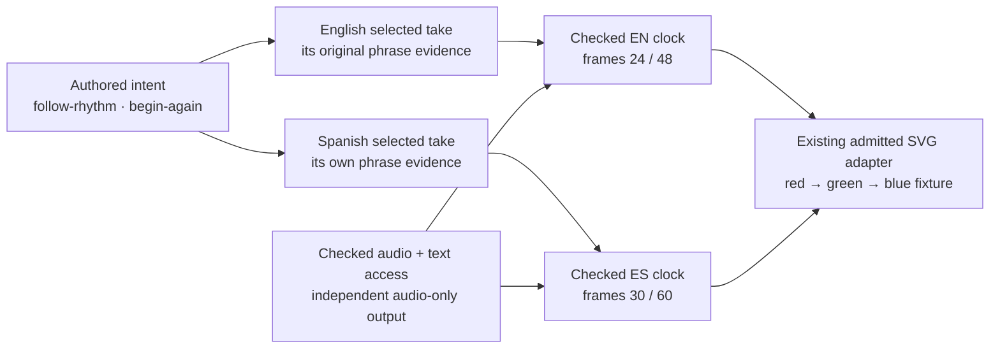

# Semantic visual companions

**Status:** M10 merged in [#395](https://github.com/giodl73-repo/REEL/pull/395), `d7602b2`; tested head `3816901`. Final required CI passed in 16m48s, and source/assembly qualification passed. Local execution and exact hosted evidence are recorded in the [role/test review](reviews/2026-11-21-m10-semantic-companion-design-review.md). Actual speech/listening, linguistic accuracy, device acceptance and release remain separate gates.

A companion connects shared authored events to language-specific phrase entrances, then to an existing SVG/browser composition. Replacing an English take changes its consuming visual clock while preserving the event IDs and the unchanged Spanish companion. Audio-only production remains independent of picture inputs.

## Two events, two language clocks

| Shared event | English phrase | Spanish phrase | EN sample / frame | ES sample / frame |
| --- | --- | --- | --- | --- |
| `follow-rhythm` | “Now follow the rhythm” | “Ahora sigue el ritmo” | 48000 / 24 | 60000 / 30 |
| `begin-again` | “Then begin again” | “Después vuelve a empezar” | 96000 / 48 | 120000 / 60 |

This hand-derived oracle uses 48 kHz audio and 24 fps: the English entrances are at 1/2 seconds and the Spanish entrances at 1.25/2.5 seconds. The lexical metadata cases check the phrases through the existing compiler and phrase matcher. The render fixtures use **synthetic signals and explicitly labeled engineering markers** at those positions. They do not claim that synthetic PCM contains these words.

For the replacement English fixture, the first entrance moves from sample 48000/frame 24 to sample 50000/frame 25. The second entrance stays at frame 48. Its checked audio and consuming evidence change; Spanish clock/evidence bytes remain identical. No translated character-count estimate or copied English timing is used.

## What the bridge reuses

| Existing interface | Responsibility retained |
| --- | --- |
| `spoken_programme::compiler` | Recompile exact selected takes, language/script/alignment subjects, joins and placed markers on the programme clock |
| `checker::check` and sealed `CheckedPackage::compiled_plan()` | Independently check original PCM and expose the plan recomputed from caller-held original controls |
| `checker::verify_access` | Verify the original access manifest and transcript bytes; engineering signals retain a signal label instead of a spoken transcript |
| `scene_authoring::spoken_phrase_sample` | Match the language-local phrase against original source/word evidence; require an occurrence when repeated phrases are ambiguous |
| `reel.presentation-source-clock.v1` and browser clock adapter | Bind exact audio/evidence hashes to named sample anchors and round shared frame boundaries once using integer arithmetic |
| `tig_browser::{Prepared,capture,render::native}` | Use the existing admitted resource view, no-network browser capture, bounded native worker and original held input/program guards |

Sources: [spoken compiler](../src/spoken_programme/compiler.rs), [independent checker](../src/spoken_programme/checker.rs), [measured browser clock](browser-source-clock.md), [authored triggers](authored-native-triggers-v1.md), [native worker](../src/tig_browser/render.rs). The bridge adds no audio renderer, phrase matcher, compositor, player or asset store.

## API and trust boundary

The module is `spoken_programme::companion`, behind `tig-publication`. `Inputs` borrows the original `checker::CheckRequest`, source/candidate/visual/access providers and exact access-manifest bytes. It accepts no arbitrary unverified compiled edition as checked evidence.

| Operation | Behavior |
| --- | --- |
| `prepare(request, inputs, timeout)` | Recheck original audio/access, resolve the two per-edition bindings, validate the derived clock and seal expected private controls |
| `produce(prepared, output, control)` | Recheck original inputs, reserve a new directory and write exact clock/evidence controls before the final private `companion.json` index |
| `check(prepared, output, timeout)` | Re-derive from original controls and compare the complete output namespace and bytes; rewritten self-reported hashes are insufficient |
| `validate_browser(prepared, edition, plan, files, timeout)` | Match an existing lowered browser plan and its actual original SVG/audio/control bytes to the sealed expected composition |
| Windows `render(...)` | Recheck originals and the admitted plan, then delegate one edition to the existing bounded native worker |

Original programme filenames and admitted asset IDs are separate namespaces. For example, `edition-000.wav` may be admitted as `speech/en/opening`. The bridge matches SHA-256 and byte length, then verifies actual provider bytes; original references stay unchanged in the private evidence. Matching content grants no admission or authority by itself.

Each stable event has one explicit binding per selected edition. A `phrase` binding requires original word evidence, a named phrase marker, exact phrase and optional occurrence. An `engineering-marker` binding requires an engineering signal and grants no spoken-word claim. A missing or ambiguous performance/marker, mismatched language closure, stale source or coincident/reversed transition frame refuses.

The private evidence preserves original per-edition recipe, text/access relationships, SVG and resolved events. Portable summaries contain counts and fixed flags; private words, titles, paths, speaker/authority names and hashes stay out. Acoustic fidelity, authority, device and release flags remain false.

The caller admits exact generated controls through its existing asset system. The bridge checks an existing `tig_browser::Prepared`; it creates no asset checkpoint, asset definition, custody claim or production cache. New project definitions/versions remain Melena work. Validation and metadata publication start no browser, voice service, player, hydration, census, daemon or upload.

## Bounded first profile

- One original full-frame SVG, two stable event IDs and one or two selected editions; exactly four browser aliases: SVG, checked audio, source clock and evidence. Extra visual resources refuse in v1. No alpha-overlay support is inferred.
- 48 kHz stereo PCM24, 24 fps, at most ten seconds/240 frames per edition and 640×360 pixels. Audio duration must fit a whole frame count; no implicit padding or trimming. An explicit full-source, zero-fade PCM window invokes the existing native exact-audio check.
- Request/SVG/source-clock controls are at most 64 KiB each, evidence at most 1 MiB and the private index at most 1 MiB. Binding counts and bounded names/phrases are checked before request serialization or provider access. Original spoken checks retain their own input/processing limits.
- Metadata operations have a maximum 30-second cooperative deadline. Each single-edition render has a 90-second cooperative aggregate: up to 30 seconds for checking and at most 60 for the existing worker. Two editions render in two separate operations, not an atomic two-language transaction.
- Existing worker envelope: 2 GiB/64 browser processes, 256 MiB/four encoder processes, 128 MiB scratch and 16 MiB output; 30-second I/O wait, 32 resource requests, 4 MiB served bytes/messages, 4096 messages and 1 MiB PNG bounds. Audio is separately held. Trusted synchronous providers must return; host reservation/enrollment and byte/program guards remain required.

Earlier companions reopen with their original retained inputs after a replacement is introduced. Missing retained bytes refuse without automatic restoration or source substitution. Both metadata and native outputs refuse overwrite and retain owned cleanup/cancellation behavior.

The [role/test review](reviews/2026-11-21-m10-semantic-companion-design-review.md) maps C01–C07 to lexical metadata, real synthetic PCM, independently decoded native frames, replacement/retention, stale evidence, text access and interruption cases. Pixel/clock correctness is distinct from human musical, linguistic, visual, listening or device acceptance.
